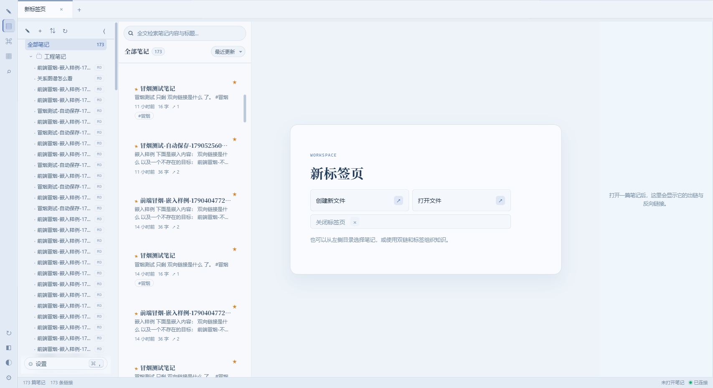
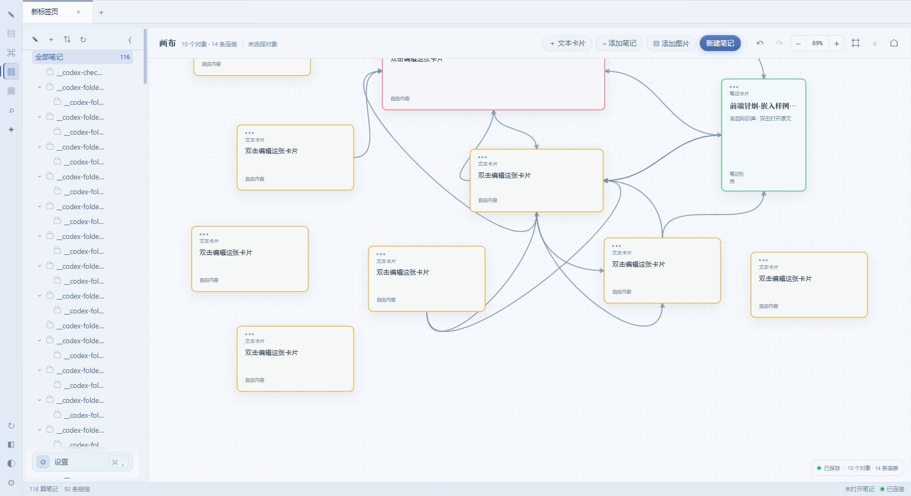
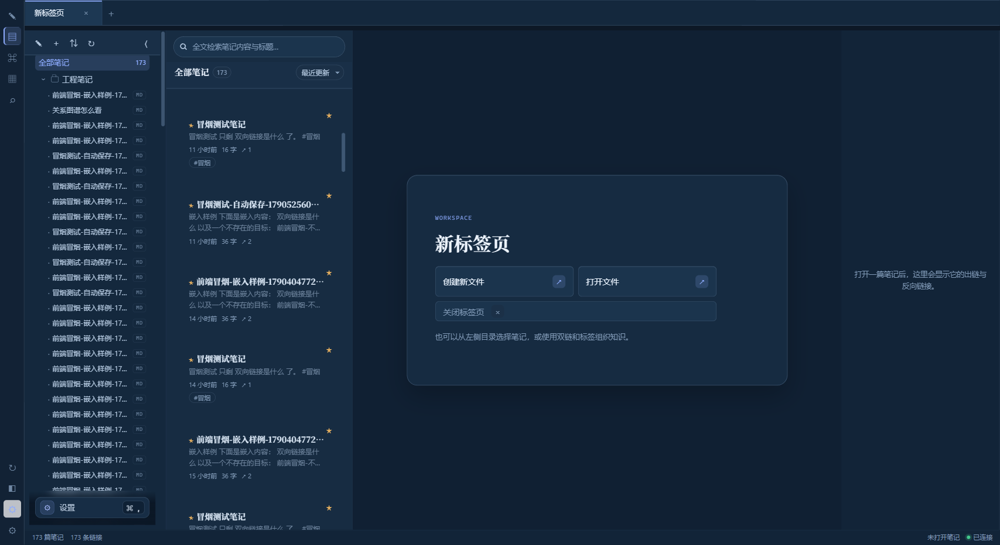
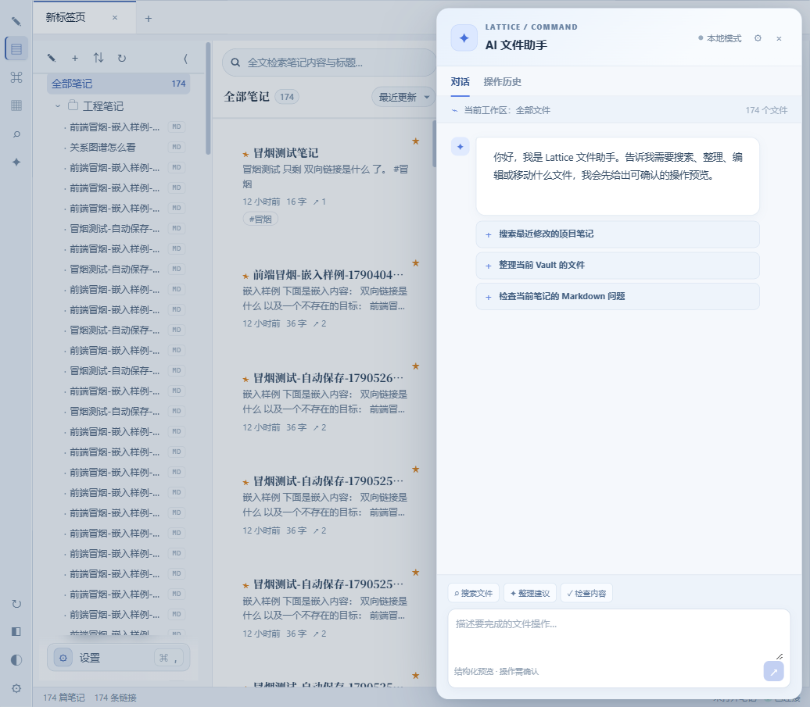
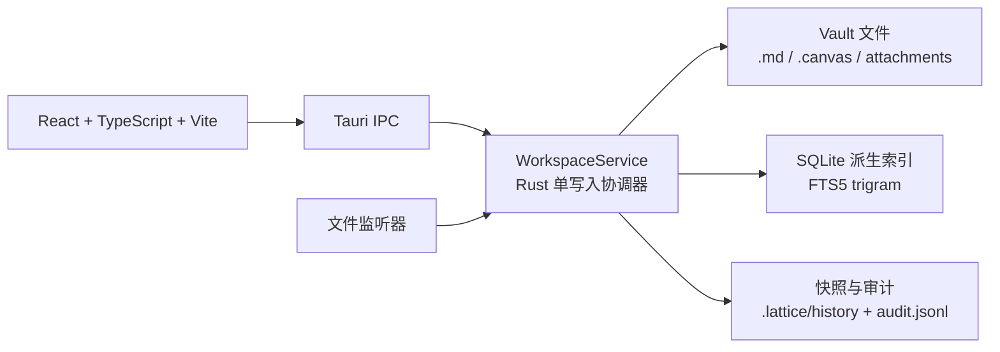

# 格物 Lattice

> **当前代码版本：0.2.0** · Tauri 2 · Rust · React 18 · TypeScript · SQLite

格物 Lattice 是一款本地优先的 Markdown 双链知识库。笔记、Canvas 和附件以普通文件保存在用户自己的 Vault 中；SQLite 只保存可重建的索引与派生数据。当前仓库正在从旧版 Node / Electron 运行时迁移到 Tauri 2 原生桌面架构，本文以当前代码为准。

[](LICENSE)
[](#开发环境)
[](package.json)

所有核心数据默认只留在本机，不需要注册或联网。当前桌面核心不启动独立 Express / Node 服务，也不监听本地 HTTP 端口；前端通过 Tauri IPC 调用 Rust 工作区服务。AI 云服务、Ollama、MCP 等属于可选外部能力，不能与本地文件存储混为一谈。


## 界面预览

| 知识库工作区 | Canvas 与本地知识流 |
| --- | --- |
|  |  |
|  |  |

旧版 MCP 设置页截图仍保留在 `FILES/README.md/`。当前 Tauri 桌面端已接入 MCP 项目配置读写 IPC，但完整 MCP sidecar 连接能力尚未交付；截图只用于展示目标交互，不代表当前桌面构建会启动外部 MCP Server。

## 文档入口

| 文档 | 面向对象 | 内容 |
| --- | --- | --- |
| [`产品文档.md`](产品文档.md) | 所有用户与维护者 | 产品介绍、快速上手、功能索引和版本主题 |
| [`使用说明书.md`](使用说明书.md) | 发行版用户 | 安装启动、界面操作、快捷键、备份迁移和故障排查；该文档描述 v0.1.5 发行版 |
| [`更新记录.md`](更新记录.md) | 发布与维护人员 | v0.1.1 至 v0.1.4 的逐版本、逐开发日变更事实记录 |
| [`doc/升级计划/lattice-architecture.md`](doc/升级计划/lattice-architecture.md) | 架构设计与迁移 | Tauri、BlockSuite、AI、MCP 和插件系统的目标架构；其中标注为 Phase 2/3/4 的内容不代表当前已交付 |
| [在线文档站](https://dawei-star.github.io/Lattice/website/lattice-docs.html) | 普通用户 | 产品介绍、隐私边界、界面预览和发布信息 |
| [下载中心](https://dawei-star.github.io/Lattice/website/lattice-download.html) | 发行版用户 | Windows 安装包和绿色版入口；文件名与校验信息以发布页为准 |

源码与问题反馈：[Dawei-star/Lattice](https://github.com/Dawei-star/Lattice)。

## 当前状态

### 已接入 Tauri 桌面核心

- Vault 目录选择、Markdown 文件读取与安全写入；
- 增量扫描、SQLite 索引、FTS5 `trigram` 中文子串检索和 `LIKE` 短词兜底；
- 笔记创建、读取、更新、删除、复制、目录移动、标签和属性；
- 双向链接、反向链接、悬空链接、关系图谱和 Inbox 状态筛选；
- Canvas 文件读写、移动和删除；
- 附件上传、列举、引用检查、校验、清理与下载；
- 文件读取、查找、grep、预览、执行、撤销和审计日志；
- Vault profile、模板、每日笔记、版本快照与恢复；
- 专家 / Skill 配置、知识健康检查、修复方案预览与确认执行；
- 单实例锁、路径穿越防护、原子写入、内容哈希冲突检测、迁移前索引备份。

### 尚未完全收口的能力

以下能力仍保留在前端契约或目标架构中，当前桌面端不会偷偷回落到已删除的 Express 服务：

- AI 会话正文仍不写入桌面 SQLite、checkpoint 或 durable result，桌面继续使用浏览器本地会话索引；相关笔记、双链/标签建议和本地确定性每日摘要已经走 Tauri IPC；
- MCP Server / MCP Client 的桌面 sidecar 接入；
- 自动安装更新、签名校验和失败回滚；GitHub Release 只读检查已经走 `update_check` IPC；
- `GET /health` HTTP 探针；
- MCP/外部连接器的真实召回和授权闭环；Vault 内联图片、Canvas 图片和附件预览已走受限 Blob IPC。

桌面端遇到尚未映射的请求会明确返回“该功能尚未接入桌面端”，而不是请求一个不存在的本地服务器。对应迁移状态见 [`web/src/api/ipc-routes.ts`](web/src/api/ipc-routes.ts) 和 [`doc/升级计划/progress.md`](doc/升级计划/progress.md)。

## 功能概览

| 能力 | 当前说明 |
| --- | --- |
| Markdown 笔记 | Markdown 文件是真源；支持标题、正文、frontmatter、标签、属性、双向链接和嵌入引用 |
| 全文检索 | SQLite FTS5 `trigram` 支持中文子串匹配；查询少于 3 个字符或 FTS 无命中时使用 `LIKE` 兜底 |
| 文件与目录 | 目录树、重命名、移动、复制、收藏、删除确认和外部 Markdown 打开；Vault 内路径严格校验 |
| 图谱 | 根据双链生成节点、边、悬空链接、孤立节点和统计信息 |
| Canvas | `.canvas` 文件独立保存，支持文本 / 笔记 / 图片卡片、连接、移动、缩放和删除 |
| 附件 | 支持 Vault 内文件浏览、上传、引用检查和系统默认应用打开；原生 Vault 资产上限为 10 MiB |
| 历史快照 | 每篇笔记最多保留 200 个快照；相同内容不重复写入，恢复会再次留下审计与快照记录 |
| Inbox | 使用可配置的 Vault 相对目录保存 `captured`、`processing`、`processed` 状态的收集内容 |
| 知识健康 | 检查 Inbox、悬空链接、孤立笔记、长期未更新、重复和结构问题；执行前生成带哈希的方案并要求确认 |
| 文件助手 | 通过统一 WorkspaceService 提供只读读取 / 查找 / grep，以及带预览、审计和撤销的文件写操作 |
| 专家与 Skill | 内置专家和 Skill 文件从受控目录读取，支持列表、详情、保存、删除和路由建议 |
| Web 能力 | 保留静态导出、PWA、主题和部分 AI / MCP 设置界面；是否可用取决于对应后端或桌面 IPC 是否已接入 |

旧版 v0.1.5 的完整用户功能说明仍见 [`使用说明书.md`](使用说明书.md)，但其中关于 Electron、独立 Node 服务和 25 MB 附件上限的内容不适用于当前 `0.2.0` 原生迁移分支。

## 快速开始

### 普通用户

正式安装包、绿色版、首次选择 Vault、备份和升级方式见 [`使用说明书.md`](使用说明书.md)。当前仓库不是安装包下载入口，发布文件以 GitHub Releases 和下载中心为准。

### 开发者

#### 1. 安装工具链

| 工具 | 要求 |
| --- | --- |
| Node.js | `>=22.5.0` |
| npm | 与 Node.js 配套的 npm |
| Rust | `rustup` 安装，最低版本由 `src-tauri/Cargo.toml` 的 `rust-version = "1.90"` 约束 |
| Windows 构建环境 | MSVC C++ Build Tools、Windows SDK、WebView2 Runtime；Tauri 开发环境需要这些系统组件 |

#### 2. 安装依赖

在仓库根目录执行：

```powershell
npm install
npm run setup
```

`npm run setup` 会安装 `web` 前端依赖和 `scripts/notion-calendar-mcp` 的独立依赖。Rust 依赖由 Cargo 在首次构建时获取。

#### 3. 启动 Tauri 桌面开发模式

```powershell
npm run dev:desktop
```

Tauri 会先通过 `beforeDevCommand` 启动 Vite（固定使用 `http://localhost:5173`），再打开桌面窗口。桌面核心数据通过 Rust IPC 处理，不需要启动 Express 服务或配置 `server/.env`。

#### 4. 仅启动 Web 前端

```powershell
npm run dev:web
```

该命令只启动 Vite。浏览器模式适合查看组件和静态页面；需要 Vault、SQLite 或写入能力时，请使用 Tauri 桌面模式，因为桌面端不会向已删除的 HTTP 后端回落。

#### 5. 构建

```powershell
# 构建前端到 web/dist
npm run build

# 构建 Tauri 安装包 / 可执行产物
npm run build:desktop
```

`src-tauri/tauri.conf.json` 将 `web/dist` 作为 `frontendDist`，桌面构建前会自动执行 `npm run build`。

## 测试与验证

当前迁移分支使用以下命令：

```powershell
# Web 纯函数、组件、静态导出、IPC 契约等测试
npm run test:web

# Rust 单元测试、Tauri 工作区、索引、文件系统和契约 parity 测试
npm run test:desktop

# 前端类型检查
npm run --prefix web typecheck
```

发布前建议至少执行：

```powershell
npm run --prefix web typecheck
npm run test:web
npm run test:desktop
npm run build:desktop
```

根 `package.json` 中仍有少量从旧 Node 版本迁移遗留的脚本入口；凡是引用已删除的 `scripts/fc.mjs`、`scripts/lattice-ai.mjs` 或旧 `server/` 目录的命令，都不属于当前 Tauri 开发流程。

## 架构



### 前端

- React 18 + TypeScript + Vite 5；
- Zustand 管理界面状态；
- `lucide-react` 提供图标；
- BlockSuite 用于编辑器投影，`web/src/editor/markdown-bridge.ts` 负责 Markdown 与可编辑块之间的转换；
- `web/src/api/client.ts` 统一处理请求，`web/src/api/ipc.ts` 和 `web/src/api/ipc-routes.ts` 负责桌面路由映射；
- 桌面端匹配到的请求只走 `invoke`，未映射能力返回 `IPC_UNAVAILABLE`，不回落 HTTP。

### Rust / Tauri

- `src-tauri/src/lib.rs` 注册 Tauri 命令并持有 `WorkspaceState`；
- `src-tauri/src/workspace.rs` 是唯一写入边界，统一处理路径校验、原子写、快照、审计、确认和撤销；
- `src-tauri/src/vault.rs` 负责 Vault 文件系统与安全路径；
- `src-tauri/src/index.rs` 负责 SQLite 投影、标签、双链、图谱和检索；
- `src-tauri/src/watcher.rs` 监听外部文件变化并触发增量对齐；
- `src-tauri/src/jobs.rs` 保存可重试、可取消的后台任务状态；
- `src-tauri/src/markdown.rs` 负责 frontmatter、标题、标签、双链和 Markdown 清洗；
- `rusqlite` 使用 `bundled`，SQLite 随 Rust 二进制构建，包含 FTS5，不依赖系统 `sqlite3.dll`。

### 数据真源与派生数据

| 数据 | 位置 / 责任 | 是否为真源 |
| --- | --- | --- |
| Markdown 笔记 | `<Vault>/**/*.md` | 是 |
| Canvas | `<Vault>/**/*.canvas` | 是 |
| 附件 | Vault 内的图片、文档、音视频等文件 | 是 |
| 索引数据库 | `<Vault>/.lattice/lattice.db` | 否，可重建 |
| 历史快照 | `<Vault>/.lattice/history/<note-id>/` | 派生的恢复材料 |
| 审计日志 | `<Vault>/.lattice/audit.jsonl` | 写入审计记录 |
| Vault profile | `<Vault>/.lattice/profile.json` | 配置文件 |
| 文件助手撤销数据 | `<Vault>/.fc/trash/` | 可撤销操作的快照 |

Vault 中的 `.lattice`、`.fc` 和 `_templates` 是内部保留目录，不作为普通笔记目录处理。删除索引数据库不会删除 Markdown；下次扫描会重新建立索引。

## 启动与 Vault 路径

Tauri 启动时按以下顺序选择 Vault：

1. 如果设置了 `LATTICE_VAULT_DIR`，使用该环境变量指定的目录；
2. 否则读取 Tauri `app_config_dir` 下的 `vault-path.txt`；
3. 如果记录不存在或路径无效，使用 Tauri `app_data_dir/vault`；
4. 应用启动后创建目录、打开 `<Vault>/.lattice/lattice.db`，应用迁移并启动扫描与 watcher。

### 关键限制

| 项目 | 当前值 / 行为 |
| --- | --- |
| 单实例 | 同一 Vault 默认只允许一个桌面实例写入；第二实例会收到占用错误 |
| Markdown 单文件 | 最大 8 MiB |
| Vault 资产读取 | 单个资产最大 10 MiB |
| 历史快照 | 每篇笔记最多 200 个，相同内容不重复写入 |
| FTS5 trigram | 至少 3 个字符适合走 trigram；短查询走 `LIKE` |
| 文件助手普通读取 | 单次读取默认最多 2 MiB，输入文件上限 64 MiB |
| 文件助手 grep | 单个输入文件最多 4 MiB |
| Skill 内容 | 最多 30,000 个字符 |
| Expert system prompt | 最多 12,000 个字符 |
| SQLite schema | 当前原生索引版本为 7，通过 `PRAGMA user_version` 迁移 |

这些是原生工作区实现的当前边界；不要用 v0.1.5 说明书中的 `%APPDATA%\Lattice\data\lattice.db`、25 MB 附件上限或独立 `PORT` 配置推断当前 Tauri 版本。

## IPC 契约

桌面端保留了前端原有资源路径作为统一抽象，例如 `/notes`、`/search`、`/canvas`、`/folders` 和 `/files/*`，但桌面模式会把它们映射到 Rust 命令，而不是发送 HTTP 请求。

主要映射范围包括：

| 领域 | 代表命令 |
| --- | --- |
| Vault | `vault_info`、`vault_read`、`vault_write`、`vault_scan`、`vault_search`、`vault_profile_set` |
| 笔记 | `note_index`、`note_list`、`note_get`、`note_create`、`note_update`、`note_delete`、`note_history_*` |
| 目录 / 标签 / 图谱 | `folder_*`、`tag_list`、`tag_delete`、`graph_build`、`meta_overview` |
| Canvas | `canvas_list`、`canvas_read`、`canvas_write`、`canvas_move`、`canvas_delete` |
| 附件 / 文件 | `vault_attachment_*`、`vault_files_list`、`vault_download`、`file_read`、`file_find`、`file_grep` |
| 文件操作 | `file_preview`、`file_execute`、`file_undo`、`file_log` |
| 专家 / Skill / Review | `expert_*`、`skill_*`、`review_health`、`review_plan`、`review_execute` |
| 更新检查 | `update_check`（只读 GitHub Releases，安装仍需签名更新器） |

IPC 契约测试要求：已映射路由必须走 Tauri `invoke`，未映射路由必须明确报告不可用，且不得静默调用 HTTP。修改 Rust 命令、前端路由或参数形状时，应同步检查 [`web/test/ipc-routes-contract.test.mjs`](web/test/ipc-routes-contract.test.mjs)、[`web/test/ipc-parity-consumption.test.mjs`](web/test/ipc-parity-consumption.test.mjs) 和 [`doc/升级计划/ipc-contract.md`](doc/升级计划/ipc-contract.md)。

## 安全与可靠性约束

- **Vault 是唯一持久化真源**：SQLite、标签、链接、图谱和检索结果都可以从文件重建。
- **单一写入入口**：UI、文件助手、Review 和未来的 AI / MCP 都应通过 `WorkspaceService` 写入，不直接修改索引数据库。
- **路径安全**：拒绝绝对路径、路径穿越、符号链接越界、保留目录和非法文件名。
- **原子写入**：先写临时文件并替换目标，降低进程中断造成半写文件的风险。
- **冲突检测**：写入可携带内容哈希；外部编辑器或其他实例修改后不会被静默覆盖。
- **历史与审计**：写入前生成快照，操作记录追加到 `.lattice/audit.jsonl`；文件助手写入支持预览和撤销。
- **索引恢复**：迁移前会尝试生成 `.db.bak-pre-migration`；索引损坏时优先从 Vault 文件重建。
- **不把本地优先误解为加密**：当前架构保护路径、写入和凭证边界，但普通 Markdown 与附件仍以文件形式存储。

## 目录结构

```text
lattice/
├── package.json                 根脚本、版本和 Tauri CLI
├── src-tauri/
│   ├── src/main.rs              Windows 原生入口
│   ├── src/lib.rs               Tauri 命令注册
│   ├── src/workspace.rs         单写入协调器、快照、审计、文件操作
│   ├── src/vault.rs             Vault 文件系统
│   ├── src/index.rs             SQLite 投影、FTS5、标签、双链和图谱
│   ├── src/db.rs                SQLite schema 与迁移
│   ├── src/watcher.rs           文件监听与 reconcile
│   ├── src/jobs.rs              持久化任务队列
│   └── Cargo.toml               Rust 依赖和 rust-version
├── web/
│   ├── src/App.tsx              应用入口
│   ├── src/api/                 HTTP / IPC 统一资源契约
│   ├── src/components/          笔记、图谱、Canvas、AI 与 Review UI
│   ├── src/editor/              BlockSuite 与 Markdown bridge
│   ├── src/settings/            设置、模型、MCP 和更新 UI
│   └── test/                    前端与 IPC 契约测试
├── scripts/
│   ├── dev.mjs                  Vite 开发启动器
│   └── notion-calendar-mcp/     可选的 Notion Calendar MCP 工程
└── doc/升级计划/                 架构、迁移计划、契约和进度
```

## 迁移路线

当前目标架构保留原项目的 Markdown Vault、FTS5 中文检索、双链、Canvas、AI 写入审计和可撤销操作，同时改变运行时边界：

1. **Phase 1：原生核心**：Tauri 2、Rust WorkspaceService、单实例锁、SQLite / FTS5、watcher、任务队列和 IPC 契约。
2. **Phase 2：编辑器与数据能力**：BlockSuite 编辑器投影、Markdown 往返保真、属性 / 链接 / 历史一致性。
3. **Phase 3：AI 本地化**：Ollama、embedding 任务、sqlite-vec、混合检索评测和桌面 AI 流式通道。
4. **Phase 4：MCP 与发布**：MCP sidecar、插件权限、自动更新、主题、性能、无障碍和多语言。

详细设计见 [`doc/升级计划/lattice-architecture.md`](doc/升级计划/lattice-architecture.md)。设计文档中的组件、权限和数据表如果标记为未来阶段，不应在用户文档中当作当前功能宣传。

## 相关入口

- [在线文档站](https://dawei-star.github.io/Lattice/website/lattice-docs.html)
- [下载中心](https://dawei-star.github.io/Lattice/website/lattice-download.html)
- [旧版 MCP 集成指南（v0.1.5 外部 Node Server）](website/lattice-mcp-guide.html)

## 许可证

本项目使用 [木兰公共许可证，第 2 版](LICENSE)。

*格物 Lattice · Local-first knowledge workspace*
