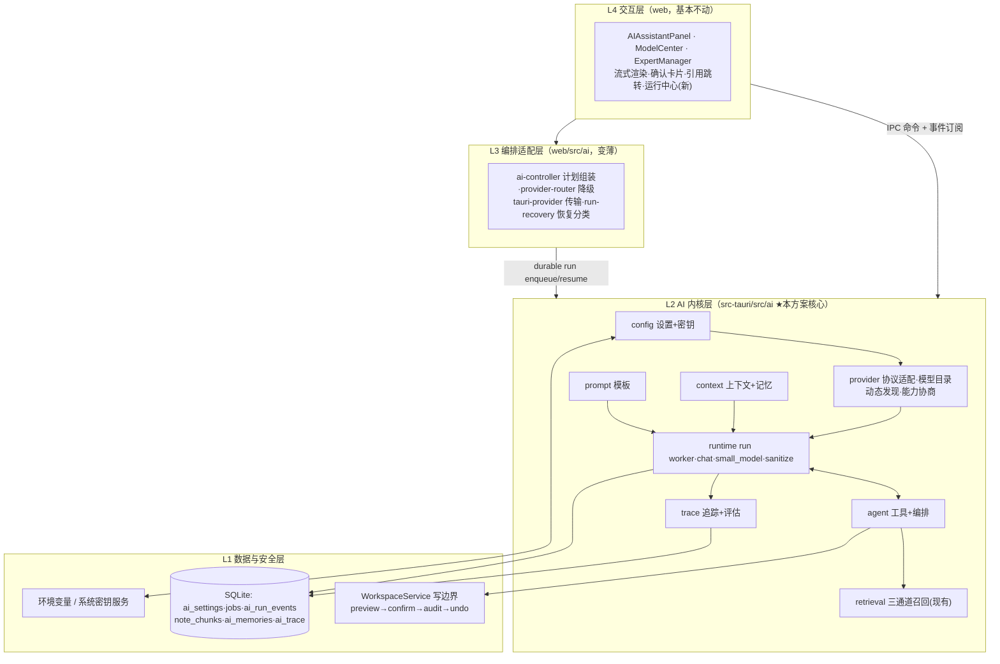
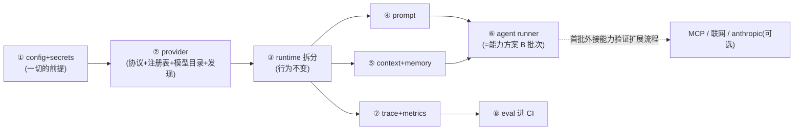
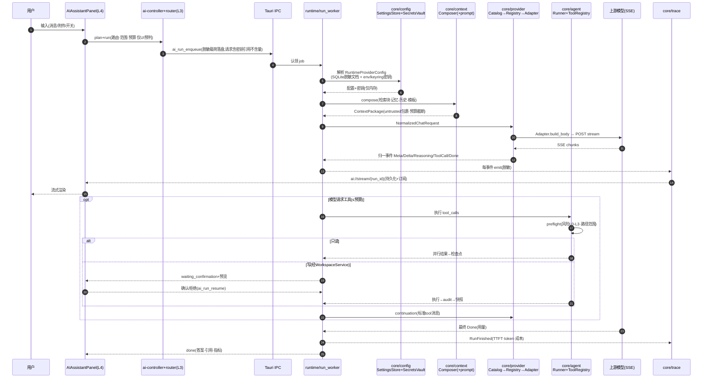
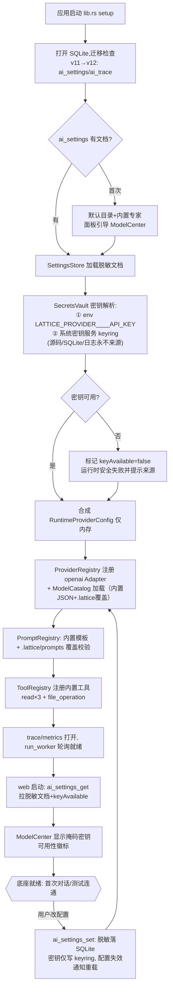
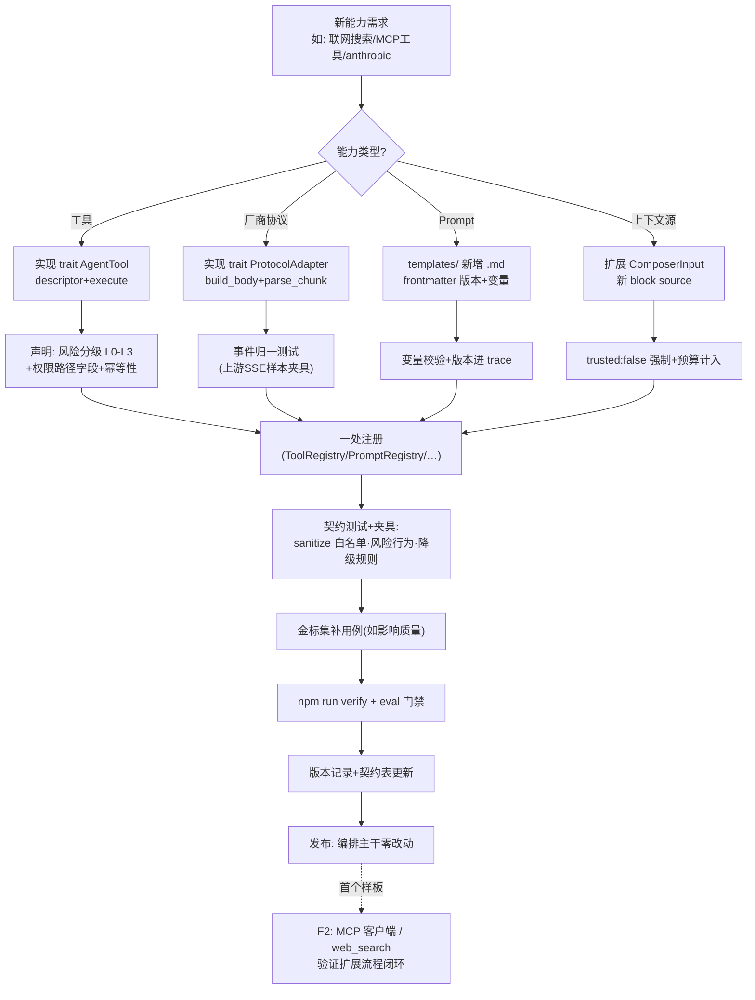

# Lattice AI 地基（AI Foundation）架构方案

> 日期：2026-10-24（修订：开放模型优先） · 分支：`phase/p1-rust-ai` · 状态：提案（待评审）
> 关联文档：AI 能力升级方案、ADR-0001（原 `doc/升级计划/`，目录重组后见 git 历史；本文不依赖其章节号）；`doc/AI/输出/AI输出体验设计方案.md`（输出层 UI 设计，消费本文 §5.1 归一事件与模型能力）
> 执行计划：`doc/AI/执行/AI升级执行方案.md`（W 系列批次分解，本文 F0–F2 的落地序列）

**目标：** 把当前分散在 `ai_runtime.rs`（1549 行单体）、`web/src/ai/`（22 个文件）与各 UI 组件中的 AI 能力，收敛为 **Rust 侧一个边界清晰、可测试、可扩展的 AI 内核（ai-core）**，作为后续语义检索、Agent 循环、MCP、联网搜索等一切 AI 能力的统一底座；并让 **GitHub/HuggingFace 顶级开放权重模型（DeepSeek、Qwen、GLM、Kimi、Llama、MiniMax 等）成为一等公民**——本机推理与云端开放权重 API 走同一套 provider 抽象，"用上新出的顶级模型"从手填配置变成目录选择或一键导入。

**设计立场：** 不推倒重来。已有资产（durable run、L0–L3 安全链、脱敏持久化、契约夹具）全部保留，本方案做的是"归位"：把职责放回正确的层，把散落的字符串和隐式约定变成显式接口。

---

## 1. 现状分析（方案依据）

### 1.1 技术栈

| 层 | 技术 | 说明 |
|---|---|---|
| 桌面壳 | Tauri 2.12 | 无 tokio 直接依赖，异步走 `tauri::async_runtime` |
| 后端 | Rust + `rusqlite`(bundled, FTS5 trigram) + `reqwest 0.13`(json/stream) + `notify 8` | SQLite WAL，迁移版本化（当前 v11） |
| 前端 | React + TypeScript(strict) + Vite | Node `--test`（`web/test/*.test.mjs`） |
| 测试护栏 | `npm run verify` = fc 测试 + typecheck + web 测试 + 契约夹具校验 + `cargo test`（109 个单测） | 夹具：`src-tauri/tests/fixtures/`（50 用例，Express↔Rust 契约） |
| 评估 | `src-tauri/eval/`：金标集 16 题 + 回归门禁 + 质量门禁 | 未进 CI，无基线报告 |

### 1.2 代码规范（本方案遵循）

- 模块级中文 doc 注释；错误统一 `Result<_, String>` 且文案中文；IPC 契约 camelCase（`#[serde(rename_all = "camelCase")]`）。
- **落盘必脱敏**：`redact_request_secrets` / `sanitize_ai_persistence` 模式（凭据置空、正文剥离）是既有铁律。
- Web 侧纯函数 + 依赖注入（如 `createTauriAiProvider(transport)`），localStorage 只存掩码。
- 文档文化：ADR + 契约表（`ipc-contract.md` §2.9 以 ✅/⬜ 跟踪）+ 版本记录。

### 1.3 现有 AI 资产盘点与归位判断

| 资产 | 位置 | 现状问题 | 地基归位 |
|---|---|---|---|
| 模型调用 | `src-tauri/src/ai_runtime.rs` | 单体：协议解析、run 生命周期、脱敏、小模型混在一起；OpenAI 协议硬编码 | 拆入 `ai/core/provider` + `ai/runtime` |
| 模型目录 | `web/src/settings/aiProviders.ts` | 20 家服务商与模型名全部硬编码在代码里，新模型上架就得发版；Ollama 只靠端口特判，本机装了什么模型全靠手填 | 数据化为 `ai/core/provider/catalog`，配 `/v1/models` + 本机运行时动态发现 |
| 配置 | `web/src/settings/aiSettings.ts` | 桌面端无 `ai_settings_get/set`（契约 ⬜）；密钥只在页面内存，重启即失 | 拆入 `ai/core/config`（设置落 SQLite、密钥走 env/密钥服务） |
| Prompt | 各处字符串（小模型提示、系统提示、欢迎语） | 无版本、无覆盖机制、改一处散多处 | 新建 `ai/core/prompt` |
| 上下文 | `web/src/ai/context-builder.ts`（token 预算/前缀缓存/历史压缩） | 前后端两套口径（web 组装 vs Rust `sanitize_context_metadata`） | 契约内核化为 `ai/core/context` |
| 记忆 | `src-tauri/src/memory.rs`（ai_memories + 敏感筛查） | 独立游离于 ai 模块之外 | 迁入 `ai/core/context/memory`（原路径重导出） |
| Agent 编排 | `web/src/lib/ai-agent.ts` + `agent-tool-gateway.ts`（前端驱动 + 伪用户消息） | 循环在前端，面板关闭即断；预算过紧 | 内核化为 `ai/core/agent` |
| 追踪/评估 | `web/src/ai/run-{trace,metrics}-store.ts`（localStorage）+ Rust `ai_run_events` | 两套事件口径；指标不落库；eval 无基线 | 统一 `ai/core/trace` |

---

## 2. 设计目标与原则

**目标**：单一事实源、协议可插拔、能力可注册、全程可观测、密钥零落盘、开放模型开箱即用。

| # | 原则 | 落地约束 |
|---|---|---|
| G1 | 内核在 Rust，Web 是薄壳 | 一切模型调用、工具执行、上下文组装最终以 Rust 为事实源；Web 保留纯函数做 UI 侧预测与降级 |
| G2 | 注册表模式 | 新能力（协议/工具/Prompt/上下文源）= 实现一个 trait + 一处注册，不改编排主干 |
| G3 | 密钥只从环境变量或系统密钥服务读取 | 源码、示例、测试、契约夹具中**不出现任何可用凭据字面量**；SQLite 只存脱敏配置 |
| G4 | 落盘必脱敏（沿用既有 redact/sanitize 模式） | 新增持久化字段必须先过 sanitize 白名单 |
| G5 | 行为契约钉死 | 每个内核模块有对应契约测试；Web↔Rust 共享行为（风险分级/融合排序）以夹具互证 |
| G6 | 渐进迁移，`npm run verify` 全绿是每步合入门禁 | 拆分先建门面重导出，再逐文件搬移 |
| G7 | 开放模型一等公民 | 顶级开放权重模型（本机 Ollama/LM Studio/llama.cpp/vLLM，或 SiliconFlow/OpenRouter/DeepSeek/Kimi 等云端开放权重服务）与专属厂商走同一抽象；模型目录是**数据**不是代码——新模型上架改 JSON 不改代码；不支持的技能（工具/视觉）显式降级而非静默失败 |

---

## 3. 分层架构与各层职责



**各层职责边界：**

| 层 | 职责 | 禁止事项 |
|---|---|---|
| L4 交互 | 渲染事件流、收集确认、展示引用/指标 | 不做任何业务决策（路由/预算/风险判定全部下沉） |
| L3 编排适配 | 请求计划组装、降级候选排序、传输适配、恢复分类展示 | 不执行工具、不组装最终上下文 |
| L2 AI 内核 | 配置/密钥、协议适配、模型目录与发现、能力协商、模板、上下文、工具编排、追踪、run 生命周期 | 不直接读写 Vault（必须经 L1 WorkspaceService） |
| L1 数据与安全 | SQLite 持久化、写边界、审计、密钥源 | 密钥不进 SQLite、不进日志 |

---

## 4. 建议目录结构（目标态与迁移映射）

```
src-tauri/src/ai/
├── mod.rs                      # 内核门面：重导出，外部 import 路径不变
├── core/
│   ├── mod.rs
│   ├── config/
│   │   ├── mod.rs              # AiSettingsStore（SQLite 迁移 v12，脱敏文档）
│   │   └── secrets.rs          # SecretsVault：env(LATTICE_PROVIDER__<ID>__API_KEY) + keyring
│   ├── provider/
│   │   ├── mod.rs              # ProviderRegistry
│   │   ├── protocol/
│   │   │   ├── mod.rs          # trait ProtocolAdapter + NormalizedStreamEvent
│   │   │   ├── openai.rs       # 自 ai_runtime.rs 迁入（SSE 解析、工具增量、reasoning 双格式归一）
│   │   │   └── anthropic.rs    # 可选扩展（F2 后按需；开放模型几乎都走 OpenAI 兼容协议）
│   │   ├── catalog.rs          # ModelCatalog：models.json 内置(include_str!) + .lattice 覆盖
│   │   ├── discovery.rs        # ModelDiscovery：GET /v1/models、Ollama /api/tags、本机端口探测
│   │   ├── capabilities.rs     # ModelCapabilities + 协商降级链（工具/推理/视觉/上下文）
│   │   └── probe.rs            # 连通性/embedding 维度测试（自 ai_runtime.rs 迁入）
│   ├── prompt/
│   │   ├── mod.rs              # PromptRegistry：内置(include_str!) + .lattice/prompts 覆盖
│   │   └── templates/          # 每个 .md 一模板，frontmatter 声明版本与变量
│   ├── context/
│   │   ├── mod.rs              # ContextComposer（契约对齐 web context-builder）
│   │   └── memory.rs           # 自 src-tauri/src/memory.rs 迁入（原路径重导出）
│   ├── agent/
│   │   ├── mod.rs              # ToolRegistry
│   │   ├── runner.rs           # AgentRunner（读并行/写串行/预算/确认挂起/检查点）
│   │   ├── budget.rs           # 预算（quick/task 默认值，请求可覆盖）
│   │   └── risk.rs             # L0–L3 分级（与 web ai-policy.ts 行为契约夹具互证）
│   ├── trace/
│   │   ├── mod.rs              # AiTraceEvent 统一事件模型 + TraceSink
│   │   └── metrics.rs          # 指标落库（TTFT/token/成本，P50 按任务类型）
│   └── eval/                   # 金标集挂钩（复用 src-tauri/eval/ 脚本，报告入仓）
├── retrieval/                  # 现有 mod.rs/retrieval.rs/embeddings.rs 归位改名
│   ├── mod.rs                  # ai_retrieve 入口（三通道→RRF→重排→引用块）
│   ├── fusion.rs               # 原 retrieval.rs（RRF/去重/新鲜度/词法重排）
│   └── embeddings.rs           # F0 保持本地哈希；A 批次接 EmbeddingProvider（开放模型优先：
│                               #   本机 Ollama bge-m3/nomic-embed-text，或 SiliconFlow BAAI/bge-m3）
└── runtime/                    # 原 ai_runtime.rs 拆分（行为不变）
    ├── mod.rs
    ├── run_worker.rs           # jobs 认领、事件持久化、取消、检查点编排
    ├── chat.rs                 # stream_provider（调用 core/provider，只管 run 生命周期）
    ├── small_model.rs          # ai_small_model（intent/rerank 有界调用）
    └── sanitize.rs             # redact/sanitize 全家（自 ai_runtime.rs 迁入，新增字段先过白名单）
```

**Web 侧（变薄，不搬家）：**

```
web/src/ai/                     # 保留：controller / providers/tauri-provider / run-recovery /
                                #   provider-read-tools(F1 后部分职责移交内核) / planner / telemetry 适配
web/src/lib/ai-policy.ts        # 保留纯函数；与 core/agent/risk.rs 用同一组夹具断言等价
web/src/settings/aiSettings.ts  # 改为 ai_settings_get/set 的客户端（localStorage 降级为缓存）
web/src/settings/aiProviders.ts # 目录数据改读内核 ai_models_catalog；保留服务商→Logo 匹配等纯 UI 逻辑
```

**迁移映射表（关键动作）：**

| 现有位置 | 动作 | 目标 |
|---|---|---|
| `ai_runtime.rs` 流式解析/工具累积 | 搬移 | `core/provider/protocol/openai.rs` |
| `ai_runtime.rs` redact/sanitize 家族 | 搬移 | `runtime/sanitize.rs` |
| `ai_runtime.rs` probe | 搬移 | `core/provider/probe.rs` |
| `aiProviders.ts` PROVIDERS 硬编码目录 | 数据化 | `core/provider/catalog.rs`（models.json + 真实样本夹具） |
| `src-tauri/src/memory.rs` | 搬移+重导出 | `ai/core/context/memory.rs` |
| `src-tauri/src/ai/{mod,retrieval,embeddings}.rs` | 改名归位 | `ai/retrieval/*` |
| `web/src/ai/context-builder.ts` | 保留，内核成为服务端事实源 | 契约对齐 `core/context` |
| 其余 web/src/ai/* | 保留变薄 | — |

---

## 5. 核心模块边界与接口约定

> 以下仅关键签名（Rust 内核 + 少量 TS 契约），完整实现不在本文展开。

### 5.1 模型服务统一接入（`core/provider`）

**边界**：只管三件事——"把归一化请求发给任意端点并返回归一化事件流"、"这个端点上有哪些模型"（目录 + 动态发现）、"这个模型能做什么"（能力协商）。不知道 run、不知道工具语义、不知道 UI。

```rust
pub trait ChatProvider: Send + Sync {
    fn id(&self) -> &str;
    fn protocol(&self) -> ProtocolKind;                 // OpenAi | Anthropic
    fn source(&self) -> ModelSource;                    // LocalRuntime(Ollama|LmStudio|LlamaCpp|Vllm) | HostedApi
    fn capabilities(&self) -> ModelCapabilities;        // 目录声明 → 发现补充 → probe 实测 → trace 修正
    fn stream(&self, req: NormalizedChatRequest, sink: EventSink)
        -> impl Future<Output = Result<NormalizedCompletion, ProviderError>>;
}

pub trait EmbeddingProvider: Send + Sync {
    fn embed(&self, texts: &[String]) -> Result<Vec<Vec<f32>>, String>;
    fn dimension(&self) -> usize;
    fn model_version(&self) -> String;                  // 进 content_hash 失效判定
}

/// 协议适配器：请求映射 + SSE 解析 + 事件归一。新增厂商协议 = 新增一个 Adapter。
/// 现实：开放模型的服务面（Ollama/llama.cpp/LM Studio/vLLM/SiliconFlow/OpenRouter/
/// DeepSeek/Kimi/GLM/Qwen 官方兼容接口）清一色 OpenAI 兼容，openai.rs 即开放模型主干。
pub trait ProtocolAdapter: Send + Sync {
    fn build_body(&self, req: &NormalizedChatRequest) -> Value;
    fn parse_chunk(&self, raw: &str, acc: &mut ToolCallAccumulator)
        -> Vec<NormalizedStreamEvent>;                  // Meta|Delta|Reasoning|ToolCall|Done
}

pub struct ProviderRegistry { /* id → Arc<dyn ChatProvider>，由 config 构建 */ }
```

**开放模型三件套（本方案新增，F0–F1 落地）：**

```rust
/// 模型能力声明：开放模型差异极大（工具调用有无、思考流格式、上下文 32k–1M），
/// 每次请求前显式协商，而不是默认所有模型都长成 gpt-4o。
pub struct ModelCapabilities {
    pub context_window_tokens: u32,
    pub native_tools: bool,            // false → 任务模式降级（禁用工具并提示，而非静默失败）
    pub vision: bool,
    pub reasoning: ReasoningKind,      // None | ReasoningContent | ThinkTags
    pub open_weights: bool,            // UI 徽标：开放权重
    pub pricing: Option<ModelPricing>, // 本机推理恒 None（零成本）
}

/// 模型目录是数据不是代码：内置 models.json 随版本发布，<Vault>/.lattice/models.json
/// 覆盖更新——顶级模型上架/改价 = 改一份 JSON，不改编排主干（与 PromptRegistry 同一套覆盖机制）。
pub struct ModelCatalog { /* 家族 → 模型 → 能力/价格/已知托管端点 */ }

/// 动态发现：GET {base}/models（OpenAI 兼容端点几乎都支持）+ Ollama /api/tags
/// （多给尺寸/量化/参数量元数据）→ 归一化 ModelDescriptor[]；
/// 附本机 loopback 端口探测（Ollama 11434 / LM Studio 1234 / llama.cpp 8080…）。
pub struct ModelDiscovery;
```

**开放模型接入路径（用户视角，三条路同一抽象）：**

| 路径 | 典型运行时 / 服务 | 密钥 | 接入动作 |
|---|---|---|---|
| 本机推理 | Ollama / LM Studio / llama.cpp / vLLM | 免（loopback） | ModelCenter「扫描本机」→ 端口探测 → 列出已装模型 → 一键导入；数据不出机器 |
| 云端开放权重 | SiliconFlow / OpenRouter / Gitee AI / DeepSeek / Kimi / Z.ai 官方 | 需要 | 目录预置端点与推荐模型 + `/v1/models` 拉真实清单，不再依赖手写名单 |
| 自托管 | 自建 vLLM / sglang / 内网网关 | 可选 | 自定义 OpenAI 兼容地址 + `/v1/models` 发现 |

**约定**：
- 上层只见 `NormalizedStreamEvent`（对齐现有 `ai://stream/{run_id}` 五类事件），协议差异（如 Anthropic `content_block_delta`）封死在 Adapter 内；`ProviderError` 带可重试分类，供降级规则（provider-router 语义）消费。
- **reasoning 双格式归一**：`reasoning_content`（DeepSeek 系）与 `<think>…</think>` 内嵌标签（Qwen3/QwQ 系）都归一为 Reasoning 事件并从正文中剔除——在 openai.rs Adapter 内完成，上层与 UI 无感（现 `extract_delta` 已支持前者，补后者）。
- **能力协商链**：目录声明 → `/v1/models` 发现补充 → 连通性测试顺带实测（F1：带 tools 的最小请求）→ F2 起 trace 观测回写（tool_calls 解析失败率）。协商结果进 run trace，降级必须给用户可见的原因。
- 目录/发现响应只含模型元数据，持久化走 sanitize 白名单；内置目录夹具与真实上游样本（`/v1/models`、`/api/tags`）互证。

### 5.2 配置与密钥管理（`core/config`）

**边界**：唯一配置事实源；密钥与配置**分离存储**。

```rust
pub struct AiSettingsStore { /* SQLite ai_settings 表（迁移 v12），只存脱敏文档 */ }

pub struct RuntimeProviderConfig {          // 内存态 = 脱敏配置 + 注入的密钥
    pub provider: ProviderMeta,             // endpoint/model/protocol/温度等
    pub api_key: SecretString,              // 仅进程内
}

pub trait SecretsVault: Send + Sync {
    /// 只从环境变量（LATTICE_PROVIDER__<ID>__API_KEY）或系统密钥服务读取。
    /// 永不来自源码/配置文件/SQLite；写入仅进系统密钥服务。
    fn load(&self, provider_id: &str) -> Option<SecretString>;
    fn save_to_keyring(&self, provider_id: &str, key: &SecretString) -> Result<(), String>;
}
```

**约定**：
- SQLite `ai_settings` 文档中 API Key 字段恒为掩码（`isSet: bool` + 尾四位），真实值只存在于 env / Windows Credential Manager（`keyring` crate，需新增依赖）/ 进程内存——延续"重启后凭据不可恢复则安全失败"的 ADR-0001 语义。
- IPC 落地 `ai_settings_get/set`（契约表 ⬜→✅），`get` 返回脱敏文档 + `keyAvailable` 布尔。
- **测试规范：单测与夹具中的密钥一律用环境变量注入或 mock vault，不写凭据字面量。**

### 5.3 Prompt / 模板管理（`core/prompt`）

**边界**：所有发给模型的文本模板的唯一出处；带版本，进 trace。

```rust
pub struct PromptRegistry { /* 内置(include_str!) + <Vault>/.lattice/prompts/*.md 覆盖 */ }

pub struct PromptInstance {
    pub content: String,
    pub version: String,        // 模板 frontmatter 声明，随 trace 记录
}

impl PromptRegistry {
    pub fn render(&self, id: &str, vars: &PromptVars) -> Result<PromptInstance, String>;
    // 模板 id 清单：assistant.system / write.polish / small.intent / small.rerank /
    //             digest.overview / clarify.question …（首批收敛现有散落字符串）
}
```

**约定**：模板渲染失败 fail-fast（启动时校验变量占位）；workspace 覆盖需在 ModelCenter 显示"已自定义"标记；模板内容视为 trusted 上下文。

### 5.4 上下文与记忆（`core/context`）

**边界**：决定"模型看见什么"，产出口径与 web `context-builder` 契约一致的 `ContextPackage`。

```rust
pub struct ComposerInput {
    pub system: Vec<String>,            // 经 PromptRegistry 渲染
    pub memory: Vec<MemoryRecord>,      // ai_memories（敏感筛查已有）
    pub retrieval: Vec<RetrievalBlock>, // trusted:false
    pub history: Vec<String>,
    pub attachments: Vec<AttachmentRef>,
    pub external: Vec<ExternalBlock>,   // MCP/联网，trusted:false
    pub budget_tokens: usize,
}

pub trait ContextComposer {
    /// 稳定块序：system→memory→retrieval→history(压缩)→attachment→external；
    /// 逐块预算截断；前缀缓存键 = 权限上下文+system+tools+memory（对齐 web 实现）
    fn compose(&self, input: ComposerInput) -> ContextPackage;
}
```

**约定**：`ContextPackage` 序列化格式与 web `serializeAiContext`（`<untrusted_xxx id>` 包裹）逐字节兼容，用夹具互证；记忆读写继续走 `memory_list/save/delete` + 确认语义，不变。

### 5.5 工具与 Agent 编排（`core/agent`）

**边界**：工具注册、风险分级、执行闸与循环；**唯一**允许触发 Vault 写入的 AI 路径（经 WorkspaceService）。

```rust
pub trait AgentTool: Send + Sync {
    fn descriptor(&self) -> ToolDescriptor;   // name/kind/risk/inputSchema/timeout/idempotent
    fn execute(&self, input: Value, ctx: ToolContext) -> impl Future<Output = Result<Value, ToolError>>;
}

pub struct ToolRegistry { /* 内置注册 + MCP 运行时注册（C 批次）+ 联网工具 */ }

pub struct AgentRunner { /* 读并行(≤4)/写串行/L2-L3→waiting_confirmation/
                            预算(步·调用·token·时长)/每步检查点(sanitize 后落盘) */ }

impl AgentRunner {
    pub async fn run(&self, plan: AgentPlan, hooks: RunnerHooks) -> AgentOutcome;
    // AgentOutcome: Completed{answer,citations,usage} | AwaitingConfirmation{pending}
    //             | BudgetExceeded | Failed
}
```

**约定**：行为契约照搬 `web/src/ai/agent-tool-gateway.ts` + `lib/ai-agent.ts`（路径范围校验、viewer 禁写、幂等键、不可信上下文禁驱动写），用同一组夹具在两侧断言等价；F1 完成后 web 循环退役，前端只渲染事件与发确认。计划组装时读取 `ModelCapabilities`：`native_tools=false` 的模型不进入任务模式（快速问答不受影响），降级原因进 trace 并在 UI 可见。

### 5.6 日志追踪与效果评估（`core/trace`）

**边界**：一个事件模型贯穿"运行—工具—模型—成本"，评估消费同一事件流。

```rust
pub enum AiTraceEvent {
    RunStarted { run_id, mode, expert, prompt_versions },
    Step { run_id, step, decision },
    ToolCall { run_id, call_id, tool, risk, duration_ms, ok },
    ModelCall { run_id, provider, model, ttft_ms, prompt_tokens, completion_tokens, cost_usd },
    RunFinished { run_id, termination, total_ms },
}

pub trait TraceSink: Send + Sync {        // 双写：ai_run_events(脱敏持久) + Tauri 事件(前端订阅)
    fn emit(&self, event: AiTraceEvent);
}

pub struct MetricsStore { /* SQLite ai_trace 指标表：按任务类型聚合 P50/P95 */ }
// 评估：src-tauri/eval 金标集消费同一事件流产出报告；F2 起基线入仓 + 回归门禁进 CI
```

**约定**：trace 事件载荷过 sanitize 白名单（沿用既有规则：查询可留、正文不留）；web 侧 `run-trace-store/metrics-store` 改为订阅内核事件，localStorage 只作展示缓存。

---

## 6. 依赖顺序与分阶段落地路线



| 阶段 | 内容 | 工期 | 合入判据（每步 verify 全绿） |
|---|---|---|---|
| **F0 最小可用底座** | ①config+secrets（迁移 v12、env/keyring、`ai_settings_get/set`）→ ②provider trait + openai Adapter 迁移 + **模型目录数据化（catalog.rs + models.json）与动态发现（/v1/models、Ollama /api/tags）** → ③ai_runtime.rs 拆分为 runtime/*（**行为零变化**） | ~2 周 | 109 单测 + 50 夹具全绿，新增目录与发现夹具；桌面重启后配置保留、密钥按 env/keyring 恢复或安全失败；ModelCenter 能拉到真实模型清单（内置目录兜底） |
| **F1 内核完备 + 开放模型体验** | ④prompt registry → ⑤context composer 内核化（夹具互证）→ ⑥agent runner（吸收能力方案 M3-B）+ **能力协商降级（工具/视觉/上下文）与本机运行时一键导入（端口探测→选模型→免密钥保存）**；anthropic Adapter 移出本阶段 | ~2.5 周 | Inbox 整理 ≤30 步；关面板循环不断；伪用户消息移除；reasoning 双格式夹具互证；无工具能力的模型在 UI 显式降级而非静默失败 |
| **F2 观测与扩展** | ⑦trace/metrics 落库（含能力观测修正：tool_calls 失败率回写 capabilities）→ ⑧金标集基线入仓 + 门禁进 CI → 以 MCP 客户端 / 联网搜索 / **anthropic Adapter（可选）**作为首批"注册表扩展"样板 | ~1.5 周 | 能力方案 M3-C 完成；回归门禁在 CI 生效 |

与既有计划的关系：**F0/F1 是 AI 能力升级方案中 M3-A/B 的前置与合并**（A 批次的 EmbeddingProvider 挂在 ② 的接口上，首选开放模型端点：本机 Ollama bge-m3/nomic-embed-text 或 SiliconFlow BAAI/bge-m3；B 批次即 ⑥；C/D 批次是 ⑧ 之后的首批扩展样板）。

---

## 7. AI 请求完整调用链路（入口 → 模型返回 → 完成）



## 8. 配置加载与初始化流程



## 9. 后续扩展新能力的接入流程（以"新工具/新协议/新上下文源"为例）



**扩展铁律**：任何新能力只允许"实现 trait → 声明元数据 → 一处注册 → 过夹具"四步，出现需要改 `AgentRunner`/`run_worker` 主干才能接入的情况，视为地基设计缺陷，先修地基。

---

## 10. 现有代码改动清单与影响分析

| 位置 | 动作 | 影响面 | 护栏 |
|---|---|---|---|
| `src-tauri/src/ai_runtime.rs`（1549 行） | 拆分为 `ai/runtime/*` + `ai/core/provider/*` | **高**：桌面 AI 主链路 | 行为零变化拆分；109 单测 + checkpoint_tests 全数保留；夹具不新增豁免 |
| `src-tauri/src/db.rs` | 迁移 v12（`ai_settings`、`ai_trace`） | 低：版本化迁移 + `.bak-pre-migration` 已有 | 迁移回滚测试 |
| `src-tauri/src/memory.rs` | 迁至 `ai/core/context/memory.rs` + 原路径 `pub use` | 低：路径兼容 | 现有敏感筛查测试不动 |
| `src-tauri/src/lib.rs` | 注册 `ai_settings_get/set`、`ai_trace_query`、`ai_models_catalog`、`ai_provider_models`（发现）、`ai_runtime_detect`（新）；`ai_chat_*` 等命令签名不变 | 低 | 契约表 ⬜→✅ 同步更新 |
| `src-tauri/Cargo.toml` | 新增 `keyring` crate | 中：Windows 链路需验证（keyring 对 Win 凭据管理器支持成熟） | 若构建受阻，F0 先只支持 env 变量源，keyring 延后不阻塞 |
| `web/src/settings/aiSettings.ts` | 改为 `ai_settings_get/set` 客户端，localStorage 降级缓存 | 中：ModelCenter 行为 | web 测试更新；掩码显示不变 |
| `web/src/settings/aiProviders.ts` | PROVIDERS 硬编码目录 → 数据来自 `ai_models_catalog`；`SERVICE_MATCHERS`（服务商→Logo）等纯 UI 逻辑保留 | 中：添加模型流程 | 目录 JSON 夹具先行；发现失败回退内置目录，不阻塞添加 |
| `web/src/settings/ModelCenter.tsx` | 「添加模型」加入本机运行时扫描与动态模型下拉；徽标：本机（数据不出机器）/开放权重/价格 | 中：主设置面板 | 连通性测试与保存门禁口径不变；web 测试更新 |
| `web/src/components/AIAssistantPanel.tsx` | F1 后移除续跑拼装（伪用户消息），改纯事件渲染 | 中：主面板 | `ai-contracts/controller` 测试先行改造 |
| `web/src/ai/context-builder.ts` | 保留，与内核 composer 夹具互证 | 低 | 新增字节级兼容夹具 |
| `web/src/lib/ai-policy.ts` | 保留，与 `core/agent/risk.rs` 共享分级夹具 | 低 | 双侧同断言 |
| `web/src/ai/run-{trace,metrics}-store.ts` | 改订阅内核事件 | 低 | 现有测试改数据源 |

**风险与缓解**：① 拆分期间回归风险 → 每个搬移独立 PR、verify 全绿才合；② keyring 不可用 → env-only 降级（SecretsVault 已抽象）；③ 夹具 schema 漂移 → `divergence.json` 白名单只减不增；④ 上游 `/v1/models` 响应形态各异（分页/字段名/ID 大小写）→ 归一化层 + 真实样本夹具，解析失败回退内置目录。

---

## 11. 安全基线（本方案的硬性验收）

1. 密钥**只**从环境变量（`LATTICE_PROVIDER__<ID>__API_KEY`）或系统密钥服务读取；源码、示例、测试、夹具、日志、SQLite 中**不出现任何可用凭据字面量**。
2. 一切新增持久化字段先过 `runtime/sanitize` 白名单；trace 事件正文不落盘（查询词除外，沿用现行规则）。
3. AI 触发写操作的唯一通道仍是 `core/agent` → WorkspaceService（preview→confirm→audit→undo），不可信上下文驱动 L2/L3 写必须用户显式授权。
4. 每阶段发布前跑 `npm run verify` 全链 + 安全专项检查（密钥字面量扫描进 CI 脚本）。
5. 明文 HTTP 仅允许 loopback；非 loopback 端点默认要求 HTTPS，内网自托管 http 端点须用户显式确认风险提示。本机推理（Ollama 等 loopback 端点）天然免密钥，是隐私最优路径——笔记数据不出机器。
6. 模型目录与发现响应（`/v1/models`、`/api/tags`）只含模型元数据，持久化走同一 sanitize 白名单；远程目录刷新仅在用户触发时进行，不自动外联。

---

## 12. 结语

这套地基的本质是四件事：**把 1549 行单体按职责拆开（F0）、把 Web 里的智能下沉为内核接口（F1）、把"加能力"从改代码变成注册插件（F2）、把"加模型"从手填配置变成目录选择或本机一键导入（F0–F1，开放模型一等公民）**。完成后，GitHub 上新出一个顶级开放模型，用户在 ModelCenter 里"发现 → 测试 → 使用"三步接入；能力方案（语义检索、Agent 深度、MCP、联网）与未来任何新想法，都只沿着第 9 节的扩展流程走，不再触碰主干。
