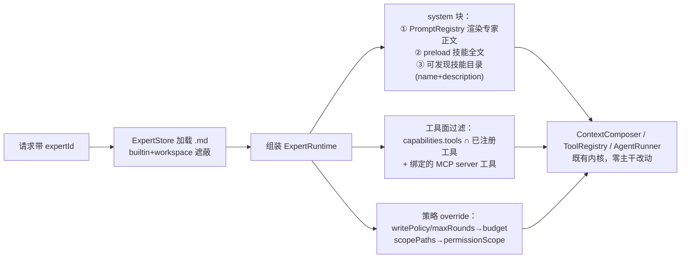
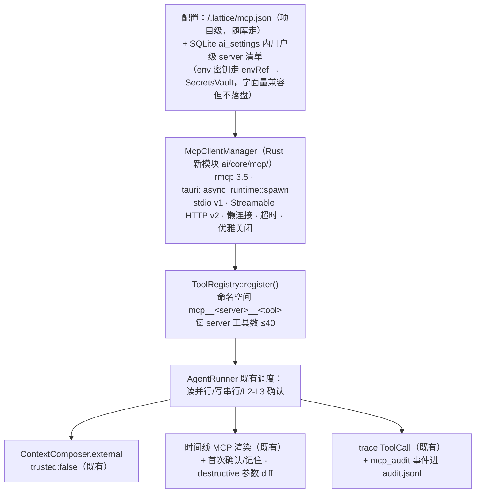

# Lattice 专家 / Skill / MCP 重构方案

> 日期：2026-10-26 · 分支：`phase/p1-rust-ai` · 状态：**进行中**（E1–E4 完成；E4 第 6 项 lattice-mcp sidecar 独立立项；§7 执行日志为事实来源）
> 关联文档：`doc/AI/地基/Lattice-AI地基架构方案.md`（W1–W9 已收官的 AI 内核，本文在其 §9 扩展流程框架内工作）；`doc/AI/执行/AI升级执行方案.md`（执行日志事实来源）
> 定位：本文回答"专家 / Skill / MCP 三个子系统为什么不适配、市场怎么做、Lattice 重构成长什么样、按什么批次落地"。

**一句话结论：** 三套子系统的共同病根是"**管理面存在、运行面断线**"——专家的 systemPrompt 与 Skill 正文从未进入提示词（旧 Electron 的注入逻辑迁移时丢失），MCP 只有配置没有连接；而市场已给出清晰答案：**Skill 对齐 Agent Skills 开放标准（SKILL.md + 渐进披露 + description 驱动路由），专家转型为"提示词 + 能力绑定"的打包入口，MCP 用官方 rmcp SDK 接入 ToolRegistry 预留槽位**。重构不推翻 AI 内核，全部沿 §9 扩展铁律（trait → 声明 → 一处注册 → 夹具）落地。

---

## 1. 现状诊断（代码事实，2026-10-26）

### 1.1 专家：运行时惰性（最严重）

7 个内置专家（`workspace.rs:4617-4625`，`include_str!` 打包）+ `<Vault>/.lattice/experts/*.json` 工作区覆盖。全链核查结论（`AIAssistantPanel.tsx` → `ai-controller` → `core/context`）：

| 字段 | 设计意图 | 实际现状 |
|---|---|---|
| `systemPrompt` | 专家人设 | **无任何消费方**。选专家只影响：上下文范围闸（`capabilities.context`）、会话存储分区、run 元数据 `expertId`、（general 时）路由建议条 |
| `capabilities.tools` | 工具面过滤 | 死字段（旧版 `filterExpertActions` 未迁移） |
| `capabilities.writePolicy` / `maxRounds` | 写策略 / 轮数 | 仅展示标签；实际由会话模式与 `buildAiAgentBudget` 决定 |
| `scope.include/exclude` | 路径范围 | 死字段（旧版 `restrictContextForExpert` 未迁移） |
| `routing.*` | 关键词路由 | 生效但原始：中文子串 `contains` 匹配，`confidenceThreshold` 语义（命中数 ≥ ⌈t×2⌉）用户不可发现 |

旧 Electron 版（`更新记录.md` v0.1.4）的 `loadRuntimeExpert`（按 priority 注入绑定 Skill 正文）、`filterExpertActions`、`restrictContextForExpert` 三个运行时行为在 Tauri 迁移中全部丢失——**这是用户感到"不适配"的直接根源：配置界面完好，模型什么都没收到。**

### 1.2 Skill：格式自成一派，字段大半是死的

9 个内置 Skill（`skill.json` 清单 + `SKILL.md` 正文）绑定到专家。`triggers` / `inputSchema` / `outputSchema` / `permissions` 四个字段无运行时校验或消费（`triggers` 甚至不参与路由——路由只看专家 keywords）；`SKILL.md` 正文仅在管理界面编辑时被读出。格式与业界无互通：既不是 Agent Skills 规范，也无导入导出。

### 1.3 MCP：配置先行，连接缺席

- 已交付：MCP 工具中心 UI（三 tab 之一）、用户级配置（localStorage，上限 8 server）、项目级 `<Vault>/.lattice/mcp.json` 读写 IPC（`mcp_project_get/set`，上限 16）、12 条静态市场目录、AI 请求携带 `mcpServers`、时间线 MCP 渲染层（`timeline.ts`）、trace 落盘脱敏（`sanitize.rs:541` 剔除 env token）。
- 未交付：**Rust 运行时完全不消费 `mcpServers`**（全库 grep 仅 workspace.rs 存取与 sanitize 剔除两处）；无 sidecar / 无 MCP Client；`ToolRegistry`（6 个内置工具）预留了"运行时追加"注释但未接。旧版 MCP Server（`scripts/mcp-server/server.mjs`，stdio + 复用 Express 数据层）已删除未迁移；现存的 `scripts/notion-calendar-mcp` 是市场条目配套的独立示例。

### 1.4 与新内核的错位

W1–W9 交付的内核恰好备好了正确的插槽，但三个子系统还是旧 Electron 时代的文件注册表设计：`PromptRegistry` 只有 4 个通用模板（无专家/技能模板）、`ToolRegistry::register()` 支持动态注册（无人调用）、`ContextComposer.external`（trusted:false）无生产者、trace 的 `RunStarted.expert/prompt_versions` 字段未填。三套子系统各自为政，没有统一叙述。

---

## 2. 市场调研结论（2026-10-26）

### 2.1 Agent Skills 已成为跨工具开放标准 → Skill 直接对齐

规范已于 2025-12-18 从 anthropics/skills 独立为开放标准 [agentskills.io](https://agentskills.io/specification)，40+ 工具采用（ChatGPT/Codex、GitHub Copilot、Gemini CLI、Cursor、VS Code、Cherry Studio、思源、LobeChat、Obsidian Copilot、ChatBox……）。要点：

- **格式**：一个 Skill = 一个目录，`SKILL.md`（YAML frontmatter + Markdown 正文）+ 可选 `references/`、`scripts/`、`assets/`。规范级字段仅 6 个：`name`（必填，须与目录名一致）、`description`（必填，"做什么 + 何时用"）、`license` / `compatibility` / `metadata` / `allowed-tools`（可选）。未知字段静默忽略，上传通道白名单校验。
- **渐进披露（progressive disclosure）三级**：① `name+description` 常驻系统提示（约 100 token/技能）→ ② 模型认为相关时把 SKILL.md 全文读入上下文（建议 <5000 token / <500 行）→ ③ 附属文件按需读取；脚本可不进上下文直接执行。上下文成本"无界技能、有界加载"。
- **路由：没有关键词引擎**——description 是唯一主路由机制，模型自主决定加载。官方经验：模型有**欠触发**倾向，description 要写得具体、带触发场景甚至"主动"（pushy）。
- **调用控制三态**（Claude Code 宿主扩展）：模型+用户可调（默认）/ 仅用户（`disable-model-invocation`，元数据退出上下文）/ 仅模型（`user-invocable:false`，纯背景知识）。Lattice 的 R1 先落地「仅用户」通道：输入 `/` 点名技能，本轮强制注入全文（见 §3.3），模型自主的 `skill_load` 作为发现式通道并存。
- **工具面二分**：`allowed-tools` 是"预批准"（该回合免审批）而非限制；`disallowed-tools` 才是剥夺。随下一回合清除。
- **生态**：anthropics/skills 19 个官方技能；分发原子单位=目录，聚合单位=带 `marketplace.json` 清单的 git 仓库；skills.sh、superpowers 等目录站活跃。**SKILL.md 文件夹已是 2026 年事实标准，Cherry/思源/ChatBox/Obsidian Copilot/LobeHub 全部原生兼容。**

### 2.2 Claude 体系的"专家"等价物：subagents

`.claude/agents/*.md` = frontmatter（name/description/tools/model/`skills` 预载/mcpServers……）+ 正文即系统提示，独立上下文运行。与 Skills 的分工（官方对照表原文转述）：**Skill = 向当前上下文注入知识/方法；Subagent = 人格 + 独立上下文 + 独立工具面的执行体**。经验红线：全部 subagent 的 description 合计超 15k token 启动告警。对 Lattice 的启示：专家的人格面（systemPrompt）与知识面（Skill）必须拆开，专家通过"预载/可发现"两种模式绑定 Skill——对应 subagent `skills` 字段（预注入全文）与默认渐进披露。

### 2.3 MCP：规范演进与 Rust 生态已就绪

- **规范**：当前最新 2026-07-28（协议无状态化 + MRTR 输入征询），2025-11-25（结构化工具输出 `outputSchema/structuredContent`、工具列表分页、OAuth 2.1 强化）。传输仅 stdio + Streamable HTTP（HTTP+SSE 已废弃）。**ToolAnnotations**（`readOnlyHint` / `destructiveHint` / `idempotentHint` / `openWorldHint`，均为"提示而非保证"）供客户端做默认风险分级；规范明示**不得基于不可信服务器注解跳过审批**；缺省值保守（destructive=true、openWorld=true）。
- **Rust SDK**：官方 `rmcp`（v3.5.0，2026-09 发布；累计下载 3000 万+；对齐 2026-07-28 并兼容旧版协商）。基于 tokio——与 `tauri::async_runtime` 同源，直接可用。feature：`client` + `transport-child-process` + `transport-streamable-http-client` + `which-command`（解 Windows `npx`→`npx.cmd` 坑）。
- **桌面客户端共同模式**：`mcpServers` JSON 配置（Claude Desktop / Cursor 同形，可互相导入）；`npx -y` / `uvx` 启动约定；工具命名空间 `mcp__<server>__<tool>`（Cursor/VS Code 惯例）；按调用/按会话审批确认；GUI 进程 PATH 不全需显式处理。
- **市场数据源**：官方 Registry `GET https://registry.modelcontextprotocol.io/v0/servers`（免认证、cursor 分页、含传输元数据）是首选；Glama / PulseMCP 可补质量与热度；mcp-get 已归档勿用。

### 2.4 竞品产品模式（知识库/桌面 AI 应用）

| 产品 | 专家/助手建模 | 关键教训 |
|---|---|---|
| Cherry Studio V2 | 智能体四步向导：基础信息/系统提示词/**技能**/**知识库**；技能=SKILL.md 安装包（注册表/GitHub 链接/ZIP/本地目录四途径）；五档权限 | 官方要做"capability-map"页面才能解释清 助手/智能体/技能/MCP/知识库 的区别——**概念混淆是这类产品的头号用户抱怨** |
| Obsidian Copilot V4 | 抛弃 persona 下拉，**一切皆 vault 内 Markdown**：根 `AGENTS.md` 全局指令（项目级覆盖）+ `skills/` SKILL.md + 自定义命令 `.md`（`{[[双链]]}` 变量） | 本地优先笔记应用的答案：专家/技能就是库里的文件，天然可分享、可 git diff |
| 思源 SiYuan | 路线图：内置工具+前端能力+MCP 工具统一抽象为"Agent Capability"注册表，统一启用/审批 | 与 Lattice 内核的 ToolRegistry 方向完全一致 |
| Notion Custom Agents | Instructions+Triggers+Tools+Model 四合一，**专家是一等可分享对象**（权限分级、版本历史） | 打包单位的分享/导入导出是产品化刚需 |
| ChatBox | `load_skill` 工具实现渐进披露 + `user_exec` 审批门控；自动发现 `~/.claude/skills/` | 渐进披露在轻客户端的落地形态：**一个内置工具** |
| LobeChat / AnythingLLM | JSON 角色卡（GitHub+npm 索引分发）；workspace 概念混淆 issue（#5495） | 角色卡=systemRole+参数的 JSON 是开源圈事实标准；合成概念的复用性差 |

**横向结论**：主流形态是"**打包单位（专家/Agent）一站式入口 + 内部正交能力绑定**"——Cherry V2 从 V1"助手=纯提示词"正是演化成这个形态；**知识范围绑定 = 工具可见性**（不绑定就不出现检索工具：省 token、降幻觉、权限即边界）是各家收敛出的最优解。

---

## 3. 重构方案

### 3.1 概念重定义（对内统一叙述，对外对齐市场）

```
专家 (Expert)  = 入口/打包单位：人格提示词 + 能力绑定（技能、工具面、知识范围、写策略）
Skill          = 给模型的知识/方法包（SKILL.md 开放标准格式，渐进披露）
MCP            = 给模型的外来手脚（外部工具能力源，注册进 ToolRegistry）
```

三者在内核里统一为既有注册表的消费者：专家正文走 `PromptRegistry`，技能加载走 `ToolRegistry`（新增 `skill_load` 内置工具），MCP 工具走 `ToolRegistry::register()` 预留槽位，外部内容走 `ContextComposer.external`（trusted:false）。**零内核主干改动**——完全符合地基 §9 扩展铁律。

UI 侧 ExpertManager 三 tab 保留（专家 / 技能 / 外部工具），顶部补一张"能力地图"卡片（Cherry 的教训：三个概念必须一屏讲清）。

### 3.2 专家：从死 JSON 到"活的提示词 + 能力绑定"

**格式**：JSON → **Markdown + frontmatter**（正文即 systemPrompt），与 `.lattice/prompts/*.md`、SKILL.md 统一美学；对齐 subagents / AGENTS.md / Obsidian Copilot 的市场共识，可 diff、可手写、可分享。

```
<Vault>/.lattice/experts/<id>.md        # 用户专家；内置改为 resources/builtin/experts/<id>.md
```

```markdown
---
id: inbox-organizer          # = 文件名，沿用现有 id 规则
name: Inbox 整理专家
description: 判断 Inbox 内容的项目归属，产出可确认的归档/移动计划。（路由与展示双用）
version: 2.0.0
icon: inbox
enabled: true
routing:                      # 保留为"快速建议"增强，不再是唯一路由
  keywords: [inbox, 收件箱, 归档]
  priority: 80
capabilities:
  context: [current-note, project, vault]     # 既有范围闸，不动
  tools: [read, search, write]                # 工具面白名单 → ToolRegistry 过滤（剥夺语义）
  writePolicy: confirm                        # disabled|confirm|auto → AgentRunner 确认策略
  maxRounds: 6                                # → budget override（只收紧）
  scopePaths:                                 # 原 scope.include/exclude → permissionScope.allowedPaths
    include: []
    exclude: ["_templates/**", ".lattice/**"]
skills:                       # 绑定关系迁移到专家 frontmatter
  - id: inbox-triage
    mode: preload             # preload=开始即注入全文 | discoverable=仅目录常驻，模型按需加载
mcp:
  servers: []                 # 绑定的 MCP server key；未绑定 = 工具不可见（知识范围绑定即工具可见性）
---
（正文 = systemPrompt，经 PromptRegistry 渲染，支持 {{today}}/{{vaultName}}/{{activeNote}} 变量；
 版本随 RunStarted.prompt_versions 进 trace）
```

**运行时接线（run_worker 内，专家解析为 `ExpertRuntime`）**：



- 预算护栏（对齐 Claude 经验数字）：技能目录每条 ≤200 token；preload 技能正文 ≤5000 token；全部专家+技能目录常驻合计 >12k token 时 ModelCenter 告警。
- 激活是显式选择（R1）：输入框常驻专家芯片，新 AI 标签页默认「通用助手」，选择只写当前标签页、不落 localStorage；发送后不再自动调用 `/experts/route` 生成建议条——消除「发一条消息，系统在内部悄悄换成某个专家」的感知。
- 死字段处置：`routing.confidenceThreshold` 删除（语义不可发现）；`skills[].priority` 删除（preload 顺序即优先级）；`skill.json` 的 `triggers/inputSchema/outputSchema/permissions` 删除（触发语义并入 SKILL.md description，权限由专家工具白名单 + ToolRegistry 风险分级接管）。
- 遮蔽机制修复：编辑内置专家 → 强制"另存为副本"（`<id>-custom`），消除"更新路径静默生成遮蔽文件"的暗坑；删除副本后内置复活（现状保留）。

### 3.3 Skill：对齐 Agent Skills 开放标准 + 渐进披露

**格式**：`skill.json + SKILL.md` → **单一 `SKILL.md`（规范 6 字段）+ 可选 `references/`**：

```
<Vault>/.lattice/skills/<id>/
├── SKILL.md          # frontmatter: name/description(/license/compatibility/metadata/allowed-tools)
└── references/       # 可选，按需加载的领域文档
```

- `description` 按 Anthropic 最佳实践重写全部 9 个内置技能："做什么 + 何时用 + 触发场景"，偏"主动"；`routing.keywords` 的职责退役。
- 未知 frontmatter 字段静默忽略（导入第三方 SKILL.md 不报错）；导出/分享通道只回写规范 6 字段（宿主扩展字段放 `metadata.lattice.*`）。

**运行时（渐进披露，ChatBox/Anthropic 同款形态）**：

0. **用户显式调用（R1，2026-10-26 落地）**：输入框输入 `/`（或点技能按钮）打开面板，选中后作为芯片挂在本轮消息上；请求带 `invokedSkills: string[]`（≤8 条、单 id ≤120 字符）。内核在专家注入之后追加 `【已调用技能：{title}（{id}）】` + SKILL.md 全文（每条 ≤8000 字、总量 ≤24000 字，标记检测保证幂等），与是否挂专家无关，只对当前 Run 生效；trace 记 `skills_invoked`。用户点名是强约束，模型自主的 `skill_load` 是发现式兜底，两条通道并存。
1. **L1 目录常驻**：可用技能（专家绑定为 discoverable + 用户启用的全局技能）的 name+description 注入 system（每条 ≤200 token，截断保护）。
2. **L2 按需加载**：新增内置工具 `skill_load`（L0 只读，结果有界 8000 字符）——模型据目录自主调用，返回 SKILL.md 全文；进入上下文的内容标记来源，trace 记 ToolCall。
3. **L3 附属文件**：v1 不支持 scripts/assets（内置场景无需求），`references/` 通过既有 `lattice_file_read` 以 vault 相对路径读取——不新增攻击面。

**导入导出**：本地文件夹 / ZIP / GitHub 仓库链接三种途径（Cherry 四途径去掉注册表项，官方 Registry 生态留给 MCP 市场）；导出 = 目录打包。兼容发现 `~/.claude/skills/`（ChatBox 先例）已在 E4 落地（只读扫描 → 预览 → 确认导入）。

### 3.4 MCP：rmcp 客户端 + 官方 Registry 市场

**架构（Client 角色，即地基 F2 预言的"首批注册表扩展样板"）**：



**风险映射（annotations → L0–L3，注解只作默认、用户可覆写、缺省按高风险）**：

| MCP 注解 | 映射 | 审批 UX |
|---|---|---|
| `readOnlyHint=true && destructiveHint=false` | L0 | 自动放行 + 时间线可展开 |
| `readOnlyHint=true`（destructive 未标注） | L1 | 自动放行 + 日志 |
| `destructiveHint=true` 或未提供注解 | **L2**（保守缺省） | 每次确认，展示参数 diff |
| `openWorldHint=true` | 附加提示 | 工具描述加"数据将离开本机"徽标 |
| `idempotentHint=true` | 重试策略 | 幂等键复用既有机制 |

- **Windows 专项**：`which-command` feature 解析 `npx`→`npx.cmd` 绝对路径，失败回退 `cmd /c` 包装；server 配置暴露 `env`（含 PATH 追加）；首次使用检测 Node/uv 可用性并给引导（Cherry 的高频坑）。
- **市场**：静态 12 条目目录保留为离线兜底；在线源接 **官方 Registry** `GET /v0/servers`（免认证、分页、搜索），安装动作生成 `npx -y / uvx` 启动配置写入 `.lattice/mcp.json`；"导入 Claude Desktop / Cursor 配置"（同形 `mcpServers` JSON 直接粘贴）。
- **Server 角色（lattice-mcp sidecar，对外暴露笔记工具）**：维持已删除架构文档的 Phase 4 定位（sidecar + 一次性令牌 RPC，不直连 lattice.db），**不在本方案范围**，仅预留 `ai/core/mcp/` 模块边界。
- **elicitation/MRTR（server 向用户征询输入）**：v2 落地——映射为 Tauri 事件 → 前端受限表单（string/number/boolean/enum），对齐规范 2026-07-28 MRTR 语义（rmcp 已内置兼容）。

### 3.5 三层配置收敛与安全基线

| 层 | 存储 | 密钥 |
|---|---|---|
| 项目级（随 vault、可 git） | `.lattice/mcp.json`、`.lattice/experts/*.md`、`.lattice/skills/*/` | 禁止明文；支持 `envRef: LATTICE_MCP__<SERVER>__<NAME>` 引用 |
| 用户级（跨 vault） | SQLite `ai_settings` 文档（用户专家/技能开关、用户 MCP server 清单） | env / Windows 凭据管理器（SecretsVault 既有） |
| 内置 | `resources/builtin/`（include_str! / 随包资源） | — |

安全基线（沿用 §11 硬性验收 + 新增）：MCP 工具结果一律 trusted:false；注解不可信、缺省按高风险；本地安装的 SKILL.md 视为 trusted 上下文（用户自装），MCP 拉回内容恒为 untrusted——与地基 G4 落盘必脱敏、L0–L3 链全部既有规则无缝衔接；市场安装页展示安全告示（审查来源/脚本/外联）。

---

## 4. 分批落地（E 系列，对齐执行方案文化）

| 批次 | 内容 | 工期 | 合入判据（每批 verify 全绿） |
|---|---|---|---|
| **E1 专家生效与格式重构** | ① `.lattice/experts/*.json` → `*.md` 迁移（启动一次性转换 + 审计 + `.bak` 备份，builtin 资源目录同步改造）② run_worker 接 `ExpertRuntime`：systemPrompt 经 PromptRegistry 渲染进 system 块；`tools/writePolicy/maxRounds/scopePaths` 接通 ToolRegistry 过滤 / budget 收紧 / permissionScope ③ trace `RunStarted` 补 expert + prompt_versions ④ ExpertManager 编辑器重构：四区分组（基础/提示词/技能绑定/能力范围）+ 编辑 builtin 强制另存副本 ⑤ 契约类型三处重复合并为单一 `ExpertDoc` 契约 | ~2 周 | 选中专家后 trace 里可见 system 块含其正文与 prompt 版本；`task-executor` 的纪律条款真实进提示词；7 内置专家迁移后 parity 夹具更新；json→md 迁移回滚测试 |
| **E2 Skill 对齐 Agent Skills** | ① `skill.json+SKILL.md` → 单一 SKILL.md（frontmatter 6 字段），9 个内置重写 description（触发场景化）② `skill_load` 内置工具（L0，目录常驻 ≤200 token/条 + 按需加载 ≤8000 字符）③ 专家绑定 `mode: preload/discoverable` 语义 ④ 导入：本地文件夹 / ZIP / GitHub 链接；导出：目录打包 ⑤ 死字段清理（triggers/inputSchema/outputSchema/permissions） | ~1.5 周 | 任务模式下模型能自主 `skill_load` 并按方法执行（金标集补 2 题验证）；导入 anthropics/skills 仓库任一 SKILL.md 不报错；目录常驻 token 合计有断言测试 |
| **E3 MCP Client v1（stdio）** | ① Cargo 加 `rmcp 3.5`（`client + transport-child-process + which-command`）② `ai/core/mcp/`：McpClientManager（懒连接/超时/关闭）+ tools/list → ToolDescriptor（注解→风险映射表 + 用户覆写）+ `mcp__server__tool` 注册 ③ IPC：`mcp_servers_status` / `mcp_tools_list` / `mcp_server_test` ④ AI 请求 `mcpServers` 端到端生效：连接 → 注册 → AgentRunner 调度 → 时间线渲染（既有）⑤ 市场：官方 Registry API + 静态兜底 + Claude/Cursor 配置导入 ⑥ Windows npx 解析与 PATH 检测 | ~2.5 周 | 配置 notion-calendar-mcp 后助手能真实调用其工具并出现在时间线；readonly 工具自动放行、destructive 走确认卡；sanitize 抽查 mcp env 不落盘；市场能搜索并一键写入配置 |
| **E4 MCP 增强 + 分享生态**（按需立项） | Streamable HTTP 传输；elicitation/MRTR 表单；`envRef` 密钥全链（SecretsVault）；专家导出 .md 分享 + LobeChat 角色卡导入；`~/.claude/skills` 自动发现；lattice-mcp sidecar（Server 角色，独立立项） | 不排期 | 各自独立验收（前 5 项已完成，见 §7；sidecar 未开工） |

依赖关系：E1 与 E2 可并行开工（E2 的专家绑定字段依赖 E1 的格式定义，先定契约）；E3 完全独立可随时插入；E4 依赖 E3。与地基计划的关系：**E3 即地基 §6 F2 预言的"以 MCP 客户端作为首批注册表扩展样板"**，验证 §9 扩展流程闭环的首个真实用例。

---

## 5. 现有代码改动清单

| 位置 | 动作 | 影响面 | 护栏 |
|---|---|---|---|
| `src-tauri/src/workspace.rs:4609-5387`（专家/Skill 注册表） | 重构为 ExpertStore/SkillStore（.md 解析）；expert_route 保留 keywords 快速建议 | 高 | json→md 迁移 + 回滚测试；parity 夹具逐字段重生成 |
| `src-tauri/src/ai/core/prompt/` | 新增 expert 系模板变量与渲染路径（正文即模板） | 中 | 版本进 trace；fail-fast 校验 |
| `src-tauri/src/ai/core/agent/` | 新增 `skill_load` 工具注册；工具面过滤（专家白名单 ∩ 注册表）；budget 只收紧 override | 中 | risk/budget 夹具双侧等价 |
| 新 `src-tauri/src/ai/core/mcp/` | McpClientManager + rmcp 集成 | 中（新依赖） | 连接生命周期单测；超时/异常夹具 |
| `src-tauri/src/lib.rs` | 注册 `mcp_servers_status/tools_list/server_test`；expert/skill 命令签名兼容 | 低 | 契约表 ⬜→✅ 同步 |
| `web/src/components/ExpertManager.tsx` | 三 tab 保留 + 能力地图卡片 + 编辑器四区重构 + 技能导入导出 | 中 | web 测试更新 |
| `web/src/settings/mcpMarketplace.ts` | 静态目录 → 官方 Registry API + 兜底 | 中 | 断网回退内置目录 |
| `web/src/components/AIAssistantPanel.tsx` | 专家芯片 + 默认通用助手（新会话不继承）；`/` 技能面板与芯片；移除发送后自动路由建议条；确认卡支持 MCP 工具 | 低 | 既有测试不动 |
| 内置资源 `resources/builtin/{experts,skills}/` | 全量转新格式（7 专家 + 9 技能） | 中 | parity 重生成 |

**风险与回退**：① rmcp 依赖引入风险（edition 2024 / MSRV 1.88，仓库 rust-version 1.90 满足）→ 先做独立 spike PR 验证 Windows 构建，受阻则退而求其次用 JSON-RPC 手写 stdio 子集（范围仅 initialize/tools/list/tools/call，成本可控）；② json→md 迁移损坏 → `.bak` 备份 + 迁移前索引快照（既有机制）；③ 技能目录 token 膨胀 → 常驻上限断言 + ModelCenter 告警；④ MCP server 质量参差（挂起/超时）→ 每 server 连接超时 + 工具执行超时进 ToolDescriptor.timeout（既有字段）。

---

## 6. 验收之外：两件事必须同步

1. **产品文档补课**：`产品文档.md` / `使用说明书.md` 目前完全不提专家/Skill/MCP（Explore 核查）。E1 合入时补"专家与技能"章节，E3 合入时补 MCP 章节（含"数据将离开本机"的隐私边界说明——README 隐私叙事的硬要求）。
2. **能力地图**：ExpertManager 顶部一屏讲清三者关系与一个选择决策（"想让 AI 更懂某个领域→装技能；想换工作方式/工具面→选专家；想接外部系统→配 MCP"）——Cherry/AnythingLLM 的用户抱怨证明这不是可选项。

---

## 7. 执行日志

| 批次 | 状态 | 验收日期 | 备注 |
|---|---|---|---|
| E1 | ✅ 完成 | 2026-10-26 | verify 全链绿（fc / typecheck / web 全链 / 夹具 52 / eval:gate / cargo 162（debug + release 两段））。**① 格式与迁移**：内置 7 专家转 Markdown（`resources/builtin/experts/*.md`，frontmatter 扁平键 + 正文 = systemPrompt），`.lattice/experts/*.json` 启动时一次性迁移为 `<id>.md`（原文件改名 `.json.bak`，审计记 `expert_migrate`，幂等；`.md` 已存在则只改名不覆盖），`expert_normalize` 双形态读取（嵌套 `routing{}`/`capabilities{}` 与扁平键），绑定支持 `id` / `id@preload` / `id@discoverable`。**② 运行时生效**：`ai/core/expert.rs` 解析 `ExpertRuntime`（人格正文 + preload 技能全文、`capabilities.tools`→工具面过滤、`writePolicy`→写闸、`maxRounds`→`budget.maxSteps` 只收紧、`scopeExclude`→写路径黑名单），入队通道（`ai_run_enqueue`）、恢复通道（`ai_run_resume`）与直连通道（`ai_chat_stream`）共用 `apply_request`；`openai.rs` 按请求 `system` 字段组装系统消息。**③ 溯源**：迁移 v13 增 `ai_trace.expert / prompt_versions` 两列，`TraceStore` 落库并在 `ai_trace_query` 明细返回；`expert_loaded` 是**独立事件类型**（不是 `status`，前端不会把它渲染成交互状态行——首版误用 status，用户以为专家被自动调用），载荷含专家版本、技能版本、system 首行预览 + FNV-1a 指纹 + 字符数（正文不入库）。**④ 编辑器**：`web/src/api/experts.ts` 收敛为唯一 `ExpertDoc` 契约（面板 `PanelExpert` 是它的类型别名——契约带字符串索引签名，`Omit` 会把具名属性抹成 `unknown`），`web/src/lib/expert-doc.ts` 承担编辑态转换（`draftFromExpert` / `payloadFromDraft` / `copyDraft` / `expertFilePath`，轮数夹紧 1–12、提示词 12000 字截断、排除路径裁剪、退役字段不产出），`ExpertManager` 改四区分组（基础 / 提示词 / 技能绑定 / 能力范围）+ 顶部能力地图 + 绑定项「预载 / 按需」下拉 + 内置专家强制另存 `-custom` 副本，保存与删除路径改为 `.lattice/experts/<id>.md`。**⑥ 写审批三档**：会话级 `approvalPolicy`（always / review / skip）成为唯一事实源，退役布尔 `autoApprove`（老 `true` → skip，其余回落 review，不放大旧权限）；内核 `RunnerInput.confirm_all_writes`（always 时连 L1 草稿也挂起）与 `auto_approve_l2`（skip 或专家 `writePolicy=auto` 时放开 L2）分工明确，L3 删除/外发/批量默认不免（同一菜单里显式允许不可逆才放开），专家「只读」为硬闸——档位只决定「问不问」，不能越过 deny。**⑤ 测试**：`web/test/expert-doc.test.mjs` 8 例（默认值、绑定归一、载荷形态、脏输入收敛、round-trip、副本 id、路径、列表分隔）；cargo 侧 `expert_runtime_injects_persona_tool_face_and_budget`（注入/过滤/收紧/停用与未知 id 回落）/ `expert_markdown_roundtrip_keeps_bindings_and_scope` / `legacy_expert_json_migrates_to_markdown_once` / `expert_list_contains_builtin_and_supports_workspace_override` / `expert_delete_and_skill_delete_only_remove_workspace_versions`。**偏差记录**：①专家正文不经 `PromptRegistry`——正文即模板，再入注册表等于双份存储与双处改版，变量渲染（`{{today}}`/`{{vaultName}}`）在 `expert.rs` 内完成，版本溯源仍走 `prompt_versions`；②parity 夹具未重录——Express 通道已退役、无法录制，E1 的输出形态变化按既有机制固化为 `divergence.json` 差异条目（expert_get / expert_list / expert_save 三命令共 15 条：`scope` 退役、`capabilities.scopeExclude` 新增、`skills[].priority/config` 退役、`skills[].mode` 新增、`routing.confidenceThreshold` 退役），属「已知差距」而非静默豁免，后续若要清账需先给出新的录制源；③`routing.confidenceThreshold` 删除后路由阈值固化为常量（命中 ≥2 关键词），`skills[].priority/config` 读取时忽略。产品文档 §3.4 与使用说明书 §3.14 已补「专家与技能」章节（§6 第 1 条完成一半，MCP 章节待 E3）。
| E2 | ✅ 完成 | 2026-10-26 | 验收：cargo 171 / web 全链 / 夹具 52 / eval:gate（18 题）/ typecheck 全绿。**① 单一 SKILL.md**：`parse_skill_frontmatter` 支持规范子集（标量、内联数组、块数组、一层 `metadata:` 映射），`skill_document_from_markdown` 以目录名为 id、`metadata.lattice.title/version/enabled` 为宿主扩展，可选字段缺省不输出 null；`skill_to_markdown` 字段顺序固定（name→description→license→compatibility→allowed-tools→metadata 排序）便于 diff。**② 内置 9 技能**：`BUILTIN_SKILLS` 改为 `&[&str]`（只剩正文文件），description 全部改成「做什么 + 何时用 + 触发场景」，例如 vault-search = 「…当用户问『之前记过什么』『给我出处』时使用；找不到证据时明确说资料不足」。**③ 迁移**：`migrate_legacy_skill_json` 把旧清单并入 frontmatter（`name`→`title`、`tools`→`allowed-tools`、`version` 保留），`.json.bak` 保留 + 审计 `skill_migrate`；SKILL.md 已有 frontmatter 时只改名不覆盖。**④ 渐进披露**：`skill_load` 入 ToolRegistry（Read，test 计数 6→7）、`execute_read_call` 返回 ≤8000 字正文与 `truncated` 标记；`build_skill_catalog` 生成 L1 目录（每条 ≤300 字、整块 ≤4000 字，超预算整条跳过），`apply` 只在目录非空时补 `skill_load` 工具描述（重复 apply 不叠加）。**⑤ 导入导出**：`skill_import_preview`（text/path/url；GitHub blob→raw；20s 超时、200k 上限）只解析不落盘，`skill_export` 返回规范化全文 + references 清单；前端 Skill 三区表单 + 导入面板 + 「导出 SKILL.md」复制。**⑥ 契约差异**：`divergence.json` 新增 32 条（skill 三命令 + expert 内嵌 skill：`title`/`metadata`/`allowedTools` 新增，`triggers`/`tools`/`permissions`/`inputSchema`/`outputSchema` 退役）。**偏差**：①技能目录只来自专家绑定的 discoverable 条目，未做全局技能常驻（每个会话会平白多 9 条目录 ≈1.5k 字）；②`references/` 只做清单提示，未做 zip 打包（不引入压缩依赖）；③「≤200 token/条」用 300 字符保守折算，未接 tokenizer；④`allowed-tools` 只做展示与语义预批准提示，不参与工具面限制（限制仍由专家白名单 + 风险分级）。 |
| R1 显式调用 | ✅ 完成 | 2026-10-26 | **① 后端 `invokedSkills`**：`expert::apply_invoked_skills` 解析请求里的技能 id（trim、单 id ≤120 字符、去重、≤8 条），读取启用中的工作区技能，在专家 system 之后追加每技能标记 + 全文（单条 ≤8000 字、总预算 ≤24000 字），无专家时从 `runtime_guard` 起手；标记检测保证入队/恢复/直连重复调用幂等。三个入口（`ai_run_enqueue` / `ai_run_resume` / `ai_chat_stream`）统一接线；worker 在 `expert_loaded` 后追加 `skills_invoked` 事件（count + id/title/version）；`redact_request_secrets` 为持久化续跑保留 id 清单。**② 前端**：新增 `web/src/lib/skill-invocation.ts`（`/` 仅在行首解析、启用过滤、中文排序、去重/移除），输入框上方浮层面板（↑↓/Enter/Esc）、本轮技能芯片、发送后清空；续跑/确认/重试/崩溃恢复四条 resume 通道都带 `invokedSkills`。**③ 专家显式化**：输入框常驻专家芯片与下拉（含「通用助手」），新 AI 标签页默认 `general`，删除 `lattice-active-expert` localStorage 继承，移除发送后自动 `/experts/route` 建议条。**④ 验证**：`cargo test --lib` 186 通过（新增 2 例：无专家注入+幂等、停用技能跳过）；`web/test/skill-invocation.test.mjs` 4 例；web 全链、typecheck、Vite 生产构建通过。浏览器实测（Vite + mock 专家/技能目录）：`/` 打开面板、↑↓/Enter 选中技能、芯片渲染与移除、专家下拉切换、新 AI 标签页回落「通用助手」均正常；截获的 SSE 请求体确认携带 `invokedSkills:["vault-search"]` 且发送后芯片清空。 |
| E3 MCP Client v1 | ✅ 完成 | 2026-10-26 | 验收：cargo 195 通过（1 ignored 冒烟）、web 全链、typecheck 全绿。**① 依赖**：`rmcp 3.7`（`client + transport-child-process + which-command`）+ `tokio`（进程/IO/时间）；reqwest 补 `query` feature。**② `ai/core/mcp/`**：`mod.rs` 配置归一化（数组/对象两种 `mcpServers`、≤8 server、`MAX_TOTAL_TOOLS` 40/单 server 40、模型名 `mcp__<slug>__<slug>`）、注解→风险映射（`readOnlyHint+destructiveHint=false → L0`、`readOnly → L1`、其余 L2；`openWorldHint` 缺省 true 并在描述里追加「数据将离开本机」）；`client.rs` 懒连接 + 配置指纹缓存 + 30s 连接/列表、120s 调用超时 + 失败只降级该 server；PATH 补 `~/.local/bin`、`~/.npm-global/bin`、Homebrew 等，Windows spawn 失败回退 `cmd /c`；`registry.rs` 官方 Registry `v0/servers` 归一化（npm→`npx -y`、pypi→`uvx`、只收 stdio、runtimeArguments/packageArguments、requiredEnv、同名去重）。**③ IPC**：`mcp_servers_status`（默认读项目配置、只报缓存连接不启子进程）/ `mcp_server_test` / `mcp_tools_list` / `mcp_registry_search`，路由 `/mcp/status|test|tools|registry`。**④ 端到端**：worker 在 run 内按 `mcp.servers` 绑定过滤后懒连接，工具定义追加进请求 `tools`（上限 60），并注册进 `ToolRegistry`（显式 `risk_level`）；读类并行执行、写类（L2/L3）过确认门——MCP 无文件预览，挂起时 `writeRequests` 带 `name/level/reason`，前端新增独立确认卡（允许/拒绝 → `ai_run_confirm`）后直接调用；`mcp_connected` 事件（server/state/toolCount，不含参数与返回值）在时间线显示连接结果；确认续跑分支对 MCP 调用跳过 `file_execute_with_context` 与 plan_hash 校验。**⑤ 市场**：设置页「搜索在线目录」走 Registry 并保留 12 条静态兜底；「从 Claude / Cursor 导入」解析 `{mcpServers:{...}}` 与裸 map（同名/缺 command 或 url 跳过，≤8 条），`registry-` 前缀防撞 key；「测试连接」按钮调用 `mcp_server_test` 并显示已连接/工具数/错误。**⑥ 验证**：`#[ignore]` 冒烟测试真的 spawn node 手写的 stdio Server，走完 initialize → tools/list → tools/call（`cargo test --lib mcp_smoke -- --ignored`）；新增 8 个前端/后端单测（注解映射、配置解析、工具命名、内容块、PATH、Registry 归一化、粘贴导入、Registry→市场条目）。**偏差**：①仅 stdio，URL 配置标 `unsupported`（Streamable HTTP 属 E4）；②`mcp_servers_status` 不传 `servers` 时读项目级配置，用户级配置由前端显式传入；③工具结果只回填文本 + 结构化内容（截断 4000 字），图片等非文本块以 `[type]` 占位；④「数据将离开本机」仅对 `openWorldHint` 缺省/true 的工具提示，未接网络白名单。 |
| E4 MCP 增强 + 分享生态 | ✅ 完成（第 6 项独立立项） | 2026-10-26 | 验收：cargo 201 通过（2 ignored：stdio / elicitation 冒烟，均本机复跑 ok）、web 全链、typecheck、Vite 构建、夹具 52、eval:gate 全绿。**① Streamable HTTP**：rmcp 增 `transport-streamable-http-client-reqwest`；配置归一化把 `url` / `transport: http|streamable-http|sse` 统一成 `http`（stdio 仍走子进程），`client.rs` 按 transport 分派 `StreamableHttpClientTransport::from_uri`；`prepare` 删除 `unsupported` 分支，连不上只记 `error`（单测用 127.0.0.1:9 验证「走 HTTP 失败」而非「不支持」）。**② envRef 密钥全链**：`config/secrets.rs` 新增 `resolve_env_reference` / `is_env_reference`，支持 `env:NAME`、`${env:NAME}`、`envRef:NAME`、`secret:NAME`、`${secret:NAME}`（环境变量名与 keyring account 各自校验，错误只带变量名）；MCP 配置新增 `envRef` 字段（值为变量名，内部展开成 `env:NAME`），`McpServerConfig::resolved_env()` 在启动子进程前解析，任一引用缺失即该 server 报错降级且不泄露明文；连接缓存指纹改用 FNV-1a 摘要，密钥不再以明文参与指纹。**③ elicitation/MRTR**：新增 `LatticeClient` 实现 `ClientHandler`，初始化声明 form elicitation 能力；server 的 `FormElicitationParams` 转成 `mcp_elicitation` run 事件（id/server/message/requestedSchema）并 oneshot 挂起 300 秒，`mcp_elicitation_reply`（accept 必须对象 content、decline/cancel 可空）回传；无前端/超时/URL 模式一律按 `decline` 优雅降级；`ElicitationSink` 绑定 run 事件流，调用结束后清空，避免后续调用串台；前端按 schema 渲染 string/number/boolean/enum 输入 + 必填校验，并在卡片上提示「会发送给外部 Server，勿填密码」，只接管正在跑的 run（重放历史事件不弹旧表单）。**④ 专家导出 .md**：`expert_export` 复用 `expert_to_markdown`（frontmatter + 正文，可再导入），返回 `filename=<id>.md`，内置专家导出为副本；前端详情页「导出 .md」复制到剪贴板。**⑤ LobeChat 角色卡导入**：`expert_import_preview` 接受单卡或数组首项，`meta.title→name`、`meta.description`、`meta.tags→routing.keywords`、`config.systemRole→systemPrompt`（缺失即拒绝）、`config.tools→capabilities.tools`（缺省 read/search），`identifier` 经 `expert_slug` 清洗成合法 id；只解析成草稿，保存仍走既有确认流程，前端新增「导入角色卡」面板。**⑥ ~/.claude/skills 发现**：`skill_discover_claude` 只读扫描 `<home>/.claude/skills/*/SKILL.md`（单文件 2MB 上限、无 frontmatter 跳过、≤100 条、带 `installed` 标记），解析复用 `skill_document_from_markdown`；前端列表 → 载入 Skill 草稿 → 确认保存。**⑦ IPC/路由**：新增 `expert_export` / `expert_import_preview` / `skill_discover_claude` / `mcp_elicitation_reply` 四条路由（契约 84→88），前端 `expertsApi.exportExpert/importExpertCard/discoverClaudeSkills`、`mcpApi.replyElicitation`。**⑧ 测试**：cargo 新增 6 例（envRef 识别与解析、MCP envRef 合并且指纹不落明文、HTTP 不再 unsupported、elicitation 回复校验、专家导出/角色卡往返、Claude 技能扫描）；新增 `#[ignore]` 冒烟 `mcp_elicitation_smoke` 用 node 手写 Server 在 tools/call 中反向 `elicitation/create`，验证「事件 → 挂起 → 回复 → 回传 Server」整条链（`cargo test --lib mcp_elicitation_smoke -- --ignored`）；stdio 冒烟在 E3 基础上复跑通过；`NODE_OPTIONS=--import tsx` 下 web 全链通过。**偏差**：①`transport: sse` 按 Streamable HTTP 处理，未实现旧版「POST + SSE 双端点」兼容；②elicitation 事件随 run 事件落盘（不落盘前端轮询不到），重放靠「仅 live run 接管」规避旧表单；③URL 模式 elicitation 直接 decline（不接管浏览器跳转）；④Claude 技能只扫单层 SKILL.md，不递归 references/；⑤lattice-mcp sidecar（Server 角色）按原文「独立立项」，本批未开工。 |

