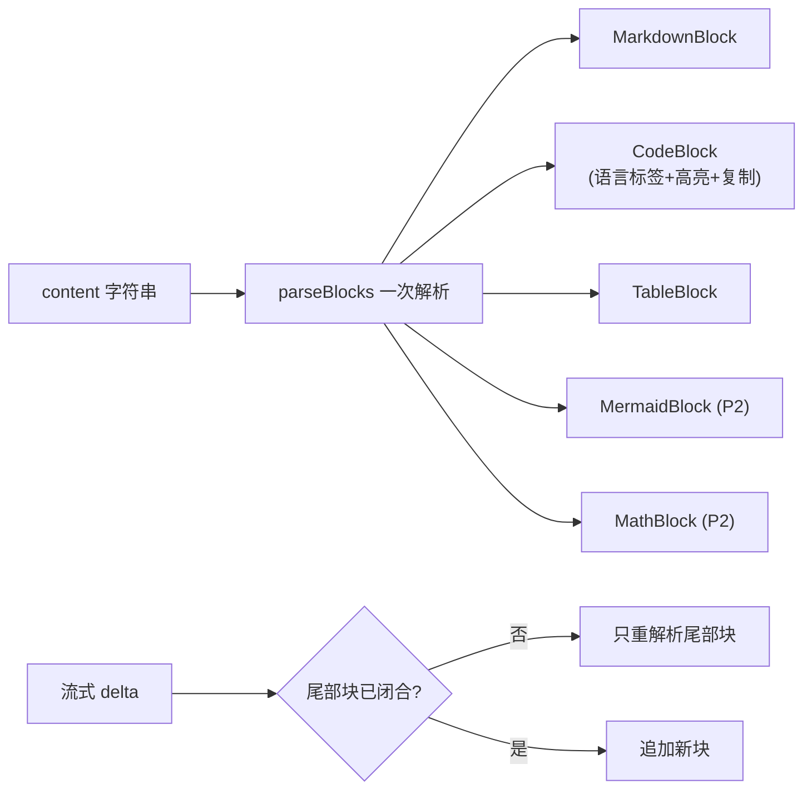

# Lattice AI 输出体验设计方案（Message Output UI）

> 日期：2026-10-24 · 分支：`phase/p1-rust-ai` · 状态：提案（待评审）
> 关联文档：`doc/AI/地基/Lattice-AI地基架构方案.md`（本方案消费其 NormalizedStreamEvent / ModelCapabilities / trace 事件）
> 执行计划：`doc/AI/执行/AI升级执行方案.md`（U 系列批次分解，本文 P0–P2 的落地序列）

**目标：** 把 AI 回答的展示层做成市场上第一梯队的水平——调研 ChatGPT Canvas、Claude Artifacts、Perplexity、Cursor 四个商业标杆与 Cherry Studio、Open WebUI、LobeChat 三个 GitHub 头部开源客户端后，**选用被反复验证的模式**，并结合笔记应用的本质差异点（输出是知识资产，不是聊完即弃的对话）给出落地设计。

**设计立场：** 现有底子比想象中好（流式、思维链折叠、行内引用跳转、可撤销执行、指标行都已存在）。本方案不重做面板，而是：①补齐明显缺位的基础件（代码高亮、成本、悬停引用）；②把分散的三块执行信息统一成一条时间线；③引入 Cherry Studio 验证过的 **MessageBlock 块架构** 解决长回复性能；④做别人没有的"输出沉淀为知识"。

---

## 1. 市场调研结论

### 1.1 标杆扫描

**商业产品：**
- **ChatGPT Canvas / Claude Artifacts**：2024–2026 的主线趋势是"从单线程聊天走向并排工作区"——长文档/代码不再挤在气泡里，而是侧边面板 + 对话内联编辑 + 变更跟踪。Claude 2026 进一步走向**会话内按需生成 UI**（generative UI）。
- **Perplexity**：把"可验证性"做成核心卖点——行内引用悬停即出来源卡片、搜索步骤折叠展示。
- **Cursor**：Agent 步骤时间线（读文件→检索→改文件，每步可展开）是 agent 类输出的公认形态。

**GitHub 开源客户端（与"顶级开放模型"取向一致）：**
- **Cherry Studio**（桌面端，300+ 供应商）：v1.3.3 重构为 **MessageBlock 块化消息结构** + 虚拟列表解决长对话卡顿；思维链可折叠、LaTeX/HTML 预览齐备。
- **Open WebUI**：对推理模型一等支持（`<think>` 渲染为可折叠块）；**Mermaid 图表直接渲染**；Artifacts 支持 HTML/CSS/JS 实时预览。
- **LobeChat**：公认最好看的开源 UI，代码高亮/LaTeX/Mermaid 全量渲染管线 + Artifacts 面板。

### 1.2 模式共识与取舍矩阵

2026 年设计文章的共识（流式+停止、思维链透明、可验证引用、可见的工具调用、Markdown+文档预览）全部命中下列矩阵；**取舍列是本方案的决策**：

| 输出模式 | 商业标杆 | 开源标杆 | Lattice 现状 | 取舍 |
|---|---|---|---|---|
| 流式 + 停止 | 全部 ✅ | 全部 ✅ | ✅ 已有（durable run 不中断） | 保持 |
| Markdown / GFM 表格 | ✅ | ✅ | ✅ 已有（marked + 白名单消毒） | 保持 |
| 代码块：高亮 + 语言标签 + 复制 | ✅ | ✅ | ⬜ 仅注入复制按钮，无高亮无标签 | **P0 采纳** |
| 思维链折叠（流式实时） | ✅ | ✅（think→details） | ✅ 已有，但纯文本渲染 | P1 升级为 markdown |
| 行内引用可跳转 | Perplexity 悬停预览 | Cherry Studio ✅ | ✅ 已有 [n] 芯片 + 跳笔记 | **P1 加悬停预览卡** |
| Agent 步骤时间线 | Cursor ✅ | — | ⬜ 进度清单/工具记录/已执行 三块分散 | **P1 统一时间线** |
| 用量与成本 | ChatGPT 用量 ✅ | — | token/时延 ✅，无成本 | **P0 成本估算** |
| 模型徽标（本机/开放权重） | — | — | ⬜ | **P0**（挂地基 ModelCatalog） |
| 输出沉淀（存为笔记/引用进笔记） | — | — | ⬜ | **P0 差异化**：别人没有 |
| Artifacts / 并排画布 | Canvas / Artifacts ✅ | Open WebUI ✅ | ⬜ | P2 长文草稿面板（笔记应用天然有落点） |
| Mermaid / 公式渲染 | 公式 ✅ | Open WebUI Mermaid 一等、LobeChat 全量 | ⬜ | P2（Mermaid 优先：笔记场景图 > 公式） |
| 长对话性能（虚拟列表） | ✅ | Cherry Studio ✅ | ⬜ 全量 .map 渲染 | P2 |
| 变体切换（‹ 1/2 ›） | ChatGPT ✅ | — | ⬜ 重新生成覆盖原答案 | P2 |
| 反馈 👍👎 | ✅ | ✅ | ⬜ | P2（写入 trace 喂评估） |

### 1.3 明确不做的

- **任意 HTML/JS 实时预览**（Open WebUI Artifacts 的 HTML 模式）：模型输出直接当页面跑，与本项目"落盘必脱敏、不可信上下文不驱动执行"的安全立场冲突。Artifacts 若做，只做"受控白名单渲染"（SVG/Mermaid/Markdown 预览）。
- **会话内 generative UI**：2026 前沿但收益不明确，观望。

---

## 2. 现状盘点（代码事实，方案依据）

| 现有能力 | 位置 | 说明 |
|---|---|---|
| Markdown 渲染管线 | `web/src/lib/markdown.ts` | marked GFM + [[双链]]/![[嵌入]] 占位符 + `sanitizeHtml` 白名单消毒，安全可注入 |
| 消息解剖 | `web/src/components/ai/AiMessageList.tsx` | 思维链 details → 进度清单 → 正文 → 附件 → 已执行+撤销 → 工具记录 → 指标行 → 引用列表 → 建议芯片 → 操作（复制/重生成） |
| 流式视图 | 同上 `AiStreamingMessage` | 思维链实时滚动 + 完成自动收起、打字点、状态文案 |
| 行内引用 | TreeWalker 后处理 `[n]` → 芯片 | 点击跳笔记（标题+锚点+摘录），引用列表高亮回闪 |
| 停止/恢复 | 面板 `stopGenerating` + durable run | 停止只停渲染，后台 Run 不中断（既有 ADR 语义） |
| 指标 | `meta.metrics` | TTFT、总时延、工具次数、token、上下文预算占用 |
| 缺位 | — | 代码高亮/语言标签、引用悬停预览、成本、模型徽标、统一时间线、Mermaid、存为笔记、虚拟列表 |

---

## 3. 设计原则

| # | 原则 | 含义 |
|---|---|---|
| O1 | **输出即知识资产** | 笔记应用的回答不是聊完即弃：一键存为笔记（引用自动转 [[双链]]）、插入当前笔记。这是相对所有聊天客户端的差异化 |
| O2 | **信任可见** | 每个回答自带"凭据"：可跳转引用、可展开思维链、可审计的执行时间线、真实的模型/成本徽标 |
| O3 | **平静渐进** | 流式期间不打扰（沿用滚动意图判定），思维链完成后自动收起，工具执行折叠成一行摘要 |
| O4 | **性能预算** | 长回复块化渲染（只重解析尾部块）、长会话虚拟列表、每块 memo |
| O5 | **安全底线** | 模型输出永远是不可信输入：白名单消毒不变；新增渲染能力（Mermaid/公式）必须沙箱化/关闭 trust |

---

## 4. 消息解剖（目标态线框）

```text
┌─ AI ─────────────────────────────────────────────────┐
│ ▸ 思考过程 · 4.2s                    [流式时: 实时更新] │  ← ReasoningBlock：markdown 渲染，完成自动折叠
│ ├── Agent 时间线 ────────────────────────────────────┤
│ │ ▸ 6 步 · 检索 2 · 读取 3 · 写入 1（已确认） · 全部完成 │  ← UnifiedTimeline：合并现有三块
│ ├─────────────────────────────────────────────────────┤
│ │ 正文 markdown……                                     │
│ │   引用芯片 [1][2] 悬停 → ┌──────────────────┐       │  ← CitationChip：hover 300ms 出预览卡
│ │                         │ 笔记标题 › 锚点    │       │     （标题/路径/摘录，点击才跳转）
│ │                         │ 摘录两行…          │       │
│ │ ┌ python ──────────────┐└──────────────────┘       │  ← CodeBlock：语言标签 + 高亮 + 复制 + 换行开关
│ │ │ print("hello")       │                            │
│ │ └──────────────────────┘                            │
│ ├─────────────────────────────────────────────────────┤
│ │ 📎 来源 3 ─────────────────────────────────────────  │  ← 引用列表（现有，保留）
│ │ 💡 建议芯片（现有，保留）                              │
│ │ GLM-5.3 · 开放权重 · 本机 · 3.2s · 1.2k tok · ≈$0.00 │  ← MetaFooter：模型徽标 + 成本
│ │ [复制] [‹ 1/2 ›] [👍👎] [存为笔记] [插入当前笔记]      │  ← 操作行（P0 起逐步点亮）
└───────────────────────────────────────────────────────┘
```

各块的职责与数据来源：

| 块 | 数据来源 | 关键行为 |
|---|---|---|
| ReasoningBlock | `reasoning`（地基 §5.1 双格式归一后） | markdown 渲染；流式实时滚动；done 自动折叠并显示思考时长；无 reasoning 不渲染 |
| UnifiedTimeline | progress + toolExecutions + executed（现有 meta 三字段） | 单一时间线按发生序合并；图标区分 检索/读取/写入/MCP；失败红色；流式态自动展开、完成自动收起为一行摘要 |
| **FileChangesCard**（任务模式） | executed + executedOperations（现有 meta 字段） | **ZCode/Cursor 式变更卡片**：头部「N 个文件已更改 +新增 -删除」+ 撤销；行级 = 文件类型图标（按扩展名）+ 文件名 + Vault 相对路径 + 单文件 ±行数 + 「审查」（打开既有操作预览/diff）与「打开」（跳转笔记）。替换现有纯文本「已自动执行 N 项操作」details；±行数在操作预览构建时由前后内容计算，随 meta 传递 |
| ContentBlocks | `content` | 见 §5 块渲染管线 |
| CitationChip / 引用列表 | `references`（现有） | 正文 `[n]` 后处理不变；新增悬停预览卡（防抖 300ms，Esc/移出关闭）；**检索注入但正文未实际引用时不展示来源**（W1 后已收紧） |
| MetaFooter | `meta` + 地基 ModelCatalog | 模型徽标三态：`本机`（loopback 运行时）/ `开放权重` / 厂商名；成本 = promptCostPer1kUsd×输入 + completionCostPer1kUsd×输出（`aiSettings` 已有价格字段，未配置则只显示 token）；本机模型显示 `¥0 · 数据不出机器` |
| ActionsRow | — | 复制（现有）；重生成变体切换 ‹ n/m ›；👍👎 → trace 事件；**存为笔记 / 插入当前笔记**（见 §7） |

---

## 5. 块渲染管线（MessageBlock 架构，采纳 Cherry Studio 验证的模式）

**问题：** 现状每个流式 delta 都 `renderMarkdown(全文)` + `dangerouslySetInnerHTML` 整体重注入，长回复（数千 token + 多代码块）时主线程开销线性放大；代码复制按钮还要靠 DOM 后处理注入。

**方案：** content 一次性解析为有序块数组，React 按块渲染、按块 memo；流式时只有**尾部未闭合块**重解析。



- **CodeBlock（P0）**：`marked` renderer 定制 `code` 输出 → 语言标签 + `highlight.js`（按需注册常用 12 种语言，同步渲染无闪烁）+ 复制 + 软换行开关。弃用现有 TreeWalker 注入复制按钮的 DOM 后处理。
- **MermaidBlock（P2）**：仅当 ` ```mermaid ` 代码围栏出现时懒加载 mermaid，`securityLevel: 'strict'`（内部消毒，禁交互脚本），渲染失败回退为普通代码块；**不做**任意 HTML 预览（见 §1.3）。
- **MathBlock（P2）**：KaTeX（`trust: false`），仅在检测到 `$…$`/`$$` 时启用，避免给纯中文笔记场景引入全局成本。
- 双链 `[[…]]`/嵌入 `![[…]]` 的既有占位符逻辑保留在 MarkdownBlock 内（管线入口不变，`sanitizeHtml` 白名单仍是最后一道闸）。

---

## 6. 流式体验规范

| 状态 | 触发 | 展示 |
|---|---|---|
| 连接/检索 | enqueue 后 | 状态行"正在检索知识与文件上下文…"+ 打字点（现有） |
| 思考中 | 首个 reasoning 事件 | ReasoningBlock 展开实时滚动（现有，升级 markdown） |
| 生成中 | 首个 delta | 正文块渐进渲染；尾部块光标；自动折叠思维链 |
| 工具执行 | tool_call / 时间线事件 | 时间线展开实时追加步骤 |
| 等待确认 | waiting_confirmation | 现有确认卡片（不变），时间线置"等待确认" |
| 完成 | done | MetaFooter 点亮；时间线收起为一行摘要 |
| 停止/失败 | cancel / error | 现有语义不变（停止只停渲染，后台 Run 继续可恢复） |

自动滚动沿用现有"滚动意图"判定（用户上翻则不跟随），此行为已是正确实现，仅随块架构平移。

---

## 7. 交互细节与差异化

1. **引用悬停预览卡（P1，Perplexity 模式）**：正文 `[n]` 与底部引用列表均支持；300ms 防抖；卡片含 标题›锚点、路径、两行摘录；点击才真正跳转（与现有 `onOpenNote(noteId, {heading, excerpt})` 对接，零后端改动）。
2. **存为笔记（P0，差异化）**：把该回答转为一篇新笔记——正文 + 末尾"来源"一节，引用自动转 `[[笔记标题]]` 双链；标题取首行或让用户改；走 WorkspaceService 正常写路径（含审计）。对话与笔记从此互通：AI 产出的知识进入图谱。
3. **插入当前笔记（P1）**：在光标处插入回答引用块（`> 引用自 AI 会话 · [[来源]]`），与写作助手共用写边界。
4. **变体切换（P2，ChatGPT 模式）**：重新生成不覆盖，保留历史变体，`‹ 1/2 ›` 切换，仅会话内存不落盘。
5. **反馈（P2）**：👍👎 写入 trace 事件（`run_id` 关联），作为金标集之外的质量信号——与地基 §5.6 评估闭环衔接。

---

## 8. 与地基方案的接口

- **事件**：`NormalizedStreamEvent` 五类（Meta/Delta/Reasoning/ToolCall/Done）已覆盖本方案全部展示需求；`<think>` 标签归一由 openai Adapter 承担（地基 §5.1），UI 永远只认归一事件。
- **能力 → UI**：`ModelCapabilities.native_tools=false` 时任务模式入口置灰并提示原因（地基 §5.5 降级链的 UI 侧）；`open_weights` / 本机运行时 → MetaFooter 徽标（地基 §5.1 ModelSource）。
- **指标**：MetaFooter 的 TTFT/token/成本数据源 = 地基 `core/trace` 落库的 `ModelCall` 事件；价格来自 `aiSettings` 既有 `promptCostPer1kUsd/completionCostPer1kUsd`。
- **渲染层归属**：本方案全部在 L4（web），不新增 IPC；唯一例外是"存为笔记"复用既有文件写命令。

---

## 9. 分阶段落地

| 阶段 | 内容 | 工期 | 判据（`npm run verify` 全绿） |
|---|---|---|---|
| **P0 基础件补齐** | CodeBlock（语言标签+高亮+复制+换行）· MetaFooter 模型徽标 + 成本估算 · 存为笔记 | ~1 周 | markdown 既有测试全绿 + 新增 code/成本/存笔记 web 测试 |
| **P1 结构升级** | MessageBlock 块架构（含流式尾部增量）· ReasoningBlock markdown 化 · 引用悬停预览 · UnifiedTimeline · **FileChangesCard 文件变更卡片**（任务模式写操作：图标/路径/±行数/审查/打开/撤销） | ~1.5 周 | 长回复渲染不整段重注入（测试断言块数）；时间线夹具（progress/toolExecutions 合并序）；±行数计算纯函数单测 |
| **P2 富媒体与规模** | MermaidBlock（strict 沙箱）· KaTeX · 变体切换 · 虚拟列表 · 反馈进 trace | ~1.5 周 | mermaid 失败回退用例；1000 条消息滚动 60fps（手测）；反馈事件过 sanitize |

P0/P1 完全不依赖地基 F0（消费的是既有字段）；P2 的徽标完整态依赖地基 ModelCatalog 上线。

---

## 10. 安全基线

1. 模型输出（含 reasoning、引用标题、工具 label）一律经 `sanitizeHtml` 白名单后再注入，新增块类型不得绕过；
2. Mermaid 仅 `securityLevel: 'strict'`，懒加载，失败回退代码块；**永不**渲染模型输出的任意 HTML/JS（明确拒绝 Open WebUI Artifacts 的 HTML 模式）；
3. KaTeX `trust: false`、`maxSize` 受限；
4. 悬停预览卡只读，不执行任何跳转副作用（点击才跳）；
5. "存为笔记"走 WorkspaceService 正常写边界（preview→confirm→audit→undo），AI 生成内容进入 Vault 前不做任何特权豁免。

---

## 附：调研来源

- [TheFrontKit · AI Chat UI Best Practices for 2026](https://thefrontkit.com/blogs/ai-chat-ui-best-practices)
- [Fuselab · Chatbot UI Design Patterns and Best Practices 2026](https://fuselabcreative.com/chatbot-interface-design-guide)
- [Setproduct · AI Chat Interface UI Design and the States Users Never See](https://www.setproduct.com/blog/ai-chat-interface-ui-design)
- [ShantiInfosoft · AI Chat UI Design: Best Practices for 2026](https://shantiinfosoft.com/blog/designing-ai-chat-interfaces)
- [Medium/bestfolios · 7 Essential AI UX Patterns in Action](https://medium.com/bestfolios/building-trust-and-enhancing-interactions-7-essential-ai-ux-patterns-in-action-12e7604de435)
- [Altar.io · Claude Artifacts, ChatGPT Canvas, and Perplexity Spaces](https://altar.io/next-gen-of-human-ai-collaboration)
- [MindStudio · Claude On-Demand Generative UI vs Canvas/Artifacts](https://www.mindstudio.ai/blog/claude-on-demand-generative-ui-vs-canvas-artifacts)
- [Markloop · AI Agent Artifact Sharing in 2026](https://markloop.io/blog/claude-artifact-sharing-compared)
- [Cherry Studio 官网](https://cherryai.com.cn) · [外观/消息渲染设置文档](https://cherryai.com.cn/docs/zh-cn/pre-basic/settings/display) · [OSCHINA v1.3.3 发布报道（MessageBlock 重构/虚拟列表）](https://www.oschina.net/news/350183)
- [Open WebUI · Reasoning & Thinking Models](https://docs.openwebui.com/features/chat-conversations/chat-features/reasoning-models) · [MermaidJS Rendering](https://docs.openwebui.com/features/chat-conversations/chat-features/code-execution/mermaid)
