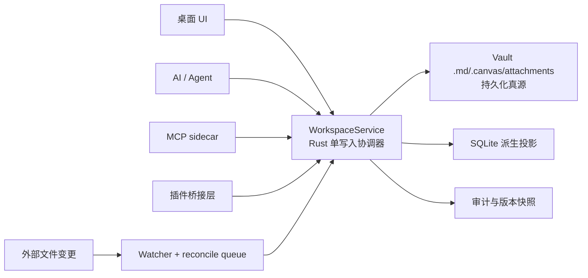
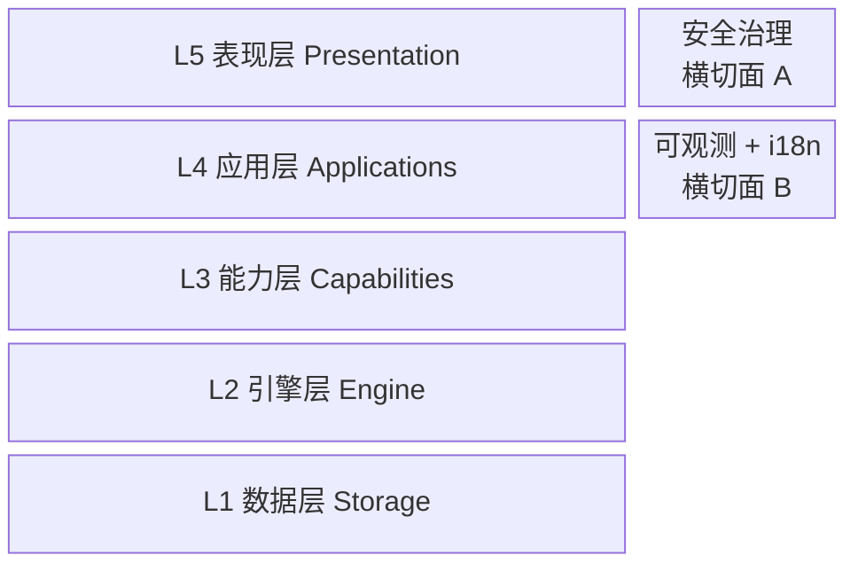
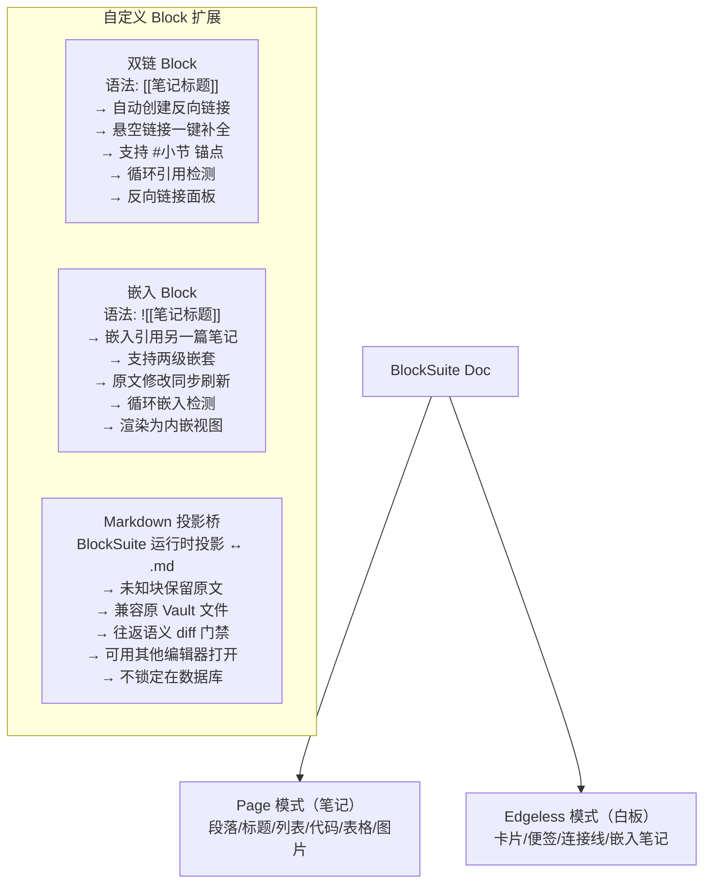
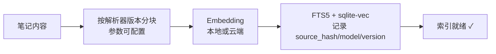
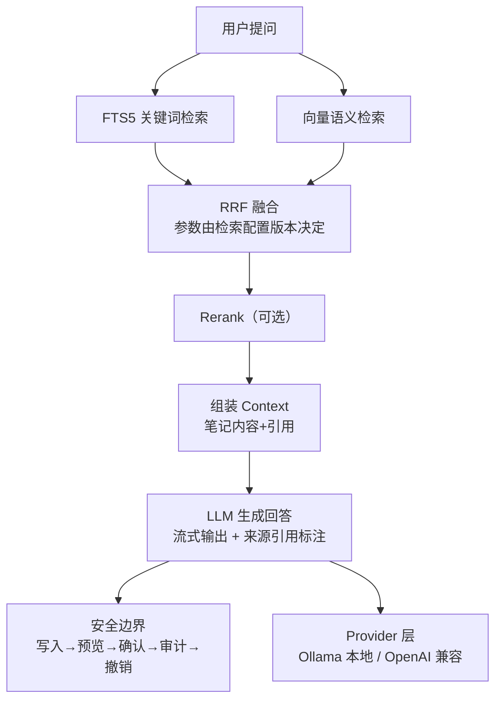
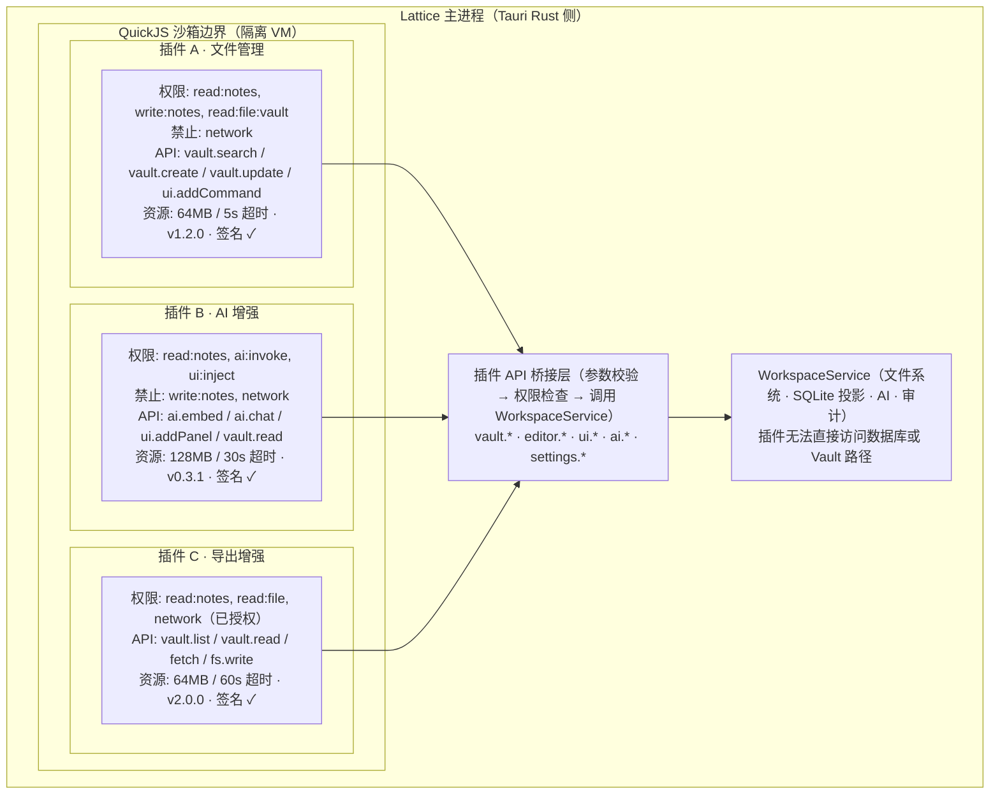
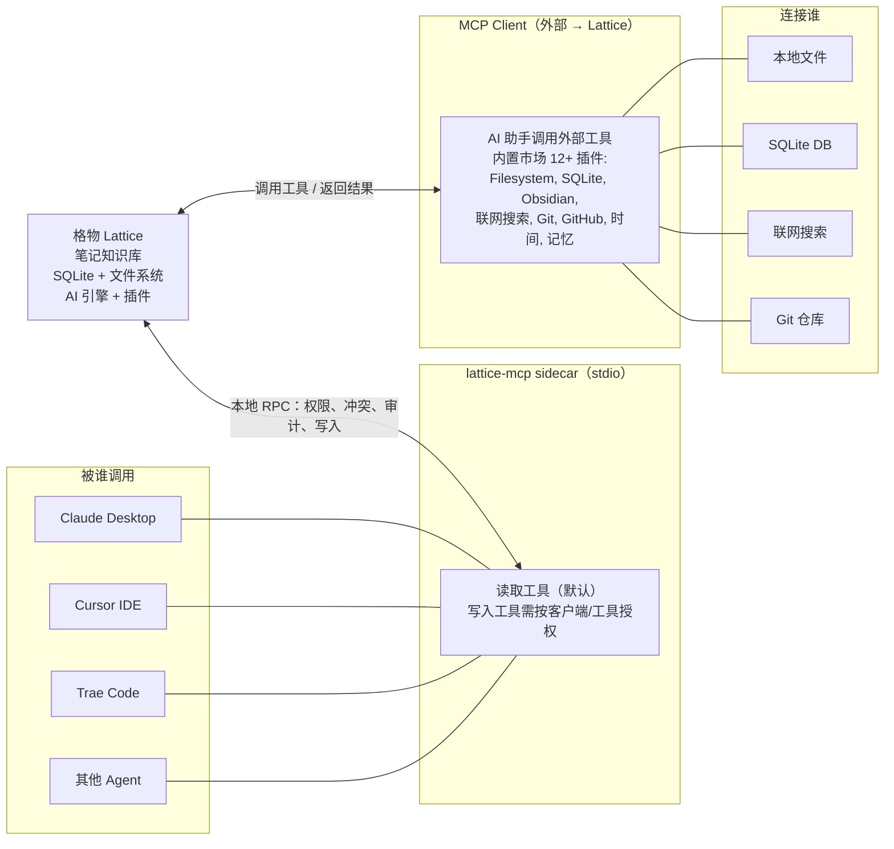
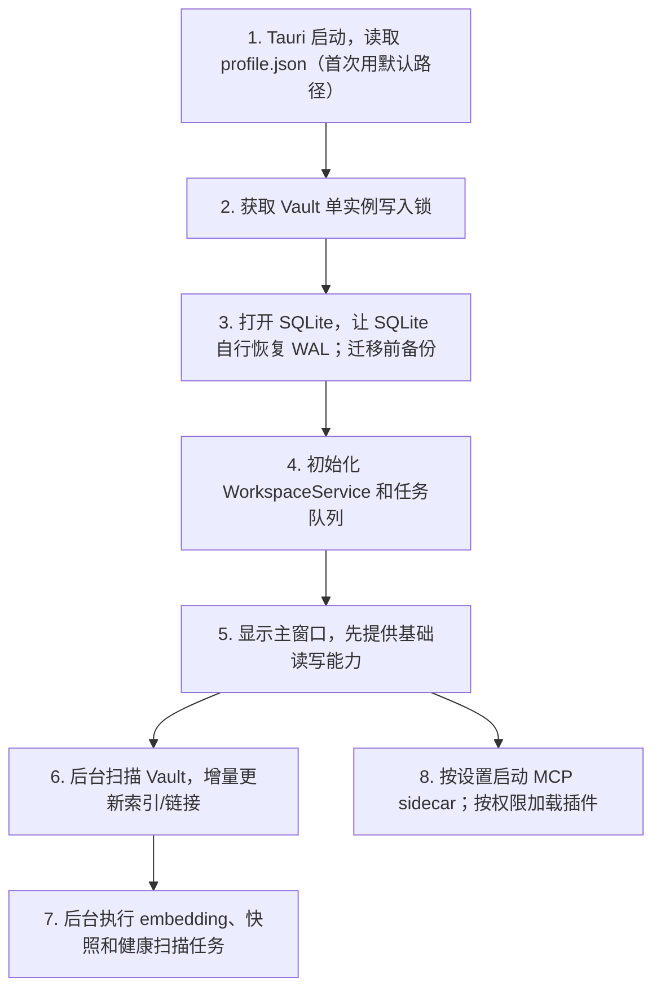
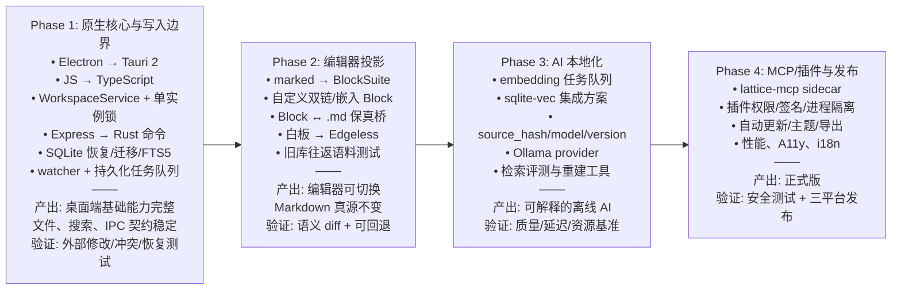

# 格物 Lattice · 单机版顶级架构说明书 v1.1

> **技术栈**：Tauri 2 · BlockSuite · React 18 · TypeScript · SQLite · sqlite-vec · QuickJS · MCP
> **许可证**：Mulan PSL v2 ｜ **日期**：2026-10-13 ｜ **形态**：Local-First 单机版
> **v1.1 修订**：明确数据真源、单写入协调器、SQLite 恢复策略、MCP sidecar、插件信任边界和向量索引元数据。

## 目录

- [01 设计哲学与核心原则](#01-设计哲学与核心原则)
- [01A 架构契约与不变量](#01a-架构契约与不变量)
- [02 架构总览图](#02-架构总览图)
- [03 技术选型一览](#03-技术选型一览)
- [04 五层架构详解（L1-L5）](#04-五层架构详解l1-l5)
- [05 核心模块设计：编辑器引擎](#05-核心模块设计编辑器引擎)
- [06 核心模块设计：AI 引擎](#06-核心模块设计ai-引擎)
- [07 核心模块设计：插件系统](#07-核心模块设计插件系统)
- [08 核心模块设计：MCP 双向集成](#08-核心模块设计mcp-双向集成)
- [09 数据架构与存储设计](#09-数据架构与存储设计)
- [10 安全设计](#10-安全设计)
- [11 启动流程](#11-启动流程)
- [12 项目结构](#12-项目结构)
- [13 迁移路径](#13-迁移路径渐进式)
- [14 与原项目对比](#14-与原项目对比)

---

## 01 设计哲学与核心原则

| 原则 | 含义 |
|---|---|
| **本地优先** | 所有数据存储在用户本地磁盘，断网完全可用，不依赖任何云端服务 |
| **数据归用户** | 笔记以 Markdown 文件直接存于 Vault 目录，可用任意编辑器打开，不锁定在数据库黑盒里 |
| **核心零服务器** | 桌面核心后端运行在 Tauri Rust 进程内，无 Express/Node 服务端口；MCP sidecar 和 Ollama 是明确的可选外部运行时 |
| **AI 可离线** | 配置并运行本地模型（Ollama）后，断网也能用 AI 问答和写作助手；云端模型可选 |
| **插件受控执行** | 第三方插件在 QuickJS 和最小权限桥接中运行；高风险能力需要独立进程/OS 沙箱，不能只依赖 VM 隔离 |
| **零厂商锁定** | 全栈开源，数据格式开放，用户可随时迁移到其他工具 |
| **不做过度设计** | 单机模式不引入协作、同步、移动端，保持架构精简 |

---

## 01A 架构契约与不变量

以下约束优先于具体实现。任何实现偏离都必须先更新本节和对应 ADR。

| 契约 | 定义 |
|---|---|
| **持久化真源** | Vault 中的 `.md`、`.canvas` 和附件是用户数据的唯一持久化真源；BlockSuite 文档和 SQLite 都是可重建的派生状态。 |
| **单写入入口** | UI、AI、MCP、插件和外部文件变更最终都经过 Rust `WorkspaceService`；外部进程不得直接修改 `lattice.db`。 |
| **投影一致性** | 文件写入成功不等于索引已完成；索引、链接、向量和图谱更新必须有状态、重试和可观测的后台任务。 |
| **编辑器保真** | Markdown 不支持的语法必须以原文块或扩展节点保留，禁止静默丢失；`Markdown → BlockSuite → Markdown` 由固定语料库验证。 |
| **并发策略** | 同一 Vault 默认单实例写入；第二实例和独立 MCP 进程只能通过受控 API 访问，冲突使用内容哈希检测。 |
| **派生索引** | 全文索引、链接、标签、向量和健康检查结果都带来源哈希/版本，必要时可删除并从 Vault 重建。 |
| **隐私边界** | “本地优先”不等于“内容已加密”。若启用内容保密，必须同时覆盖 Markdown、版本快照、附件和索引，而不是只加密 SQLite。 |

### 推荐的写入边界



---

## 02 架构总览图

**五层正交 + 两面横切**



> 注：横切面 A（安全治理）与横切面 B（可观测 + i18n）纵贯所有五层。

### 各层包含组件

| 层 | 组件 |
|---|---|
| **L5 表现层 Presentation** | Tauri 桌面（Win/Mac/Linux）、React + TS（Vite 5 / Zustand）、静态导出、主题系统（Tailwind + CSS Var） |
| **L4 应用层 Applications** | 笔记、白板 Canvas、图谱 Graph、Inbox、AI 助手、设置 |
| **L3 能力层 Capabilities** | AI 引擎（混合检索 RAG / 写作助手 Agent）、MCP sidecar（Server + Client）、全文搜索（FTS5 trigram 中文子串）、插件运行时（QuickJS + 权限模型）、知识健康（悬空链接/孤立 / Review）、后台任务队列 |
| **L2 引擎层 Engine** | BlockSuite（块编辑器 + 白板统一）、双链引擎（`[[]]` / `![[]]`）、事件总线（发布订阅）、Markdown 互转（Block ↔ .md） |
| **L1 数据层 Storage** | SQLite（FTS5 + sqlite-vec，均为派生投影）、文件系统（Vault .md/.canvas）、可选内容加密、版本快照（增量备份）、Keychain（凭证存储） |

L5 与下层之间通过 **IPC** 通信。

### 横切面 A：安全治理

- Markdown 消毒器 (XSS)
- MCP 默认只读
- AI 写入审计 + 撤销
- 插件权限沙箱
- 凭证系统 Keychain
- 非回环地址强制 Token
- SQL 白名单只读
- viewer 禁止 MCP 写入
- AI 路由二次认证
- 不可信内容隔离
- 操作审计日志
- IP 私网检测

### 横切面 B：可观测 + i18n

- 结构化日志
- 性能埋点
- 错误收集 + 崩溃报告
- IPC 健康检查与诊断导出
- 自动更新检查
- 多语言 (zh/en)
- 无障碍 (A11y)
- 遥测（可关闭）
- 数据库迁移
- 索引一致性检查
- SQLite checkpoint 与恢复诊断（禁止启动时删除 WAL/SHM）

---

## 03 技术选型一览

| 层 | 组件 | 选型 | 替代原项目 | 选型理由 |
|---|---|---|---|---|
| L5 表现层 | 桌面壳 | **Tauri 2** | Electron | 包体 15MB vs 150MB，内存降 60%，原生性能，一套代码出三平台 |
| L5 表现层 | 前端框架 | React 18 + TypeScript | React + JS | 类型安全，可维护性大幅提升 |
| L5 表现层 | 状态管理 | Zustand | Preact Signals | 主流生态，TS 友好，调试工具丰富 |
| L4 应用层 | 路由 | 无（两视图内嵌） | 同 | 笔记+图谱两视图，不需要路由库 |
| L4 应用层 | 样式 | Tailwind + CSS Variables | 散落 styles.css | 主题系统统一，暗色/亮色切换 |
| L3 能力层 | AI Provider | OpenAI 兼容 + Ollama | 仅云端 OpenAI | 本地模型可离线，隐私优先 |
| L3 能力层 | 向量检索 | sqlite-vec（需明确静态/动态集成方案） | 外部服务 | 与 SQLite 投影统一版本；性能不足时再按基准分库 |
| L3 能力层 | 插件沙箱 | Rust QuickJS 宿主（`rquickjs` 等）+ 权限桥接；第三方插件可选独立进程 | 无 | QuickJS 不是 OS 沙箱，桥接层和签名链必须单独防护 |
| L3 能力层 | MCP | 独立 `lattice-mcp` sidecar + 本地受认证 RPC | Node stdio | 外部客户端启动 sidecar；sidecar 不直接写数据库 |
| L2 引擎层 | 编辑器 | **BlockSuite** | 自研 marked | 开源块编辑器天花板，统一笔记+白板数据模型 |
| L2 引擎层 | 双链引擎 | BlockSuite 扩展 | 自研 | `[[双链]]` `![[嵌入]]` 作为自定义 Block |
| L1 数据层 | 主数据库 | SQLite (`rusqlite` bundled) | node:sqlite | FTS5 全文检索保留，Rust 侧原生驱动；文档与实际依赖保持一致 |
| L1 数据层 | 文件存储 | Vault 文件系统 | 同（保留） | Markdown 直接存磁盘，用户可控 |
| L1 数据层 | 加密 | AES-256-GCM + 系统 Keychain | safeStorage | 明确区分“凭证加密”和“内容加密”；内容加密需覆盖 Vault 与版本快照 |
| L1 数据层 | 版本控制 | 增量快照 | 时间戳备份 | 省空间，可回溯任意版本 |

---

## 04 五层架构详解（L1-L5）

### L1 数据层 Storage

Vault 文件是用户数据的持久化真源；SQLite、向量和图谱都是可删除重建的派生投影。所有读写都由 L2/L3 的受控服务访问，不直接暴露给前端或插件。

| 组件 | 职责 | 关键设计 |
|---|---|---|
| SQLite | 索引、标签、AI 配置、MCP 审计、笔记元数据、任务状态 | FTS5 trigram 分词（中文子串匹配）+ sqlite-vec；每个派生索引记录来源哈希、解析器/模型版本 |
| 文件系统 | Markdown 原文、Canvas 白板、图片附件 | 用户可直接用其他编辑器打开，不锁定在数据库 |
| 加密 | API Key 密文存储；可选内容加密 | AES-256-GCM，密钥用系统 Keychain；内容加密必须覆盖 Markdown、快照、附件和索引 |
| 版本快照 | 笔记历史版本与恢复 | 增量 diff + 定期完整快照；包含来源哈希、版本号和保留策略；恢复操作进入审计 |

### L2 引擎层 Engine

核心引擎，提供编辑器、双链、事件分发等基础能力。

| 组件 | 职责 | 关键设计 |
|---|---|---|
| BlockSuite | 块编辑器运行时投影 | Page 模式（笔记）/ Edgeless 模式（白板）；不取代 Markdown/.canvas 真源 |
| 双链引擎 | `[[标题]]` 双向链接 / `![[标题]]` 嵌入引用 | 解析结果写入派生表；定义路径、标题、别名和重复标题的解析优先级 |
| 事件总线 | 模块间解耦通信 | 事件只负责通知；需要可靠性的索引、向量和快照更新必须进入持久化任务队列 |
| Markdown 互转 | BlockSuite 运行时投影 ↔ .md 文件 | 保留 frontmatter、HTML、公式、嵌套列表、双链和未知块；以语义往返测试作为发布门禁 |

### L3 能力层 Capabilities

具体业务能力，调用 L2 引擎和 L1 数据。

| 组件 | 职责 | 关键设计 |
|---|---|---|
| AI 引擎 | 混合检索 RAG、写作助手、Agent 任务模式 | FTS5 关键词 + 向量检索 RRF 融合；K、top_n、分块参数版本化并由评测集调优 |
| MCP 双向 | sidecar Server（暴露笔记能力）+ Client（调用外部工具） | 默认只读；按客户端/工具/路径授权，写入需确认、审计和可撤销 |
| 全文搜索 | 中文全文检索 | FTS5 trigram + LIKE 兜底；AI 分块由解析器和配置版本决定 |
| 插件运行时 | 第三方插件加载与隔离 | QuickJS 运行时 + 最小权限桥接；资源限制和高风险进程隔离 |
| 知识健康 | 悬空链接、孤立笔记、重复检测 | Review 中心，定期扫描，可修复 |
| 任务队列 | 索引、embedding、快照和健康扫描 | 持久化状态、重试、取消、幂等和失败诊断 |

### L4 应用层 Applications

面向用户的功能模块，组合 L3 能力。

| 模块 | 功能 |
|---|---|
| 笔记 | 编辑/预览/分栏三模式，900ms 静默自动保存，多标签页 |
| 白板 | Canvas 画布，兼容 Obsidian .canvas 格式 |
| 图谱 | 力导向布局，按度数缩放，双链可视化 |
| Inbox | 待整理/整理中/已处理，AI 整理建议 |
| AI 助手 | 流式对话、知识库问答、写作助手、每日摘要 |
| 设置 | AI 模型配置、MCP 插件市场、主题、导入导出 |

### L5 表现层 Presentation

| 平台 | 技术 | 说明 |
|---|---|---|
| 桌面 | Tauri 2 | Windows/macOS/Linux 原生窗口，系统托盘，自动更新 |
| 静态导出 | TypeScript 前端能力 | 导出 HTML/PDF/静态站点；不提供浏览器直接编辑 Vault 的运行模式 |
| 主题 | CSS Variables | 暗色/亮色/自定义主题包 |

---

## 05 核心模块设计：编辑器引擎

### BlockSuite 数据模型与双链扩展



**设计要点**：双链和嵌入在编辑器中使用 BlockSuite 自定义 Block，但持久化仍回到 Markdown 语法；搜索、AI 索引和图谱使用解析后的派生投影。BlockSuite 不是第二份真源，未知 Markdown 结构必须降级为可保真的原文块。

**必须定义的解析规则**：

- 链接解析顺序为“显式路径 > 唯一标题 > 显式别名”；重复标题不能静默选择目标。
- 移动/重命名笔记时，链接更新必须是一个可预览、可撤销的操作。
- 嵌入只允许有限深度，检测循环时返回明确错误状态，不把错误内容写回原文。
- frontmatter、HTML、公式、表格、嵌套列表和未知扩展都必须有往返测试样本。

---

## 06 核心模块设计：AI 引擎

### AI 混合检索 + RAG 管线

**索引管线（写入后进入后台任务队列）**



**查询管线（用户提问时）**



**AI 能力清单**

1. 知识库问答（带来源引用）
2. 写作助手（润色/摘要/翻译/续写）
3. Agent 任务模式（多轮+审计+撤销）
4. Inbox 整理建议
5. 每日摘要（定时生成）
6. 知识健康分析
7. 检索调试视图

→ 默认本地模型，可切换云端；切换提供者或模型后必须显式重建受影响的 embedding。

### AI 运行约束

- Ollama 是可选外部运行时，不属于 Lattice 二进制内的零依赖；启动时检查可用性并在 UI 中明确显示。
- embedding 表必须保存 `source_hash`、`model_id`、`model_version`、`dimensions` 和 `chunker_version`。
- AI 写入按操作建立事务边界；多文件任务支持部分失败、重试、撤销和冲突提示。
- 检索评估至少记录 Recall@K、MRR/nDCG、首 token 延迟、总延迟和内存，不能只用新旧结果重叠率判断质量。
- 外部 MCP 返回值和笔记内容都视为不可信数据，必须与系统指令隔离，不能仅靠 Markdown 消毒器防 prompt injection。

> **保留的核心设计**：原项目的 FTS5 + 向量混合检索思路继续保留，但 RRF、分块和 top_n 都作为可版本化参数，通过 golden set 和性能基准调优。新增本地模型支持（Ollama）和 sqlite-vec 集成，使 AI 在满足本地运行时条件时可以离线工作。

---

## 07 核心模块设计：插件系统

### 插件沙箱架构与权限模型

QuickJS 只负责限制 JavaScript 运行时能力，不提供操作系统级安全边界。第三方插件必须先经过签名、版本、来源和权限校验；需要网络或文件系统能力的插件通过最小权限桥接，风险较高的插件使用独立进程或平台沙箱。



### 权限模型

| 权限 | 说明 | 默认 |
|---|---|---|
| `read:notes` | 读取笔记内容 | 需确认 |
| `write:notes` | 创建/修改/删除笔记 | 需确认 |
| `read:file:vault` | 读取 Vault 目录文件 | 需确认 |
| `write:file:vault` | 写入 Vault 目录文件 | 禁止 |
| `network` | 网络请求 | 禁止 |
| `ai:invoke` | 调用 AI 引擎 | 需确认 |
| `ui:inject` | 注入 UI 面板/命令 | 需确认 |
| `mcp:call` | 调用 MCP 工具 | 禁止 |

权限不是一次性开关。桥接层还必须执行路径白名单、网络域名白名单、单次调用超时、结果大小限制、并发限制和审计。插件清单需要包含签名、发布者、版本、依赖、权限理由和撤销状态；插件更新失败时保留上一版本。

---

## 08 核心模块设计：MCP 双向集成

### MCP Server + Client 双向数据流

Lattice 的 MCP Server 以独立 `lattice-mcp` sidecar 交付。Claude、Cursor 等客户端通过 stdio 启动 sidecar；sidecar 再通过一次性令牌保护的本地 IPC/RPC 调用正在运行的 Lattice。sidecar 不直接打开 `lattice.db`，也不直接修改 Vault，避免多个进程绕过写入协调器。



**安全边界**：默认只读；写入授权按客户端、工具和 Vault 路径细分，并要求用户确认；所有写入记审计日志并支持撤销。环境变量只能作为开发期覆盖，不能作为生产授权模型。

**配置存储**：Server 列表和非敏感配置可存 SQLite；API Key 只存系统 Keychain；sidecar 启动令牌短时、单次使用。Filesystem/SQLite 工具只能通过 WorkspaceService 访问当前 Vault，不允许把数据库路径直接暴露给外部进程。

> **为什么 MCP 是生态关键**：MCP 让 Lattice 既是**知识提供者**（Claude/Cursor 可以搜你的笔记），又是**工具消费者**（AI 助手可以操作文件、搜索网络、查 Git）。这是笔记软件成为 AI Agent 知识库的核心协议，也是单机生态的基石。

---

## 09 数据架构与存储设计

### Vault 目录结构

```text
Vault/                           ← 用户可选的任意目录
├── 项目笔记/
│   ├── 重构计划.md              ← Markdown 原文，可直接用其他编辑器打开
│   └── 架构设计.md
├── 日常记录/
│   └── 2026-10-13.md
├── 画板/
│   └── 系统设计.canvas          ← 白板，兼容 Obsidian .canvas 格式
├── attachments/                 ← 图片附件
│   └── screenshot.png
├── templates/                   ← 笔记模板
│   └── 读书笔记.md
└── .lattice/                    ← 隐藏目录，Lattice 内部数据
    ├── lattice.db               ← SQLite 主库（索引/标签/AI配置/MCP审计）
    ├── lattice.db-wal           ← SQLite 运行时文件，由 SQLite 自己恢复/checkpoint
    ├── lattice.db-shm           ← SQLite 运行时文件，不得启动时直接删除
    ├── lock                      ← Vault 单实例写入锁
    ├── jobs/                     ← 索引、embedding、快照任务状态
    ├── versions/                ← 笔记历史快照（增量 diff）
    │   └── 2026/10/13/重构计划/
    │       ├── v001.diff
    │       └── v002.diff
    ├── plugins/                 ← 已安装插件
    │   ├── file-manager/
    │   │   ├── manifest.json
    │   │   ├── main.js
    │   │   └── permissions.json
    │   └── ai-enhance/
    ├── themes/                  ← 自定义主题
    │   └── midnight.css
    ├── mcp-config.json          ← MCP sidecar 配置（密钥引用，不明文）
    └── profile.json             ← 非敏感配置（inbox/daily/journal 路径）
```

### SQLite 表结构（核心表）

```sql
-- 笔记元数据（原文在文件系统）
CREATE TABLE notes (
  path        TEXT NOT NULL,           -- Vault 内相对路径
  title       TEXT,
  content_hash TEXT NOT NULL,
  parser_version TEXT NOT NULL,
  created_at  TEXT NOT NULL,
  updated_at  TEXT NOT NULL,
  word_count  INTEGER DEFAULT 0,
  is_archived INTEGER DEFAULT 0,
  index_state TEXT NOT NULL DEFAULT 'pending',
  PRIMARY KEY (path)
);

-- 每个连接都必须开启；迁移和测试均验证外键约束生效。
PRAGMA foreign_keys = ON;

-- 全文检索（FTS5 trigram 分词）
CREATE VIRTUAL TABLE notes_fts USING fts5(
  path, title, content,
  tokenize = 'trigram'               -- 中文子串匹配
);

-- 向量索引（sqlite-vec）
CREATE TABLE note_chunks (
  note_path TEXT NOT NULL,
  chunk_id INTEGER NOT NULL,
  source_hash TEXT NOT NULL,
  chunker_version TEXT NOT NULL,
  content TEXT NOT NULL,
  PRIMARY KEY (note_path, chunk_id),
  FOREIGN KEY (note_path) REFERENCES notes(path) ON DELETE CASCADE
);

CREATE VIRTUAL TABLE note_embeddings USING vec0(
  note_path TEXT,
  chunk_id INTEGER,
  embedding FLOAT[384]
);

-- 双链关系
CREATE TABLE links (
  source_path  TEXT NOT NULL,
  target_path  TEXT,
  anchor       TEXT,                 -- [[标题#锚点]]
  type         TEXT DEFAULT 'link',  -- link | embed
  is_dangling  INTEGER DEFAULT 0,    -- 悬空链接
  UNIQUE (source_path, target_path, anchor, type),
  FOREIGN KEY (source_path) REFERENCES notes(path) ON DELETE CASCADE
);
CREATE INDEX ix_links_target ON links(target_path);

-- 标签
CREATE TABLE tags (
  name       TEXT PRIMARY KEY,       -- 支持 嵌套/路径
  created_at TEXT NOT NULL
);

CREATE TABLE note_tags (
  note_path TEXT NOT NULL,
  tag_name TEXT NOT NULL,
  PRIMARY KEY (note_path, tag_name),
  FOREIGN KEY (note_path) REFERENCES notes(path) ON DELETE CASCADE,
  FOREIGN KEY (tag_name) REFERENCES tags(name) ON DELETE CASCADE
);

-- AI 会话
CREATE TABLE ai_sessions (
  id         TEXT PRIMARY KEY,
  title      TEXT,
  messages   TEXT NOT NULL,          -- JSON
  created_at TEXT NOT NULL
);

-- AI 配置（密文存储）
CREATE TABLE ai_settings (
  key   TEXT PRIMARY KEY,
  value TEXT NOT NULL                -- AES-256-GCM 加密
);

-- MCP 审计日志
CREATE TABLE mcp_audit (
  id         INTEGER PRIMARY KEY,
  tool       TEXT NOT NULL,
  params     TEXT,
  result     TEXT,
  principal  TEXT,                   -- 调用者身份
  decision   TEXT NOT NULL,           -- allowed | denied | confirmed
  redacted   INTEGER NOT NULL DEFAULT 1,
  created_at TEXT NOT NULL
);

-- 笔记版本快照索引
CREATE TABLE note_versions (
  id         INTEGER PRIMARY KEY,
  note_path  TEXT NOT NULL,
  version    INTEGER NOT NULL,
  diff_path  TEXT NOT NULL,          -- .lattice/versions/ 下的路径
  created_at TEXT NOT NULL
);

-- 可恢复的派生任务：索引、embedding、快照和健康扫描都不能只靠内存事件。
CREATE TABLE jobs (
  id          TEXT PRIMARY KEY,
  kind        TEXT NOT NULL,
  subject     TEXT NOT NULL,
  source_hash TEXT,
  state       TEXT NOT NULL,          -- pending | running | done | failed | cancelled
  attempts    INTEGER NOT NULL DEFAULT 0,
  error       TEXT,
  created_at  TEXT NOT NULL,
  updated_at  TEXT NOT NULL
);
```

---

## 10 安全设计

| 威胁 | 防御措施 | 实现层 |
|---|---|---|
| XSS 注入 | 自研白名单 Markdown 消毒器，过滤危险 HTML/JS | L2 引擎 |
| MCP 越权写入 | sidecar 默认只读；按客户端/工具/路径授权，用户确认、审计和可撤销 | L3 能力 |
| MCP/AI prompt injection | 外部内容与系统指令分层，工具结果大小/域名/路径受限 | L3 能力 |
| AI 篡改笔记 | 写入流程：预览→确认→事务→审计→可撤销；多文件任务可恢复 | L3 能力 |
| 插件越权 | QuickJS + 最小权限桥接 + 签名；高风险插件使用独立进程/OS 沙箱 | L3 能力 |
| 凭证泄露 | API Key 只存系统 Keychain；SQLite 只存引用或密文 | L1 数据 |
| 内容泄露 | 明确是否启用内容加密；启用时覆盖 Markdown、附件、快照和索引 | L1 数据 |
| 网络/SSRF | 默认仅允许回环；外连使用域名白名单、用户确认和请求超时 | L3 能力 |
| SQL 注入 | SQL 白名单只读，参数化查询 | L1 数据 |
| 不可信内容 | AI 生成的 Markdown 经消毒器处理后才写入 | L3 能力 |
| 权限提升 | `viewer` 角色禁止 MCP 写入和 AI 写入 | L3 能力 |

---

## 11 启动流程

### 单机启动序列（开箱即用）



### 启动保障

- ✓ 零配置：首次启动自动初始化一切
- ✓ 零端口：无 Express，无端口冲突
- ✓ 核心零 Node：桌面核心不依赖 Node；Ollama 和外部 MCP Server 属于可选运行时，必须单独检查可用性
- ✓ 快速启动：先显示窗口，完整索引在后台；按 Vault 规模定义冷/热启动目标
- ✓ 数据安全：Markdown 在磁盘，索引可重建
- ✓ 状态恢复：SQLite 自行恢复 WAL；迁移有备份、事务和失败诊断
- ✓ 插件隔离：沙箱加载失败不影响主程序
- ✓ MCP 可选：不需要时不启动 stdio
- ✓ 迁移函数化：runMigrations() 可调用，非 require 脚本拼接
- ✓ 环境变量优先：DB_PATH/VAULT_PATH 在模块加载前设置
- ✓ 存在性检测：DB 文件大小阈值判断是否需要初始化

**目标：双击即用，无需任何配置**

---

## 12 项目结构

```text
lattice/
├── src-tauri/                       # Rust 后端（替代 Express）
│   ├── src/
│   │   ├── main.rs                  # Tauri 入口，注册所有 IPC 命令
│   │   ├── db/
│   │   │   ├── mod.rs               # SQLite 连接池
│   │   │   ├── migrations/          # SQL 迁移文件
│   │   │   └── repository.rs        # 数据访问层
│   │   ├── vault/                   # 文件系统操作
│   │   │   ├── mod.rs               # Markdown 读写
│   │   │   ├── watcher.rs           # 文件变更监听
│   │   │   └── markdown.rs          # 解析/序列化
│   │   ├── workspace/               # 单写入协调器
│   │   │   ├── service.rs           # UI/AI/MCP/插件统一入口
│   │   │   ├── lock.rs              # Vault 单实例锁
│   │   │   └── reconcile.rs         # watcher 收敛与冲突检测
│   │   ├── jobs/                    # 持久化后台任务
│   │   │   ├── queue.rs             # 索引/embedding/快照队列
│   │   │   └── recovery.rs          # 崩溃恢复与重试
│   │   ├── ai/                      # AI 引擎
│   │   │   ├── provider.rs          # OpenAI 兼容 + Ollama
│   │   │   ├── embeddings.rs        # 本地/云端 embedding
│   │   │   ├── retrieval.rs         # FTS5 + 向量 + RRF
│   │   │   ├── sessions.rs          # 会话管理
│   │   │   └── agent.rs             # 任务模式 Agent 循环
│   │   ├── mcp/                     # MCP 双向
│   │   │   ├── sidecar.rs           # lattice-mcp sidecar 生命周期
│   │   │   └── client.rs            # MCP Client（调用外部）
│   │   ├── plugins/                 # 插件系统
│   │   │   ├── sandbox.rs           # QuickJS 沙箱宿主
│   │   │   ├── permissions.rs       # 权限检查
│   │   │   └── api.rs               # 插件 API 桥接
│   │   ├── crypto.rs                # AES-256-GCM 加密
│   │   └── config.rs                # 配置管理
│   ├── Cargo.toml
│   └── tauri.conf.json
│
├── web/                             # React 前端
│   ├── src/
│   │   ├── main.tsx                 # React 入口
│   │   ├── App.tsx                  # 根组件
│   │   ├── editor/                  # BlockSuite 封装
│   │   │   ├── Editor.tsx           # 编辑器容器
│   │   │   ├── blocks/              # 自定义 Block（双链/嵌入）
│   │   │   └── markdown-bridge.ts   # BlockSuite 投影 ↔ .md 保真桥
│   │   ├── app/                     # 应用模块
│   │   │   ├── notes/               # 笔记
│   │   │   ├── canvas/              # 白板
│   │   │   ├── graph/               # 图谱
│   │   │   ├── inbox/               # 收件箱
│   │   │   └── settings/            # 设置
│   │   ├── ai/                      # AI UI
│   │   │   ├── Chat.tsx             # 对话面板
│   │   │   ├── WritingAssistant.tsx # 写作助手
│   │   │   └── DebugView.tsx        # 检索调试
│   │   ├── plugins/                 # 插件加载器
│   │   ├── mcp/                     # MCP 市场/配置
│   │   ├── store/                   # Zustand stores
│   │   ├── hooks/                   # 自定义 hooks
│   │   ├── styles/                  # Tailwind + 主题
│   │   └── lib/                     # 工具函数
│   ├── vite.config.ts
│   └── package.json
│
├── plugins/                         # 内置插件
│   ├── file-manager/
│   ├── ai-enhance/
│   └── export-pro/
│
├── specs/                           # 架构/需求文档
└── package.json                     # workspace 根配置
```

---

## 13 迁移路径（渐进式）

### 四阶段迁移计划



---

## 14 与原项目对比

| 维度 | 原 Lattice | 重构后 | 提升 |
|---|---|---|---|
| 桌面壳 | Electron（仅 Win） | Tauri 2（Win/Mac/Linux） | 三平台 |
| 编辑器 | 自研 marked | BlockSuite 块编辑器 | 统一数据模型 |
| 语言 | JavaScript | TypeScript + Rust | 类型安全 |
| 后端 | Express (Node 进程) | Tauri Rust（无独立进程） | 无端口冲突 |
| 状态管理 | Preact Signals | Zustand | 主流生态 |
| 向量检索 | 外部服务 | sqlite-vec 内嵌 | 零依赖 |
| AI 模型 | 仅云端 OpenAI | 本地 Ollama + 云端 | 可离线；本地运行时单独安装 |
| 插件系统 | 无 | QuickJS + 最小权限桥接；高风险插件可独立进程 | 可控扩展生态 |
| 包体积 | ~150MB | 按平台实测（不含 Ollama 模型/WebView 运行时） | 以基线数据为准 |
| 内存占用 | ~300MB+ | 按 Vault 规模和插件/模型状态实测 | 以基线数据为准 |
| 启动速度 | ~2s（等 Node） | 先显示窗口，索引和插件后台初始化 | 按冷/热启动基线验收 |
| 协作 | 无 | 无（单机保持） | 同 |
| MCP 双向 | 有 | 有（保留+增强） | 保留 |
| 安全边界 | 有 | 有（保留+插件沙箱） | 增强 |

> **保留的精华**：保留 FTS5 trigram 中文检索、混合检索、AI 写入审计/撤销、Markdown 消毒、Vault 文件真源和可重建索引；实现载体变化时以数据保真、单写入边界和可恢复任务为优先级。

---

*格物 Lattice 单机版顶级架构说明书 · v1.1 · 2026-10-13 · License: Mulan PSL v2*
