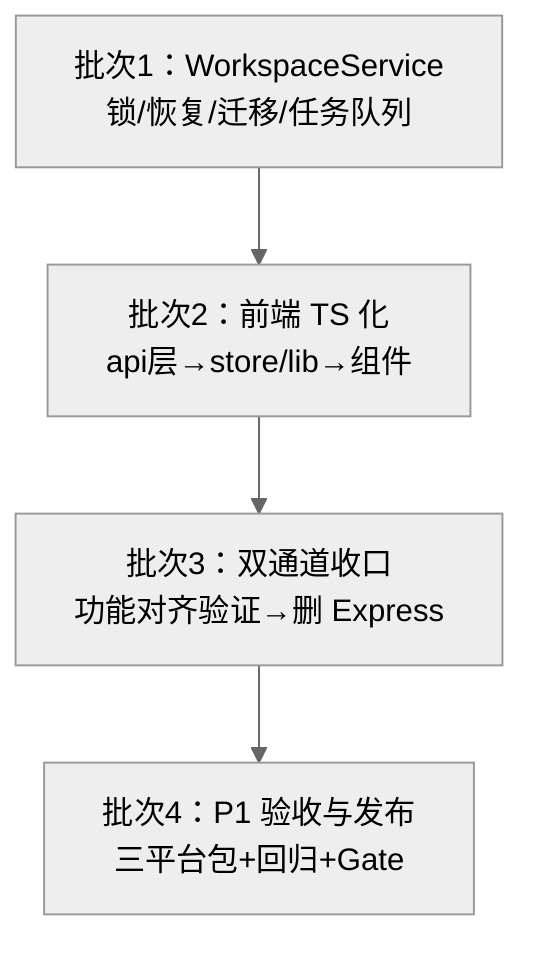

# 格物 Lattice 项目升级计划书 v1.1

> **依据文档**：[lattice-architecture.md](lattice-architecture.md)（格物 Lattice 单机版顶级架构说明书 v1.1，2026-10-13）
> **基线版本**：Lattice v0.1.5（web 0.1.5 / server 0.1.5 / Tauri 0.1.5）
> **计划日期**：2026-10-13 ｜ **形态**：Local-First 单机版 ｜ **许可证**：Mulan PSL v2
> **配套文档**：[更新记录.md](更新记录.md)（版本事实来源）、[使用说明书.md](使用说明书.md)

## 目录

- [一、计划书概述](#一计划书概述)
- [二、现状基线与差距分析](#二现状基线与差距分析)
- [三、升级整体路线图](#三升级整体路线图)
- [四、阶段 0：准备与基线冻结](#四阶段-0准备与基线冻结)
- [五、Phase 1：换壳 + TypeScript](#五phase-1换壳--typescript)
- [六、Phase 2：换编辑器（BlockSuite）](#六phase-2换编辑器blocksuite)
- [七、Phase 3：AI 本地化与向量索引](#七phase-3ai-本地化与向量索引)
- [八、Phase 4：MCP/插件与发布](#八phase-4mcp插件与发布)
- [九、验证标准与回滚方案总表](#九验证标准与回滚方案总表)
- [十、资源分配与协作要求](#十资源分配与协作要求)
- [十一、风险登记册](#十一风险登记册)
- [十二、架构守护机制（防偏离）](#十二架构守护机制防偏离)
- [附录 A：命令速查](#附录-a命令速查)
- [附录 B：阶段出口判据汇总](#附录-b阶段出口判据汇总)

---

## 一、计划书概述

### 1.1 目标

把 Lattice 从「Electron 壳 + Express 后端 + 自研 marked 编辑器」的现状，按架构说明书升级为「Tauri 2（Rust）+ BlockSuite 块编辑器 + QuickJS 插件沙箱 + 本地优先 AI」的单机版形态，**全程不偏离架构书定义的五层架构（L1-L5）与两大横切面（安全治理、可观测 + i18n）**。

### 1.2 升级原则（不可违背）

1. **保留精华**：FTS5 trigram 中文检索、混合检索、AI 写入审计/撤销、Markdown 消毒器、Vault 文件真源和可重建索引——实现载体可以变化，但数据不变量不能变化。
2. **不做过度设计**：单机模式不引入协作、同步、移动端和浏览器编辑模式；不新增 Express 路由（只减不增）。
3. **数据归用户**：Markdown/.canvas/附件是唯一持久化真源；BlockSuite 是编辑投影，SQLite 是派生投影。任何阶段升级失败，用户数据零损失。
4. **单写入入口**：UI、AI、MCP、插件和 watcher 都经过 Rust `WorkspaceService`，禁止外部进程直接改 Vault 或 SQLite。
5. **每阶段可交付**：每个 Phase 结束都是一个可日常使用的完整版本，带数据保真、恢复和回滚验证。

### 1.3 范围

| 包含 | 不包含 |
|---|---|
| Electron→Tauri 2 迁移收口、JS→TypeScript、Express→Rust 命令 | 协作/多人同步、云服务、移动端（架构原则 7） |
| marked→BlockSuite、双链/嵌入自定义 Block、Markdown 互转 | 路由库引入（架构 03：两视图内嵌不需要） |
| QuickJS 插件沙箱、权限模型、Ollama 本地模型、sqlite-vec | 对外 SaaS、账号体系 |
| 自动更新、主题、导出增强、性能、无障碍、国际化 | 数据库黑盒式存储（违背数据归用户原则） |
| — | 浏览器编辑运行模式（不属于当前单机目标；静态导出保留） |

---

## 二、现状基线与差距分析

升级计划的可执行性取决于对现状的准确认知。以下为 v0.1.5 代码实地勘察结论（2026-10-13）：

### 2.1 已完成（可直接利用的存量）

| 项 | 现状 | 证据 |
|---|---|---|
| Tauri 2 壳 | **可编译出 release 产物**，窗口/CSP/bundle 配置完整 | `src-tauri/tauri.conf.json`、`src-tauri/target/release/` |
| Rust vault 命令面 | 已实现 9 个 IPC 命令 + SQLite 索引 + 增量扫描 | `src-tauri/src/lib.rs`（vault_info/list/read/write/search/scan/index_stats/read_asset/open）、`src-tauri/src/db.rs` |
| 前端原生通道 | TS 类型化 IPC 封装 + 契约测试 | `web/src/api/native-vault.ts`、`web/test/native-vault-contract.test.mjs` |
| 双入口切换 | `isTauri() ? <NativeWorkspace/> : <App/>`，浏览器模式回落 Express。**注意：NativeWorkspace 是过渡壳**（仅文件列表+分栏编辑），全功能 UI（AI/图谱/Inbox/设置）目前只在 App.jsx | `web/src/main.tsx`、`web/src/NativeWorkspace.tsx` |
| 状态管理 | Zustand ^5 已就位（架构选型达成） | `web/package.json` |
| TypeScript 基建 | TS 5.9 + `typecheck` 脚本存在，但主体仍是 .jsx/.js | `web/tsconfig.json`、`web/src/**` |
| BlockSuite 依赖 | @blocksuite/* ^0.19.5 已安装，**尚未接线** | `web/package.json`（marked ^14 仍在用） |
| Express server | 功能完整在役：AI RAG/混合检索、MCP 双向、加密、审计、Review、60+ 测试文件 | `server/src/`、`server/test/` |

### 2.2 差距（升级工作量的真实分布）

| 架构目标 | 差距 | 归属阶段 |
|---|---|---|
| 零服务器（Express → Rust） | **AI 引擎、MCP 双向、加密、审计、Review 等 80% 后端逻辑仍在 Node 进程**，Rust 侧仅覆盖 vault 文件读写 | **P1 核心工作** |
| 零 Node 运行时（脚本工作区） | 产品 stdio MCP Server 现为独立 Node 工作区 `scripts/mcp-server`（另有 notion-calendar-mcp）；P4 以 sidecar 方案替换或明确保留为外部工具 | P4 |
| 桌面端全功能 UI | 桌面模式渲染的是过渡壳 NativeWorkspace，全功能 UI 尚未接到 IPC 通道 | P1 批次 2/3 |
| 全量 TypeScript | web/src 约 60+ 文件为 .jsx/.js | P1 |
| BlockSuite 编辑器 | 未接线，marked + MarkdownPreview 仍在用；双链/嵌入 Block、互转桥、Edgeless 白板均未开始 | P2 |
| QuickJS 沙箱 + 权限模型 | 未开始 | P4 |
| Ollama 本地模型 + sqlite-vec | 向量检索仍在 Express 侧，未内嵌 | P3 |
| 自动更新/主题/i18n/A11y | 未开始 | P4 |

> **结论**：架构书 P1 的真实含义是先建立**统一写入边界和可恢复的原生核心**，再逐步替代 Express 回落路径。AI、MCP 和第三方插件分别延后到 P3/P4，避免多个高风险边界同时变化。

---

## 三、升级整体路线图

### 3.1 路线图总表

| 阶段 | 主题 | 核心产出 | 出口判据（Gate） | 里程碑 |
|---|---|---|---|---|
| **P0** | 准备与基线冻结 | 基线 tag、CI 门禁、契约测试清单 | 全量测试绿 + 基线性能数据归档 | M0 |
| **P1** | 原生核心与写入边界 | WorkspaceService、单实例锁、watcher 收敛、SQLite 恢复/迁移、IPC 契约、前端 TS 化；再逐步删除 Express | 文件读写/搜索/冲突/恢复走统一 Tauri IPC；无直接 DB 写入 | M1 |
| **P2** | 编辑器投影 | BlockSuite 编辑器 + 双链/嵌入 Block + 保真互转桥 + Edgeless 白板 | 语义 diff 通过；legacy 可回退 | M2 |
| **P3** | AI 本地化与向量索引 | 任务队列、sqlite-vec 集成、embedding 元数据、Ollama、检索评测 | 断网 AI 可用；模型切换可重建；质量/资源基准达标 | M3 |
| **P4** | MCP/插件与发布 | `lattice-mcp` sidecar、插件权限/签名/隔离、自动更新、主题、导出、性能、A11y、i18n | 安全测试、恢复测试、三平台签名和全量 verify 通过 | M4 |

### 3.2 阶段依赖关系


依赖要点：
- **P2、P3 以数据契约为前提串行推进**：先稳定 Markdown 投影和任务队列，再做 BlockSuite 与向量索引，避免两个阶段同时改变内容模型。
- **P1 内部严格串行**：WorkspaceService/锁与恢复 → IPC 契约 → 前端 TS 化 → 模块迁移 → 删除 Express 回落。顺序颠倒会造成「旧通道已删、新通道未通」的断裂。
- 每阶段出口必须通过 Gate Review（见附录 B），未通过不得进入下一阶段。

### 3.3 时间节点安排（基准估算）

> 以下为计划基准值，每个 Gate 复盘后按实际进度校准后续节点。

| 阶段 | 基准工期 | 累计时间点 | 关键节点 |
|---|---|---|---|
| P0 准备 | 第 1 周 | T0 + 1 周 | M0：基线 tag `v0.1.5-baseline` + CI 门禁生效 |
| P1 原生核心 | 第 2–12 周（11 周 = 10 开发 + 1 缓冲） | T0 + 12 周 | M1：统一写入边界和恢复机制，迁移期 Express 回落可用 |
| P2 编辑器投影 | 第 13–17 周（5 周 = 4 开发 + 1 缓冲） | T0 + 17 周 | M2：BlockSuite 投影版 v0.3.0 发布 |
| P3 AI 本地化 | 第 18–24 周（7 周 = 6 开发 + 1 缓冲） | T0 + 24 周 | M3：离线 AI 与向量索引 v0.4.0 发布 |
| P4 MCP/插件与发布 | 第 25–29 周（5 周 = 4 开发 + 1 缓冲） | T0 + 29 周 | M4：正式版 v1.0.0 三平台发布 |

> **工期对账口径**：按 1 名全栈开发为主 + 1 名兼职测试/评审、**任务串行**累加，与 5.2 各任务预估周严格对账（避免计划表与任务表两张皮）；每阶段最后 1 周为验收缓冲（回归测试 + Gate Review + 发布物准备），不计入新功能开发。若两名全栈按 Rust 线/前端线并行，P1 可压缩至约 7 周、总体约 22 周；单人独立执行（无兼职）整体 ×1.6。

---

## 四、阶段 0：准备与基线冻结

### 4.1 前置条件

无。本阶段为一切升级工作的地基。

### 4.2 任务拆解

| 编号 | 任务 | 优先级 | 依赖 |
|---|---|---|---|
| P0-1 | 打基线 tag `v0.1.5-baseline`，记录全量测试结果 | P0 | — |
| P0-2 | 建立 CI 门禁：`typecheck` + web test + server test + `cargo clippy -D warnings` | P0 | P0-1 |
| P0-3 | 采集基线性能数据（启动耗时、包体、内存、搜索延迟、AI 首字延迟） | P0 | P0-1 |
| P0-4 | 制定分支策略与 IPC 契约测试清单 | P0 | P0-2 |
| P0-5 | 冻结数据不变量：Markdown 真源、投影表、链接解析、source hash、任务状态、单实例锁 | P0 | P0-4 |
| P0-6 | 增加 SQLite 异常退出/WAL 恢复、迁移失败和重复启动测试；禁止删除 WAL/SHM | P0 | P0-5 |

### 4.3 实施方法

**P0-1 基线冻结**

```bash
git tag v0.1.5-baseline && git push origin v0.1.5-baseline
cd web && npm run test        # 记录结果归档到 doc/升级计划/baseline.md
cd ../server && npm run test
cd ../src-tauri && cargo test && cargo clippy -- -D warnings
```

**P0-2 CI 门禁**：在 `.github/workflows/` 新增 `upgrade-gate.yml`，四个 job（web-test / server-test / rust-test / typecheck）全部必过才允许合并到 `main`。P1 期间 server-test 保留；P1 结束时随 `server/` 一并移除。

**P0-3 基线性能**：用现有应用记录：冷启动时间、安装包体积、空闲内存、500 篇笔记库的搜索 P95、AI 问答 TTFT。写入 `doc/升级计划/baseline.md`（与本计划书同目录），作为 P4 性能验收的对照基线。

**P0-4 契约清单**：枚举 Express 当前暴露的全部 REST 端点（`server/src/routes/index.js` 为入口逐模块清点：vault/notes/canvas/ai/mcp/review/files/workspace/experts），形成《IPC 契约清单》落盘为 `doc/升级计划/ipc-contract.md`，每项标注：方法、路径、请求/响应结构、对应未来 Rust 命令名。P1 逐项核销。同时盘点根目录 `scripts/` 下 Node 工作区（mcp-server、notion-calendar-mcp）的进程级接口与测试入口，纳入 P4 sidecar 兼容性评估。

### 4.4 注意事项与风险点

- 基线 tag 后所有升级工作在 feature 分支进行，`main` 随时可发版——用户不受升级过程影响。
- 契约清单必须以**代码为准**逐端点核实，不允许凭记忆列举（文档与实现常有漂移）。

### 4.5 验证标准

- [ ] tag 存在且 CI 全绿
- [ ] baseline.md 按 500/10,000 篇 Vault 分别记录冷启动、首屏、搜索 P95、索引延迟、内存和包体
- [ ] IPC 契约清单覆盖 server 全部路由模块，经第二人抽查 10 项无遗漏
- [ ] 数据不变量和 WAL 恢复测试已进入 CI

### 4.6 回滚方案

P0 不改动任何产品代码，无需回滚。

---

## 五、Phase 1：原生核心与写入边界

> **阶段目标**：先建立 WorkspaceService、Vault 单实例锁、SQLite 恢复/迁移、watcher 收敛和持久化任务队列，再完成 IPC/TypeScript 化。AI 和 MCP 只迁移到稳定的命令边界之后。

### 5.1 前置条件

- P0 全部出口判据通过（M0 达成）
- Rust 工具链（stable + wasm32 target 备用）、三平台构建环境可用
- 《IPC 契约清单》定稿

### 5.2 任务拆解与执行顺序

P1 内部严格按以下顺序执行（每批完成即合并主干并出中间版本）：



| 批次 | 任务编号 | 任务内容 | 依赖 | 预估周 |
|---|---|---|---|---|
| 批次 1 | P1-01 | Rust WorkspaceService：统一文件写入、哈希冲突、快照、审计和命令错误模型 | — | 1.5 周 |
| 批次 1 | P1-02 | SQLite 恢复与迁移：WAL 自恢复、迁移前备份、事务迁移、外键/索引、失败诊断；禁止删除 WAL/SHM | P1-01 | 1 周 |
| 批次 1 | P1-03 | Vault 单实例锁 + watcher reconcile + 持久化 jobs：索引/链接/快照任务可重试、可取消、可恢复 | P1-01~02 | 1.5 周 |
| 批次 1 | P1-04 | Review/标签/双链/画布/附件等非 AI 命令面迁移，并确保全部写入经过 WorkspaceService | P1-01~03 | 1.5 周 |
| 批次 2 | P1-05 | `web/src/api/` 全部 JS 模块 → TS（与 native-vault.ts 同风格，invoke 化） | P1-01~04 | 0.5 周 |
| 批次 2 | P1-06 | store/、hooks/、lib/ → TS，开启 tsconfig strict | P1-05 | 1 周 |
| 批次 2 | P1-07 | components/ + shell/ + settings/ 全量 .jsx → .tsx | P1-06 | 1.5 周 |
| 批次 3 | P1-08 | 功能对齐验证：按契约清单逐项核销桌面通道 vs Express 通道行为一致 | P1-07 | 0.5 周 |
| 批次 3 | P1-09 | 功能对齐通过后删除 Express 回落路径；MCP 保留为后续 sidecar，不在本阶段直接共享数据库 | P1-08 | 0.5 周 |
| 批次 4 | P1-10 | 三平台构建、全量回归、性能对比基线、版本号升版、发布 v0.2.0 | P1-09 | 1 周 |

> 对账：P1 先完成数据和写入边界。AI、向量、MCP 和第三方插件分别在 P3/P4 开发，避免把多个高风险迁移同时放进同一批次。

### 5.3 具体实施方法

#### P1-01~P1-04 Rust 原生核心

按架构书 12 节建立 `workspace/`、`jobs/` 和 `db/migrations/`，先实现统一写入边界：

1. `WorkspaceService` 是唯一写入入口，负责路径校验、内容哈希、原子写入、快照、审计和统一错误模型。
2. Vault 启动时获取单实例锁；第二实例明确返回只读或“已被占用”，不能静默共写。
3. SQLite 使用 `rusqlite bundled`；启动让 SQLite 自行恢复 WAL，迁移前备份，迁移使用事务，严禁删除 WAL/SHM 文件。
4. watcher 事件进入持久化 jobs 表，索引、链接、快照和健康扫描支持幂等、重试、取消和失败诊断。
5. 外部编辑器修改、重命名、删除与 UI 保存统一走 reconcile 流程；冲突按内容哈希发现并交给 UI 处理。
6. Review、标签、链接、Canvas 和附件命令逐项对齐契约，但不得绕过 WorkspaceService 直接改数据库或文件。

P1 不实现完整 AI、MCP sidecar 或第三方插件；这些能力在数据边界稳定后分别进入 P3/P4。

#### P1-05 ~ P1-07 前端 TypeScript 化

1. **顺序**：先 api 层（它们直接对接新 Rust 命令，收益最大），再 store/lib（类型模型核心），最后 UI 组件（量大但机械）。
2. **方法**：`git mv x.jsx x.tsx` 后按报错补类型，**不改运行时行为**；`web/tsconfig.json` 逐步收紧（先 `strict: false` + 逐目录开启，最后全开 strict）。
3. `web/src/api/client.js`（fetch 封装）在 P1-05 时按「桌面通道 invoke / 迁移期 Express 回落」双轨封装；P1-09 删除 Express 轨。浏览器编辑不作为目标运行模式。
4. 每转换一批跑 `npm run typecheck` + 全量测试，测试文件保持 .mjs 不动（测试先行锁行为）。
5. **入口策略（防功能倒退）**：批次 2 期间 api 层双轨就绪后，先让桌面模式改渲染全功能 App（NativeWorkspace 过渡壳保留作故障对照），全功能在 IPC 下验证通过后才进入 P1-09 删除过渡壳——顺序不可反。

#### P1-08 功能对齐验证

按《IPC 契约清单》逐项核销，采用**契约快照对照**机制（node 测试环境无法直连 Tauri IPC，不要试图在 .mjs 里调 invoke）：

1. P1 批次 1 期间，为每个 Express 端点录制真实请求/响应快照，存 `src-tauri/tests/fixtures/`；
2. Rust 集成测试逐命令加载对应 fixture，断言 Rust 输出与快照结构、语义一致；
3. 前端侧在 web 测试中 mock `invoke`，验证 UI 消费层行为不变。

三部分全绿才允许进入 P1-09。

#### P1-09 删除 Express

```bash
# 1. 迁移仍需要的测试资产（P3 检索对比单独处理）：
git mv server/eval/golden-set.json src-tauri/eval/golden-set.json
git mv server/eval/metrics-report.mjs src-tauri/eval/metrics-report.mjs
# 2. 删除 Express：
git rm -r server/
# 3. 入口统一（方向：保留全功能 App，删除过渡壳）：
#    web/src/main.tsx: 删除 isTauri() 分支，恒渲染全功能 App
#    删除 NativeWorkspace.tsx、native-workspace.css、api/native-document.js（native-vault.ts 的类型封装并入 api 层后一并清理）
# 4. Node MCP 脚本收口：
#    不在 P1 直接删除；由 P4 sidecar 兼容性测试决定替换、保留为外部工具或独立打包
#    scripts/notion-calendar-mcp 保留源码（可选外部工具），从根 setup / verify / mcp 脚本链路摘除
# 5. 清理构建配置：
#    web/vite.config.js: 删除 /api /health /ready proxy
#    根 package.json: setup/verify/test/test:mcp 等脚本移除 server 与 MCP 脚本项
```

**浏览器编辑决策**：浏览器访问和编辑模式随 Express 一并下线，单机版以桌面为唯一运行形态；**静态站点导出保留**——它是前端能力（`web/src/lib/static-export.js`），数据源改走 invoke，导出产物为纯静态文件，不依赖服务器存活。

删除后 CI 移除 server-test job；根 `verify` 脚本收敛为 `test:fc + web typecheck + web test + cargo test`。

#### P1-10 验收与发布

见 5.4 验收标准。发布前按「版本号单一真源」机制升版：`web/package.json` version → 0.2.0、`src-tauri/tauri.conf.json` version 同步（vite 构建期 define 注入，杜绝包内版本错位——2026-10-02 事故教训）。发布 v0.2.0，更新记录.md 按 v0.1.x 惯例补全。

### 5.4 验收标准（P1 Gate = M1）

- [ ] `cargo test` + `cargo clippy -D warnings` 全绿
- [ ] `npm run typecheck` 全绿（strict 开启）
- [ ] web 全量测试绿 + parity 对照测试全绿
- [ ] `server/` 回落路径已移除，`grep -rn "'/api" web/src/` 无 Express 直连残留；MCP sidecar 不在本阶段共享数据库
- [ ] 全功能功能面回归：图谱/Inbox/Review/设置在桌面模式逐项人工过一遍；AI/MCP 按后续阶段验收
- [ ] 三平台安装包产出（Windows 优先验证，Mac/Linux 至少 CI 构建通过）
- [ ] 首屏与完整索引分开测量；按 500/10,000 篇 Vault 记录冷/热启动、首屏和索引延迟
- [ ] 架构书 §11 启动恢复序列在 Tauri 下逐步验证通过，包含 WAL 恢复和迁移失败回滚
- [ ] 第二实例被锁定或明确只读；外部修改冲突可检测并提示
- [ ] 无端口监听（`netstat` 验证零端口）

### 5.5 回滚方案

- **结构保障**：P1 全程 Express 保留在仓库且双通道并存；桌面模式在 IPC 不完整时保留迁移期回落。浏览器编辑不作为回滚运行模式。
- **操作**：若 P1-08 对齐验证某模块不过，该模块保留 Express 通道延期收口，不阻塞其他模块进入 P1-09；若 P1 整体失败，`git checkout main` 回到 v0.1.x 发布线，双通道版本仍可用。
- **数据**：Vault 内 .md/.canvas 是真源，SQLite 索引可重建；回滚通过备份、迁移事务和重建完成，禁止手工删除 WAL/SHM。

---

## 六、Phase 2：换编辑器（BlockSuite）

> **阶段目标**：BlockSuite 作为编辑器运行时投影，Markdown/.canvas 真源不变；完成双链/嵌入、保真转换、Edgeless 和可回退开关。禁止以“零成本迁移”替代语义保真测试。

### 6.1 前置条件

- M1 已达成（纯 Tauri 版发布，无 Express 干扰）
- BlockSuite ^0.19.5 已在依赖中（现成）
- 现有 marked 渲染链路的全部测试用例清单（markdown.test.mjs 等）已盘点

### 6.2 任务拆解与执行顺序

| 编号 | 任务 | 依赖 | 优先级 |
|---|---|---|---|
| P2-01 | BlockSuite 编辑器容器：`web/src/editor/Editor.tsx` 接入 @blocksuite/presets，替换 EditorPane 的 marked 渲染 | — | P0 |
| P2-02 | Markdown 互转桥 `markdown-bridge.ts`：Doc↔.md 双向转换 + 往返一致性测试 | P2-01 | P0 |
| P2-03 | 双链 Block：`[[标题]]` 语法 → 反向链接/悬空补全/#锚点/循环检测/反向链接面板 | P2-02 | P0 |
| P2-04 | 嵌入 Block：`![[标题]]` → 两级嵌套/原文修改同步刷新/循环嵌入检测 | P2-03 | P1 |
| P2-05 | 消毒器接入 BlockSuite 渲染管线（白名单逻辑从 lib/sanitize.js 迁移适配） | P2-01 | P0 |
| P2-06 | Edgeless 白板：Canvas 迁移到 BlockSuite Edgeless，兼容 Obsidian .canvas 读写 | P2-01 | P1 |
| P2-07 | 全库校验工具：只读扫描存量 .md，逐篇执行 Doc↔.md 往返并出报告（**不修改原文件**——.md 真源不动，无落盘迁移） | P2-02 | P1 |
| P2-08 | 特性开关：设置页引擎切换（持久化），`LATTICE_EDITOR` 环境变量仅开发期覆盖 | P2-01 | P0 |
| P2-09 | P2 验收与发布 v0.3.0 | 全部 | — |

执行顺序：P2-01 → P2-02/P2-08 并行 → P2-03 → P2-05 → P2-04 → P2-06 → P2-07 → P2-09。

### 6.3 具体实施方法

**P2-02 互转桥（本阶段技术核心）**：这是架构书设计要点「双链和嵌入是 BlockSuite 自定义 Block，编辑/搜索/AI 索引/图谱都基于统一 Block 模型」的落地基础。

1. 实现 `markdownToDoc(md: string): Doc` 与 `docToMarkdown(doc: Doc): string`。
2. **往返一致性是硬标准**：建立语料库（现有测试 markdown.test.mjs 用例 + 常见中文笔记样本 + 双链/嵌入/代码块/表格/任务列表混合样本），断言 `docToMarkdown(markdownToDoc(x))` 语义等价（允许空白规范化，不允许语义丢失）。
3. 双链/嵌入语法在转换层保留为自定义 Block flavor，不做扁平化降级——否则搜索与图谱会数据不一致。

**P2-03 双链 Block**：按架构书 05 节实现（自动反向链接、悬空一键补全、#小节锚点、循环引用检测、反向链接面板）。复用现有 `links` 表与 LinkPanel（P1 TS 化后为 .tsx）的交互设计，仅把渲染层换成 BlockSuite Block。

**P2-08 双轨开关**：以设置页切换为准（设置项持久化），`LATTICE_EDITOR=blocksuite|legacy` 环境变量仅作开发期覆盖；二者取值优先级写死（env > settings），避免双机制打架。默认 legacy，BlockSuite 稳定后翻转默认值。legacy 轨保留至 P2 结束后的第一个补丁版再删除。

### 6.4 注意事项与风险点

- BlockSuite 0.19 API 迭代较快，锁定 ^0.19.5 小版本升级需过往返测试。
- 中文输入法（IME）组合输入是块编辑器常见坑，P2-01 验收必须包含 IME 用例。
- 互转桥的边界情况（frontmatter、HTML 块、嵌套列表、数学公式）宁可降级保留原文块，不可静默丢失内容——**内容保真是第一优先级，视觉还原是第二**。

### 6.5 验收标准（P2 Gate = M2）

- [ ] 往返一致性语料库全绿（含 frontmatter/HTML/公式/表格/嵌套列表/双链/嵌入/中文样本）
- [ ] 双链语法兼容确认：旧库 `[[标题]]` 全部正确解析，反向链接面板行为与旧版一致
- [ ] 全库往返模拟：对存量 Vault（≥200 篇，真实库或构造语料）逐篇执行 `.md → Doc → .md` 语义 diff，无内容丢失（原文件不被修改）
- [ ] Edgeless 模式可打开并编辑旧 .canvas 文件
- [ ] IME 中文输入用例通过；900ms 静默自动保存行为不变
- [ ] 双轨开关可随时切回 legacy；未知块、冲突和循环嵌入都有明确错误状态且数据无损

### 6.6 回滚方案

- **运行时回滚**：设置页一键切回 legacy 编辑器（开发期可用 `LATTICE_EDITOR=legacy`；Vault 文件未动，无数据风险）。
- **版本回滚**：发布物保留 v0.2.0 安装包；BlockSuite 引发的任何编辑器异常，用户降级安装即恢复。
- **数据保障**：P2 不改写 SQLite schema（只加不改），.md 真源不动；万一互转桥写出异常内容，靠版本快照（versions/ 增量 diff）恢复。

---

## 七、Phase 3：AI 本地化与向量索引

> **阶段目标**：完成可恢复的 embedding 任务、sqlite-vec 集成、模型版本管理、Ollama provider 和检索评测。插件和 MCP 延后到 P4，避免把两个安全边界与 AI 一起发布。

### 7.1 前置条件

- M2 已达成；WorkspaceService 和 jobs 队列稳定运行至少一个版本周期
- Ollama 测试环境（本地拉取 bge-small embedding 模型 + 任一 chat 模型）

### 7.2 任务拆解与执行顺序

| 编号 | 任务 | 依赖 | 优先级 |
|---|---|---|---|
| P3-01 | sqlite-vec 集成方案：确定静态/动态链接、三平台构建和失败回退 | P1-02 | P0 |
| P3-02 | embedding 任务管线：source_hash、model_id/version、dimensions、chunker_version 和重建 | P3-01 | P0 |
| P3-03 | Ollama provider：本地 chat + embedding；不可用时明确禁用，不跨隐私边界自动云端回退 | P3-02 | P0 |
| P3-04 | 混合检索：FTS5 + 向量 + 可配置 RRF，建立质量、延迟、内存基准 | P3-02 | P0 |
| P3-05 | AI 会话/Agent 迁移：流式取消、工具结果隔离、多文件事务、审计和撤销 | P3-03 | P0 |
| P3-06 | P3 验收与发布 v0.4.0 | 全部 | — |

执行顺序：P3-01 → P3-02 → P3-03/P3-04 并行 → P3-05 → P3-06。

### 7.3 具体实施方法

**P3-01/P3-04 向量内嵌**：先完成 sqlite-vec 的静态/动态集成 spike，验证 Windows/macOS/Linux 的打包和扩展加载；若性能不足，按基准评估是否分库。`note_embeddings` 必须与 `note_chunks` 通过 `source_hash`、`model_id`、`model_version` 和维度关联。切换前用 golden set 跑检索评测，记录 Recall@K、MRR/nDCG、延迟和内存，不以固定重叠率作为唯一门槛。

**P3-03 Ollama**：`provider.rs` 增加 Ollama 端点（默认 `http://127.0.0.1:11434`，仅回环地址）。设置页提供「本地模型 / 云端模型」切换，切换仅由用户显式操作；本地不可用时 UI 明示并禁用 AI 功能，不静默跨到云端。

**P3-05 AI 事务边界**：流式任务支持取消和空闲超时；外部工具结果与系统提示分层；多文件写入记录计划、确认、每个文件的结果和可撤销快照，部分失败必须能恢复。

### 7.4 注意事项与风险点

- embedding 模型、维度或分块器变化必须使旧向量失效，设置页提供显式重建按钮。
- sqlite-vec 扩展加载失败时，全文检索仍可用，UI 明确显示向量索引不可用。
- Ollama 模型不随安装包捆绑，首次使用需检查磁盘空间、模型可用性和资源占用。

### 7.5 验收标准（P3 Gate = M3）

- [ ] 断网环境：Ollama 本地问答、写作助手和检索可用；不可用时错误状态明确
- [ ] golden set 通过质量、延迟和内存门槛；模型切换可重建受影响索引
- [ ] AI 流式取消、外部工具隔离、多文件部分失败和撤销测试全绿
- [ ] sqlite-vec 在三平台加载失败时不会阻塞全文检索和笔记编辑

### 7.6 回滚方案

- sqlite-vec 切换保留全文检索通路和旧向量投影一个版本周期，异常时按配置回退。
- Ollama 与云端 provider 独立配置，仅允许用户显式切换，不自动跨隐私边界。

---

## 八、Phase 4：MCP/插件与发布

> **阶段目标**：先交付受控的 MCP sidecar 和插件能力，再完成自动更新、主题、导出、性能、无障碍和国际化。第三方扩展必须通过安全门禁后才进入市场。

### 8.1 前置条件

- M3 已达成；WorkspaceService、审计和权限模型稳定；插件 API 冻结为 v1（此后只加不改）

### 8.2 任务拆解

| 编号 | 任务 | 说明 | 优先级 |
|---|---|---|---|
| P4-00 | MCP sidecar | `lattice-mcp` 独立进程、stdio 生命周期、一次性本地 RPC 令牌、按客户端/工具/路径授权；禁止直接打开 DB | P0 |
| P4-01 | 插件宿主 | QuickJS/rquickjs、资源限制、超时取消、桥接参数校验；高风险插件独立进程 | P0 |
| P4-02 | 插件信任链 | manifest、签名、发布者、依赖、撤销、版本回滚、权限理由 | P0 |
| P4-03 | 插件安全测试 | 越权、路径逃逸、资源耗尽、网络白名单、崩溃隔离和升级回滚 | P0 |
| P4-04 | 示范插件 | 3-5 个插件全部走正规权限确认和审计流程 | P1 |
| P4-05 | 自动更新 | tauri-plugin-updater + 签名校验 + stable/beta 双通道 + 失败拒装回滚 | P0 |
| P4-06 | 主题与导出 | CSS Variables 主题包；PDF/HTML/静态站点保留前端实现，数据源改走 invoke | P1 |
| P4-07 | 性能与可观测 | 按 Vault 规模测首屏/索引/搜索/AI P95、内存和包体；结构化日志、诊断导出、可关闭遥测 | P0 |
| P4-08 | 无障碍与国际化 | 键盘导航、焦点管理、对比度、屏幕阅读器；zh/en 资源文件化 | P1 |
| P4-09 | 发布工程 | 三平台签名、安装包、官网下载页联动、v1.0.0 发布 | P0 |

### 8.3 验收标准（P4 Gate = M4）

- [ ] 自动更新：旧版本 → 新版本升级成功；签名校验失败的包拒绝安装；更新失败自动回滚到上一版
- [ ] MCP sidecar：stdio 启停、令牌、工具/路径授权、只读默认、写入确认和审计测试通过
- [ ] 插件安全测试：越权、路径逃逸、资源耗尽、网络白名单、崩溃隔离和版本回滚全绿
- [ ] 性能达标（对照 baseline.md 的 Vault 规模分层指标）
- [ ] 全量 verify（web test + cargo test + parity + MCP + 插件安全 + 往返一致性）通过
- [ ] 三平台安装包 + 数字签名
- [ ] zh/en 切换完整覆盖主要界面
- [ ] 更新记录.md 与使用说明书.md 同步至 v1.0.0，并说明 MCP/插件和内容加密边界

### 8.4 回滚方案

- 自动更新双通道：stable 用户始终可从官网下载上一版安装包降级；更新器校验失败不落盘。
- 发布采用「先 beta 通道灰度 ≥ 1 周，无 P0/P1 级问题再推 stable」。

---

## 九、验证标准与回滚方案总表

| 阶段 | 核心验证手段 | 回滚机制 | 数据安全保障 |
|---|---|---|---|
| P0 | 基线测试归档 + CI 门禁 | 无产品代码改动 | — |
| P1 | parity 对照测试 + cargo test + typecheck strict + 锁/恢复/冲突测试 | Express 双通道并存直到 P1-09；模块级延期收口 | .md 真源 + SQLite 迁移备份 + 索引可重建 |
| P2 | 往返一致性语料库 + 存量库往返模拟 | 设置页引擎切换（`LATTICE_EDITOR` 仅开发期覆盖） | 不改 schema、真源不动、版本快照兜底 |
| P3 | golden set 检索质量/延迟/内存 + embedding 重建 + AI 事务测试 | 全文检索保底 + 旧向量投影保留一个版本周期 | 本地/云端 provider 不自动跨边界 |
| P4 | MCP 契约 + 插件安全测试 + 全量 verify + 性能基线对照 | stable/beta 双通道 + 签名校验拒装 | 更新失败不落盘；插件失败回滚 |

**总原则**：每一层回滚都优先靠「数据在文件系统 + 索引可重建」这一架构根基兜底，其次才是版本降级。

---

## 十、资源分配与协作要求

### 10.1 角色与职责

| 角色 | 职责 | 主要阶段 |
|---|---|---|
| Rust 后端 | P1 WorkspaceService/恢复、P3 向量、P4 sidecar/插件/更新器 | P1/P3/P4 |
| 前端/编辑器 | P1 批次 2-3、P2 全部、P4 主题/i18n/A11y | P1/P2/P4 |
| AI 工程 | P3 AI 线、模型/索引版本、golden set 和资源基准维护 | P3 |
| QA/测试 | 契约清单、parity 测试、安全测试集、回归、Gate Review 组织 | 全程 |
| 发布管理 | 版本号、安装包签名、官网联动、更新记录.md | M1-M4 |

单人/双人执行时的轮转建议：单人按「后端周/前端周」节奏切换，避免上下文频繁横跳；双人按 Rust 线 + 前端线分工，QA 兼职穿插。

### 10.2 协作流程

1. **分支策略**：`main`（随时可发布）+ `phase/p1-rust-ai` 等阶段分支 + 任务级小分支。阶段分支经 Gate Review 后合回 main 并打 tag。
2. **Gate Review**：每阶段出口召开一次评审（对照附录 B 判据逐项打勾），未通过项录入下一阶段首任务。
3. **文档制度**：沿用现有惯例——每完成一个任务在 [更新记录.md](更新记录.md) 追加事实记录；架构如有微调，先改 [lattice-architecture.md](lattice-architecture.md) 再改代码，**文档与实现不允许长期漂移**。
4. **契约变更纪律**：IPC 命令签名变更必须同步三处（Rust 命令、TS 封装、契约测试），否则 CI 拦截。

### 10.3 外部依赖与协作要求

| 依赖 | 责任人 | 要求 |
|---|---|---|
| Rust 工具链 & 三平台构建环境 | 发布管理 | P0 期间备妥，Windows 本地 + Mac/Linux CI |
| Ollama 模型（bge-small + chat 模型） | AI 工程 | P3 开始前就绪 |
| BlockSuite 上游动态跟踪 | 前端/编辑器 | 锁定 ^0.19.5，升级需过往返测试 |
| 代码签名证书（三平台） | 发布管理 | **P1 期间启动申请**（流程周期长），P3 Gate 前到位 |

---

## 十一、风险登记册

| # | 风险 | 概率 | 影响 | 缓解措施 |
|---|---|---|---|---|
| R1 | WorkspaceService 迁移引入写入/冲突行为偏差 | 高 | 高 | 以现有文件哈希保护和契约快照为规格；增加多实例、外部修改、崩溃恢复测试 |
| R2 | BlockSuite ↔ Markdown 往返转换丢内容 | 中 | 高 | 语料库先行；不可转换块降级为原文块保真；存量库逐篇 diff 验收 |
| R3 | P1 工期超估（Rust 命令面与写入边界复杂） | 高 | 中 | 先交付 WorkspaceService；AI/MCP/插件延后；模块级延期收口，不提前删除回落通道 |
| R4 | QuickJS 或桥接层被绕过 | 中 | 高 | QuickJS 只作纵深防御；签名、最小权限、路径/网络白名单、高风险插件独立进程和安全测试 |
| R5 | sqlite-vec 与 FTS5 同库性能或构建失败 | 中 | 中 | 先做三平台集成 spike；以基准决定同库/分库；全文检索始终保留可用 |
| R6 | 三平台构建/签名链路阻塞 | 中 | 中 | P0 备妥环境；证书提前申请；Windows 优先验证，另两平台 CI 兜底 |
| R7 | 升级期间用户日常使用受影响 | 低 | 高 | main 随时可发版；所有工作在分支；每阶段发布均为完整可用版本 |
| R8 | IME/中文输入在块编辑器异常 | 中 | 中 | P2-01 验收必含 IME 用例；双轨开关随时回退 |
| R9 | 架构偏离（实现走样无人发现） | 中 | 高 | 第十二章守护机制：依赖边界 lint + 契约测试 + Gate Review + 文档先行 |
| R10 | MCP 协议版本演进 | 低 | 中 | 锁定 SDK 语义，协议升级独立小版本处理 |
| R11 | WAL/SHM 被错误清理导致 SQLite 恢复失败 | 中 | 高 | 启动只让 SQLite 自恢复；checkpoint 后再按 SQLite 规则处理，CI 注入异常退出 |
| R12 | 多进程直接写 Vault/SQLite 造成索引陈旧或覆盖 | 中 | 高 | 单实例锁；MCP sidecar 只经本地 RPC；所有写入走 WorkspaceService |
| R13 | 浏览器编辑、stdio MCP、零服务器边界互相矛盾 | 高 | 中 | 浏览器编辑从目标范围移除；MCP 独立 sidecar；文档与构建产物同步检查 |

---

## 十二、架构守护机制（防偏离）

升级跨约 7 个月（单人口径 29 周；双人并行约 5 个月）、4 个阶段，最大的风险不是做不完，而是**数据边界和恢复策略在实现中走样**。以下机制写入日常流程：

1. **依赖边界自动化检查**：引入 dependency-cruiser（web 侧）与 clippy lint 分组（Rust 侧），固化规则：
   - `web/src` 禁止 import `server/**`（P1-09 后自动失效，此前防误用）
   - L5 组件禁止直接调用 `invoke`，必须经 `web/src/api/` 封装层
   - Rust `ai/`、`mcp/`、`plugins/` 模块禁止绕过 `WorkspaceService` 直连 Vault 或 SQLite
   - 任何启动代码禁止删除 WAL/SHM；数据库恢复必须有异常退出测试
2. **契约测试常驻 CI**：native-vault-contract 模式扩展为全命令面契约测试，命令签名变更必须三处同步（见 10.2）。
3. **禁止事项清单**（评审时逐条对照）：不引入路由库；不加 Express 路由；不引入协作/同步/移动端/浏览器编辑模式；插件/MCP 不得绕过 WorkspaceService；AI 写入不得跳过审计链路。
4. **文档先行**：任何与架构书的偏差，先在 lattice-architecture.md 记录修订理由与版本，再动代码；无文档修订的偏离在 Gate Review 一律打回。
5. **数据不变式**：Markdown/.canvas 为真源、投影带 source hash、模型/解析器版本可追踪、任务可恢复、写入可审计和可撤销。RRF、分块大小、top_n 等属于可版本化实验参数，必须由 golden set 和性能基准验证，不得伪装成不可变架构约束。

---

## 附录 A：命令速查

```bash
# ---- 前端（web/）----
npm --prefix web run dev            # 开发服务（5173）
npm --prefix web run build          # 构建
npm --prefix web run typecheck      # TS 检查
npm --prefix web run test           # 全量 web 测试

# ---- 迁移期服务端（P1-09 后移除）----
npm --prefix server run dev         # Express 开发（5177）
npm --prefix server run test        # server 测试

# ---- MCP（P4 sidecar）----
# lattice-mcp 由外部 MCP 客户端通过 stdio 启动，不直接打开 Vault/SQLite

# ---- 桌面（Tauri，根目录脚本）----
npm run dev:desktop                 # 桌面开发模式（tauri dev，自动起 web dev）
npm run build:desktop               # 桌面安装包构建
npm run test:desktop                # Rust 测试（cargo test --release）
cd src-tauri && cargo clippy -- -D warnings   # Lint 门禁
npm run verify                      # 全量验证（P1/P3/P4 门禁逐阶段收敛）
```

## 附录 B：阶段出口判据汇总

| Gate | 一句话判据 |
|---|---|
| **M0** | tag 存在、CI 四 job 全绿、基线性能归档、契约清单定稿 |
| **M1** | 纯 Tauri 核心 v0.2.0：WorkspaceService、单实例锁、WAL 恢复、任务队列、typecheck/parity 全绿；Express 只保留迁移回滚包 |
| **M2** | v0.3.0：BlockSuite 编辑投影上线、往返语义 diff、双链解析规则和 legacy 回退通过 |
| **M3** | v0.4.0：断网 AI 可用、模型切换可重建、检索质量/延迟/资源基准通过 |
| **M4** | v1.0.0：MCP sidecar、插件安全门禁、自动更新、分层性能目标、全量 verify、三平台签名发布 |

---

*格物 Lattice 升级计划书 v1.1 · 2026-10-13 · 依据 lattice-architecture.md v1.1 编制 · License: Mulan PSL v2*
